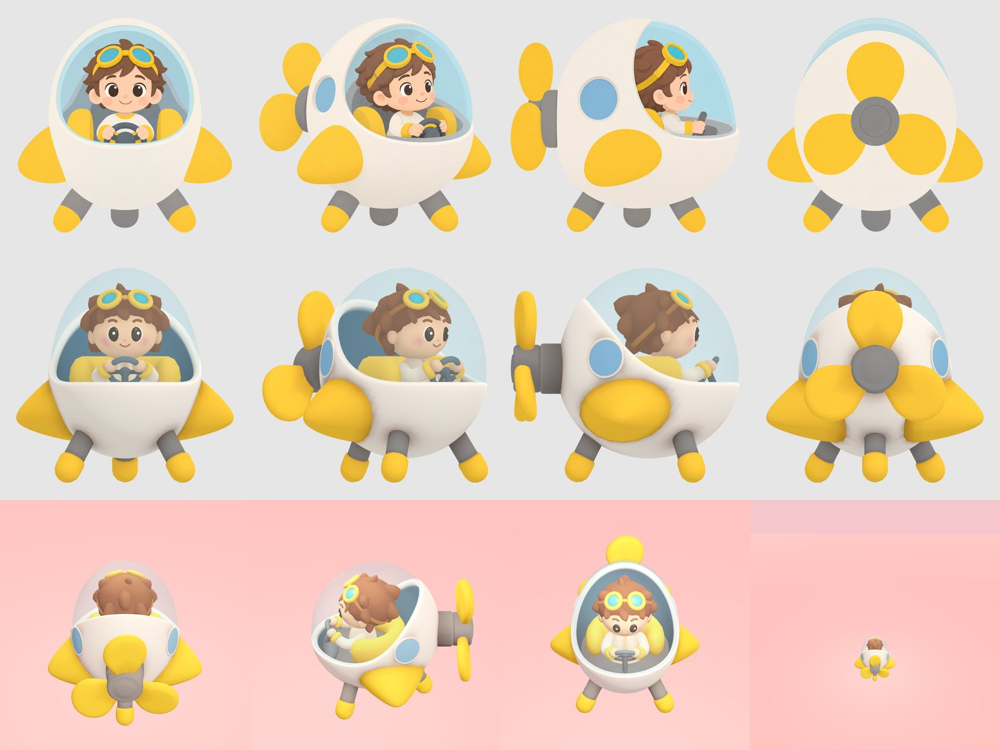

# W1-01 ミクロごう（pod＋pilot）3D 化の結果

| 項目 | 内容 |
|------|------|
| 対象 | `pod`（ミクロごう。中の パイロットの 上半身を ふくむ。pilot 単体の GLB は 無い） |
| 作った日 | 2026-11-22 |
| もとの絵 | `art/w1-hero` の `art/concepts/W1_hero/`（点検は `W1W2_取り込みの結果.md` 3.1） |
| 作りかた | `blender/pod.py`（形は ぜんぶ 式。`python -m blender.characters pod` で 作りなおせる） |
| 出力 | `godot/assets/models/characters/pod.glb`（約 0.5 MB、19,444 三角形、マテリアル 14） |
| 変えなかった 約束 | GLB の 名前、`BUILDERS["pod"]`、部品名 `Propeller`（回る）・`Window`（ドーム）、前 ＝ +Y、当たり判定（球 r0.55、Hitbox r0.7、hover_height 1.1） |
| 絵との 見くらべ | `docs/screenshots/W1_01_pod_compare.jpg`（上の 段 ＝ 絵、中の 段 ＝ モデル、下の 段 ＝ ゲームの カメラから） |



## 1. 使った絵

| 絵 | 何を 読んだか | 注意 |
|----|--------------|------|
| `pod_3d_front.png` | 船体の 幅と 高さ、たまご形の 太さの 変わりかた、ふちの 太さ、ひれの 張り出し、脚の 開き | 縮尺の 基準（全長 1143 px ＝ 1.4 m） |
| `pod_3d_side_right.png` | 船体の 長さ、丸まどの 大きさ、ひれの 根もとの 形、パイロットの 前後の 位置 | 1.19 倍して 測る。ドームの 切り口は 使わなかった（5 章 1） |
| `pod_3d_back.png` | プロペラ（羽根の 形、ハブの 大きさ、軸の 高さ） | 外形で 合わせなおす（5% 小さい） |
| `pod_3d_bottom_r2.png` | 脚 3 本の 配置（前の 左右＋うしろ 中央） | 1.07 倍 |
| `pod_3d_front_right45.png`、`pod_3d_parts.png`、`pod_detail.png` | ひれの 立体の 形、部品の 分け方、羽根の 厚さ | 形の 確認だけ |
| `pod_turnaround.png` の 5 番目 | 後ろ上から 見た すがた（ゲームの カメラ）。ドームの 切り口 | 寸法には 使わない |
| `pilot_3d_front.png`、`pilot_3d_side_right.png`、`pilot_3d_front_right45.png`、`pilot_faces.png`（通常） | 顔、髪、ゴーグル、服の 色 | 大きさは 船の 絵の 中の パイロットに 合わせた（2 章） |
| 使わなかった | `pod_3d_top.png`（真上で ない）、`pod_3d_bottom.png`（初稿） | |

## 2. 縮尺と 寸法

正面の絵の 全長 1143 px を 1.4 m と した（1 px ＝ 1.225 mm）。原点は 船体の まん中、前は +Y、上は +Z。

| 所 | 絵（正面の 縮尺の px） | m | モデル（m） |
|----|----------------------|------|-----------|
| 全体（幅×高さ×長さ） | 1068×1070×1143 | 1.31×1.31×1.40 | 1.33×1.31×1.39 |
| 船体だけ | 762×957×912 | 0.93×1.17×1.12 | 0.93×1.17×1.12 |
| いちばん 太い 高さ | 上から 52〜55% | | 上から 55%（上半分 0.645、下半分 0.527 の だ円を つないだ たまご形） |
| ひれの 張り出し（片側） | 153 | 0.19 | 0.20 |
| 脚（船体の 下へ） | 112 | 0.14 | 0.15 |
| プロペラと 軸（船体の うしろへ） | 231 | 0.28 | 0.28 |
| プロペラの 直径 | 背面 約 0.95〜1.0 m、真横 約 0.90 m | | 0.95 |
| 丸まどの 直径 | 189 | 0.23 | 0.22（＋ふち） |
| ふち（殻の 厚さ） | 約 40 | 0.05 | 0.05（丸みの 半径 0.025） |
| ドームの 下の ふち | 正面は 上から 66%、真横は 57〜62% | | 上から 63%（z ＝ -0.15） |
| パイロットの 頭（髪こみの 幅） | 419 | 0.51 | 0.52 |

- 全長は 1.39 m（船首の いちばん 前が ガラスで、殻より 1.2 cm 内がわに あるため）。船体は 当たり判定の 球（r0.55）と ほぼ 同じ 大きさ。
- パイロットは spec_3d の 単体の 寸法（上半身 0.55 m）では なく、船の 絵の 中の 大きさ（頭が ドームの 幅の 6 割）で 作った。単体の 寸法だと ドームの 中で 小さすぎて、ゲームの 画面で 見えない。

## 3. 部品

| 部品 | 形 | 寸法（m） | 位置（m） | 色（sRGB） | 材質 |
|------|----|----------|----------|-----------|------|
| 船体 | たまご形の 殻（外がわ → 丸い ふち → 内がわが 1 枚の 面） | 0.93×1.12×1.17、厚さ 0.05 | 原点 | `#F3EBE1`。内がわは 頂点カラーで `#8FA5B0` | つやなし |
| ドーム `Window` | 船体と 同じ たまご形の 上と 前（殻より 1.2 cm 内がわ） | 下の ふち z ＝ -0.15、うしろの ふちは 後ろへ 40° たおした 面 | | `#B8E2EA`、アルファ 0.26、両面 | 半透明 |
| ひれ ×2 | だ円の 断面の 円すい、先は 小さく 丸い。根もとは 殻の 厚みの 中で 止める | 根もと 約 0.5×0.33、船体の 面から 先まで 約 0.25 | 先 (±0.66, -0.19, -0.35) | `#FCC738` | つやなし |
| 着陸脚 ×3 | 灰色の 円柱（r 0.066）＋黄色い 丸い 先（r 0.080、長さ 0.165） | | 先 (±0.385, 0.285, -0.72)、(0, -0.47, -0.72) | `#8B8987`、`#FCC738` | つやなし |
| 軸（回らない） | 円柱 r 0.153 | y -0.50 〜 -0.66 | 軸の 高さ z ＝ -0.04 | `#8B8987` | つやなし |
| プロペラ `Propeller` | 羽根 3 枚（丸い しずく形の 厚い 板、ふちは 半円）＋ハブ | 先まで r 0.475、羽根の 丸 r 0.175、厚さ 0.085、ひねり 12°、ハブ r 0.145 | 原点は ハブ (0, -0.752, -0.04)、回転軸は 前後 | `#FCC738`、`#8B8987` | つやなし |
| 丸まど ×2 | 船体の 面に そった 円ばん＋低い ふち | 直径 0.22 | (±0.40, -0.27, 0.03) | `#85B6D5`、ふちは 船体の 色 | 弱い つや |
| ゆか・計器の 台・ハンドル | 円ばん、だ円体、輪（r 0.095）＋軸 | | ゆか z ＝ -0.245 | ゆか `#7C7B7C`、ほか `#626C74` | つやなし |
| 座席 | パイロットを うしろから かこむ U 字の クッション | 太さ 0.16×0.26 | 上の はし z ＝ 0.035 | `#FCC738` | つやなし |
| 頭・耳・手 | だ円体 | 頭 0.40×0.38×0.34 | 頭の 中心 (0, 0.115, 0.185) | `#FCC294`。ほおは 頂点カラーで `#F6A58E` | つやなし |
| 髪 | 大きな かたまり 1＋はね 11＋前髪 3 | かたまり 0.47×0.45×0.40 | (0, 0.05, 0.24) | `#894927` | つやなし |
| 目・まゆ・はな・口 | ひとみ（だ円体）＋白目＋光の 点、まゆと 口は 細い くだ | ひとみ 0.07×0.09 | 目 (±0.076, ·, 0.17) | `#3A2619`、`#FFF9F1`、`#B3523A` | 目だけ 弱い つや |
| ゴーグル・バンド | 輪 2（外径 0.17）＋レンズ 2＋つなぎ、頭を 一周する 帯 | | 頭の 上（ひたいの 上）に 固定 | `#FCC738`、`#44BED0`、`#C0702D` | レンズだけ 弱い つや |
| 上着・うで・そで口 | 回転体、くだ、輪 | 肩幅 約 0.30 | | `#F8E3C9`（前の 合わせは `#EDCFA4`）、そで口 `#FCC738` | つやなし |

- 色は 絵から 測った 値（`W1W2_取り込みの結果.md` 3.1 の 測定値と 同じ）。船体と 黄は、spec の `#F8F4E9`・`#F2C744` では なく 絵の 明るい 面の 色（`#F3EBE1`・`#FCC738`）。
- 形が まじわる 所（ひれと 船体、脚の つけ根、ふちの 内がわ、髪と 顔など）の うすい 影は、頂点カラー（glTF の `COLOR_0`）に 焼いて ある。シェーダーと テクスチャは 使って いない。

## 4. おすすめの うち 採ったもの（`W1W2_取り込みの結果.md` 5 章）

| 番号 | 内容 | このモデル |
|------|------|-----------|
| 1 | 縦横比は 絵の 比（全長 1.4 m は 守る） | 採った。spec の 1.4×1.2×1.0 m では なく、絵の ほぼ 丸い たまご形 |
| 2 | 丸まど（左右）と 脚 3 本は 付ける。上の ひれは 付けない | 採った。脚は 前の 左右＋うしろ 中央、3 本とも 黄色い 先つき |
| 3.1 | パイロットは `pilot_3d_*` を 正とする。ななめがけは 省いて よい | 採った。クリームの 上着、茶の バンド。ななめがけは 無し |
| 3.1 | プロペラは 3D では 黄の 発光に する | **採らなかった**。絵の とおり つやなしの 黄（5 章 3） |

## 5. 絵との ちがい（残したもの）

1. **ドームの 切り口**。真横の絵（`pod_3d_side_right.png`）は、船体の 上半分が ひさしの ように 頭の まん中まで かぶさる。`pod_turnaround.png` の 5 番目（後ろ上から）と W0 の キービジュアルは、ドームが あわの ように 上を おおい、パイロットの 頭が うしろから 全部 見える。絵どうしが 合わない。ゲームの カメラは 後ろ上（見おろす 角度 約 35°）なので、後ろ上の 絵に 合わせた。真横から 見ると、ふちは 絵より 後ろへ たおれて いる。真横の絵に 合わせなおす ときは `blender/pod.py` の `CUT_Y`・`CUT_LEAN` を 変える（`CUT_LEAN` を 0 に 近づけると 立つ）。
2. **丸まどの 位置**。真横の絵（うしろから 23%、上から 43%）より 少し 下（うしろから 26%、上から 48%）。1 の ふちに かからない ように した。
3. **プロペラは 光らせて いない**。A-model の 文章は「プロペラだけ 発光」だが、絵は つやなしの 黄。絵に 合わせた。暗い 場所で 見えにくければ、`m_yellow` と 別の マテリアルに して 弱い 発光を 足す。
4. **パイロットの バンドは 茶色**。船の 絵（`pod_3d_*`）は 黄、単体の 絵（`pilot_3d_*`）は 茶。取り込みの 記録の とおり 単体の 絵に 合わせた。後ろから 見た ときに 目立つのは 黄。
5. **髪**。絵は 細かい 束が 多い。大きな かたまり 1 つと、丸い はね 11、前髪 3 に まとめた。
6. **座席**。絵は 左右の 黄色い ひじかけと 灰色の 背もたれ。U 字の 黄色い クッション 1 つに した（前から 見ると 左右に 見える）。
7. **脚**。正面・背面・真横の 絵は「黄色い 先つき 2 本＋まん中に 灰色の 短い 1 本」に 見える。底面の 絵と 分解図の 3 本に した。
8. **三角形の 数**。A-model の 目安（1 体 2,000〜6,000）より 多い 19,444。いつも 画面に 映る 主役で、なめらかな 丸みと パイロットに 使った。LOD は 切って ある（`pod.glb.import` の `meshes/generate_lods=false`。自動の LOD だと、ゲームの 距離で 丸まどの 円ばんが つぶれて 穴に 見える）。
9. **表情**は「通常」だけ。被弾や ダッシュの 顔は 作って いない（目・まゆ・口は 別の 部品なので、あとで 足せる）。

## 6. ゲーム側で 変えたもの

- 当たり判定・カメラ・`player.gd` は 変えて いない。
- `godot/src/ui/title.gd` の `_add_pod_preview()`：(1) すきとおった 背景の ビューポートに 描いた 半透明は 色に アルファが かかった 形で 出るので、重ねる 側を `BLEND_MODE_PREMULT_ALPHA` に した（しないと ドームが 黒ずむ）。(2) 船は 原点より うしろへ 長いので、`ModelLib.fit` を 1.0 から 0.85 に した（回した ときに プロペラが わくから 出ない）。
- `blender/characters.py` の `build_pod()` は `blender/pod.py` を 呼ぶだけに なった。

## 7. 作って 分かったこと（ほかの キャラクターにも 当てはまる）

- **Godot（4.7）の glTF 読みこみは、メッシュの 1 つ目の マテリアルにだけ 頂点カラーを 使わない**（`vertex_color_use_as_albedo` が 立たない）。頂点カラーで 影や 色を 付ける ときは、影が ほぼ 乗らない 部品を 1 つ目に する（pod は 丸まどの 円ばん）。
- Blender の glTF 書き出しは、マテリアルの ノードで 頂点カラーを 使って いる ときだけ `COLOR_0` に 出す（`blender/pod.py` の `mat()`）。
- 頂点ごとに 焼いた 影は、メッシュの あらさより 細かいと ギザギザに 見える。となりの 頂点と 2〜4 回 ならして 広げる（`bake_soft_shadow()` の `soften`）。
- ガラスは 両面に すると、むこうがわの 面も 重なって あわの ように 見える（パイロットの 前は 1 枚、背景の 前は 2 枚）。
- 部品の 根もとは 殻の 厚みの 中で 止める（`into_shell()`）。船の 中まで 突き出すと、ドームごしに 見える。

## 8. 確かめかた

```bash
<venv>/bin/python -m blender.characters pod
tools/pod_views.sh /tmp/pod_views/                 # 正面・背面・真横・ななめ・ゲームの カメラなど（--light=dark／flat、--hide=Window）
python3 tools/pod_compare.py <絵の フォルダ> /tmp/pod_views/ /tmp/pod_compare.png
tools/pod_views.sh /tmp/pod_views/ pod --stage=mouth --play=3   # 本物の 場所で、HUD を かくして 撮る
```

- 見た もの：絵との 4 方向の ならび、ゲームの カメラ（後ろ・左・正面、等倍）、暗い 光、光なし（焼いた 影だけ）、口・しょくどう・脳の 場所、タイトル画面。
- 見て いない もの：ブラウザ版（書き出し用の テンプレートが 無い 環境だった。撮影は ブラウザ版と 同じ OpenGL の レンダラー）。実機の スマートフォンでの 速さ。

