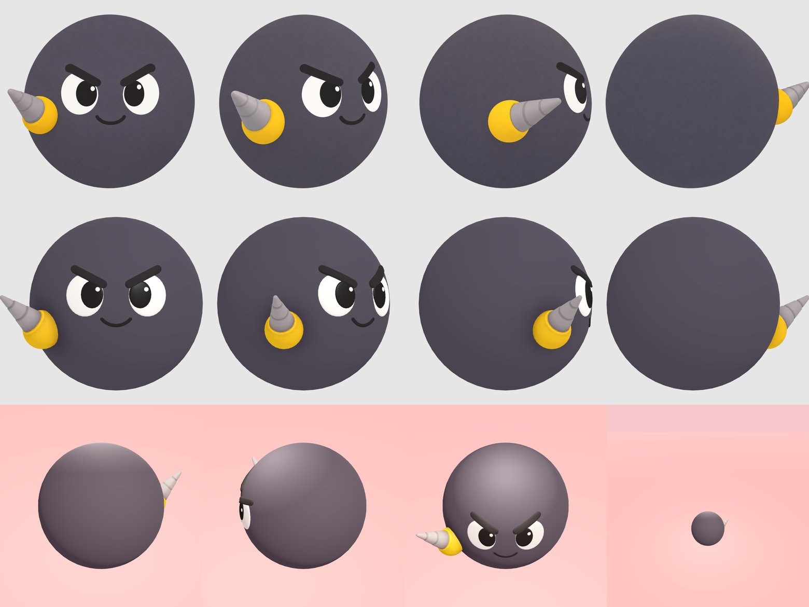

# W2-01 むしばきん（mushiba）3D 化の結果

| 項目 | 内容 |
|------|------|
| 対象 | `mushiba`（むしばきん。口の ステージの てき。ふつうは 4 ひき） |
| 作った日 | 2026-11-23 |
| もとの絵 | `art/w2-enemies` の `art/concepts/W2_enemies/`（点検は `W1W2_取り込みの結果.md` 3.2） |
| 作りかた | `blender/mushiba.py`（形は ぜんぶ 式。作りの 道具は `blender/pod.py` と 共通。`python -m blender.characters mushiba` で 作りなおせる。同じ GLB に なる ことを 確かめた） |
| 出力 | `godot/assets/models/characters/mushiba.glb`（約 0.19 MB、7,572 三角形、マテリアル 9、テクスチャなし） |
| 変えなかった 約束 | GLB の 名前、`BUILDERS["mushiba"]`、前 ＝ +Y、`enemy.gd` の CONFIG（radius 0.7、touch_r 0.9） |
| 絵との 見くらべ | `docs/screenshots/W2_01_mushiba_compare.jpg`（上の 段 ＝ 絵、中の 段 ＝ モデル、下の 段 ＝ ゲームの カメラから） |



## 1. 使った絵

| 絵 | 何を 読んだか | 注意 |
|----|--------------|------|
| `mushiba_3d_front.png` | 体の 半径（497 px）、顔の ぜんぶ（白目・黒目・光・まゆ・口の 位置と 大きさ）、玉の 位置、ドリルの 太さ・先の 位置 | 縮尺の 基準。顔は この絵を 正面から まっすぐ 体に 投影して 置いた |
| `mushiba_3d_side_right.png` | ドリルの 長さ（体の 半径の 0.63 倍）、みぞの 数、玉が 前後の まん中 あたりに ある こと、色 | ドリルが 前を 向いて いる（ほかの 絵は 横）。2 章の 向きの 決めで 両方を 取った |
| `mushiba_3d_back.png` | ドリルの 張り出し（体の 外へ 0.36 R）、体の 色 | |
| `mushiba_3d_parts.png` | ドリルの 部品（円すい＋黄色い えり＋べつの 黄色い 玉）、みぞ 2 本、えりと 玉と 円すいの 太さの 比 | 部品ごとの 縮尺は 合って いない。比だけ 使った |
| `mushiba_3d_top.png`、`mushiba_3d_front_right45.png`、`mushiba_turnaround.png` | 形と 向きの 確かめ | |
| `mushiba_faces.png` | 使わなかった（「通常」が やさしい顔。3D 用の 正面の 顔で 作る 決め） | |

## 2. 縮尺と 寸法

体の 半径を 0.665 m に した（絵ごとに 体の 半径の px で 割って 測る。正面 497、背面 481、真横 514 px）。原点は 体の まん中、前は +Y、上は +Z、本人の 右は +X（正面の 絵では 左）。

**大きさの 決め**：spec の 体径 0.85 m（半径 0.425）は 使わない。当たり判定（`enemy.gd` の radius 0.7、さわる 範囲 touch_r 0.9）を 変えずに、見える 体の 半径を 0.63〜0.70 m の あいだに した（いたい 所 ＝ 見える 所）。spec と 合わせる ときは、モデルを 0.64 倍に して CONFIG も 下げる。

| 所 | 絵（体の 半径 R ＝ 1） | モデル（m） |
|----|----------------------|-----------|
| 体 | 球 | 半径 0.665（44×28 分割。ゲームの 距離で かどは 見えない） |
| 全体の 幅（ドリルこみ） | 正面 2.19 R | 1.56 m（2.34 R） |
| 白目 | 中心 (±0.36, +0.10)、半径 横 0.215・たて 0.247 | 同じ（たかさ 1.0 cm） |
| 黒目 | 白目の 中心から 内がわ（はなの ほう）へ 0.086、半径 0.126×0.157 | 同じ（白目の 上に 0.7 cm） |
| 光の 点 | 黒目の 中心から 絵の 右上へ (0.066, 0.058)、半径 0.026。両目とも 同じ 向き | 同じ |
| まゆ | まっすぐな 太い 棒。内の はし (±0.15, 0.225)、外の はし (±0.47, 0.392)（約 27°、内がわが 下）、太さ 0.094 | 同じ（たかさ 2.0 cm。白目の 上に かぶさる） |
| 口 | 円弧。はし (±0.165, -0.178)、いちばん 下 -0.252、太さ 0.038 | 同じ |
| 黄色い 玉 | 正面 中心 (-0.82, -0.16)、半径 0.21 | 半径 0.150、中心は 体の 中心から 0.70 m、向き (0.80, 0.50, -0.28) |
| えり（黄色い カップ） | 分解図：玉の 1.26 倍、円すいの 根もとの 1.22 倍 | 半径 0.115。玉の 中心から 0.10 m 先 |
| 円すい | 長さ：真横 0.63 R・正面 0.50 R（ななめ）。根もとの 太さ 0.30 R。みぞ 2 本（3 段）、先は 丸い | 長さ 0.372、根もとの 半径 0.100、先の 丸み 0.024。みぞは 根もとから 36%・68%（深さ 7 mm、先の がわの 段が 3 mm 細い） |

**ドリルの 向き**：ななめ 前・外・少し 上 (1.0, 0.70, 0.80)。正面から 見ると 横（外）へ 約 39° 上、真横から 見ると 前へ 約 49° 上。正面の 絵（外へ 41° 上）と 真横の 絵（前へ 24° 上）の 両方に 近く なる ように した。

## 3. 部品

| 部品 | 形 | 色（sRGB） | 材質 |
|------|----|-----------|------|
| 体 | 球 | `#524C59` | つやなし（roughness 0.9） |
| 白目 ×2 | 体の 面に はった うすい ふくらみ（上は 平ら、ふちは 丸く 落ちて 体に もぐる） | `#FAF7F3` | つやなし |
| 黒目 ×2 | 同じ。白目の 上 | `#252121` | 半つや（0.45） |
| 光の 点 ×2 | 同じ。黒目の 上 | `#FAF7F3` | 半つや（0.5） |
| まゆ ×2 | 丸い はしの 太い 線の ふくらみ | `#2F2B2D` | つやなし |
| 口 | 円弧の 線の ふくらみ | `#2A2526` | つやなし |
| 黄色い 玉 | 球。直径の 4 割が 体に うまる | `#F9C320` | 半つや（0.7） |
| `Drill`（えり＋円すい） | えり：浅い 半球の カップと 丸い ふち。円すい：回転体（根もとの 丸い ふち、みぞ 2 本で 3 段、丸い 先） | えり `#F9C320`、円すい `#ABA1A2`（みぞは 頂点カラーで 2 割 暗く） | 半つや（0.7、0.6） |

- 色は 絵の 平らな 所の 中央値（正面の 中央・背面・真横で ほぼ 同じ）。体は spec の `#45434E` より 少し 明るく 紫が かった 絵の 色。黄は 真横の 絵の 玉の 中央値（正面の 平らな 所は `#F4B717`、明るい 所は `#FAC017`）。ドリルの 灰は 取り込みの 測定値 `#A09898` より 明るい（真横の 段の まん中）。黒目は spec の こん色 `#202333` では なく 絵の 色。
- 形が まじわる 所（玉と 体、えりと 玉、円すいの 根もと）の うすい 影は 頂点カラー（`COLOR_0`）に 焼いて ある。顔には 焼かない（はっきり 見せる）。
- `Drill` は 別の ノード。原点は えりの 前の 面の 中心、ローカルの 上（Blender の Z）が ドリルの 軸。いまの ゲームは 回して いない（回す ときは `model.get_node("Drill").rotate_object_local(Vector3.UP, …)`）。
- 三角形：体 2,376、顔 2,416、玉 624、Drill 2,156。合計 7,572。

## 4. 絵との ちがい（残したもの。目立つ 順）

1. **ドリルの 向き**。絵は 正面・背面・真上・45° では 横（外）向き、真横だけ 前向き。決めの とおり ななめ 前・外・少し 上に した。そのため 正面では ドリルが 少し こちらへ 向いて 絵より 短く 見え、45°（右前）からは ほぼ こちらを 向く（絵は 左上へ のびる）。真横では 絵より 上を 向く。
2. **大きさ**。spec の 体径 0.85 m では なく 1.33 m（当たり判定に 合わせた。2 章）。ゲームの 中では 船（1.4 m）と ほぼ 同じ 大きさに 見える。
3. **玉と えり**。正面の 絵は 玉が まるい 円ばんに 見えて、ドリルの 根もとが その 左上に 乗る。モデルは ドリルが ななめ 前を 向く ぶん、正面からは 玉の 下半分と えりが 見える。えりは 玉と 同じ 色なので、分解図ほど 分かれて 見えない（影の 頂点カラーで 境めだけ 見える）。
4. **顔は 正面の 絵の 投影**。正面からは 絵と 同じ。真横・45° では 目が 体の 丸みに そって 細く 見える（絵の 真横は 目が もう 少し 前に 出て 見える）。
5. **黒目の 向き**。正面の 絵の とおり 両目とも 内がわ（はなの ほう）に 寄って いる（「横目」では ない）。
6. **体の 明るさの 変化**（絵は 上が 明るく 下が 暗い）は 光で 出して いる。暗い 光（`--light=dark`）では 下半分が かなり 暗いが、上の つやと 顔・ドリルで 形は 分かる。
7. **表情**は「通常」（3D 用の 正面の 顔）だけ。おこる・びっくり・やられの 顔は 作って いない（目・まゆ・口は 別の 部品なので、あとで 足せる）。

## 5. ゲーム側で 変えたもの・確かめた こと

- `enemy.gd` の CONFIG・当たり判定は 変えて いない。体の 半径 0.665 は 当たりの 球（0.56）より 大きく、さわる 範囲（0.9）より 小さい。
- **LOD は 切った**（`mushiba.glb.import` の `meshes/generate_lods=false`）。自動の LOD だと、ゲームの カメラの 距離（約 8 m）で 体の まるい ふちが 角ばって 見えた。
- `godot/src/ui/card.gd` の `_make_picture()`：3D の 絵が 回る とき、原点から いちばん 遠い 所（ドリルの 先）で 大きさを 合わせなおす ように した。前の ままだと 回った ときに ドリルが わくから 切れた。左右前後が そろった 形（ほかの キャラクター）は 変わらない。
- たたかれた ときと やられた とき：`enemy.gd` は モデルの 根もとの `scale` を 変える（ふくらむ → 小さく なって 消える）だけ。`Drill` も 子なので いっしょに 動く。本物の 口の 場所で、1 回 たたいて ふくらむ 絵と 消えた あとの 絵を 撮って 確かめた。
- `blender/characters.py` の `build_mushiba()` は `blender/mushiba.py` を 呼ぶだけに なった。

## 6. 作って 分かったこと

- 顔の 部品は、正面の 絵の 座標の まま 体の 面へ まっすぐ 投影して、法線の 向きに 少し 浮かせた ふくらみに すると、正面の 絵と ぴったり 合い、ふちは 体に もぐるので 浮きも すきまも 出ない（`wrap()`・`_decal()`）。重なる 部品（黒目・光・まゆ）は 下の ふくらみの 高さの 上に 乗せる（`under`）。
- glTF の 1 つ目の マテリアルに 頂点カラーが 使われない 件（`W1_01_pod_3D化の結果.md` 7 章）は、影の 要らない 光の 点を 1 つ目に して よけた。`Drill` の 1 つ目は えりで、玉と 同じ 色でも 別の マテリアル（`MushibaCollar`）に して、玉の 影が 消えない ように した。

## 7. 確かめかた

```bash
<venv>/bin/python -m blender.characters mushiba
tools/pod_views.sh /tmp/m/ mushiba                       # 正面・背面・真横・ななめ・ゲームの カメラ（--light=game／dark／flat）
python3 tools/pod_compare.py <絵の フォルダ> /tmp/m/ /tmp/m_compare.png mushiba
tools/pod_views.sh /tmp/m/ mushiba --stage=mouth --play=2 --enemy   # 本物の 口で、いちばん 近い てきの アップと たたいた あと
tools/screenshot.sh card:mouth:mushiba /tmp/card.png               # ものしりカード（ずかんから 開いても 同じ）
```

- 見た もの：絵との 4 方向の ならび、ゲームの 光と 暗い 光、ゲームの カメラ（後ろ・横・前）、LOD の あり／なし、口の 場所（18〜35 m 先の むしばきん、たたいた とき、消えた あと）、ものしりカード（回る 4 つの 向き）、ずかん。
- 見て いない もの：ブラウザ版（撮影は 同じ OpenGL の レンダラー）。実機の スマートフォン。
