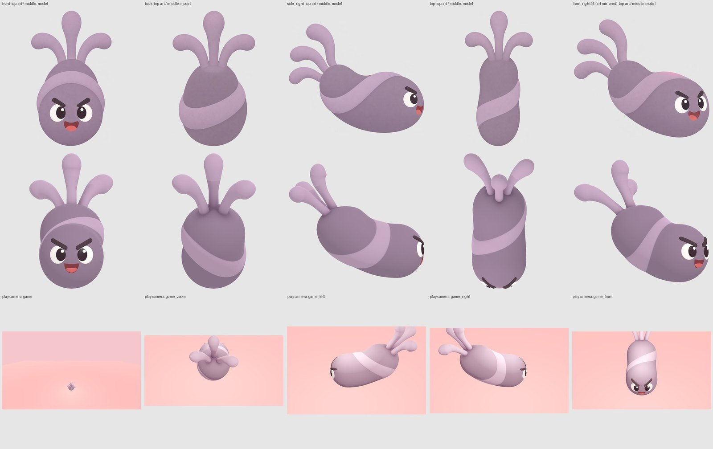

# W2-01 ピロリきん（pylori）3D 化の結果

| 項目 | 内容 |
|------|------|
| 対象 | `pylori`（ピロリきん。い（胃）の ステージの てき。ふつうは 5 ひき、カルテ 2 では 4 ひき） |
| 作った日 | 2026-11-25 |
| もとの絵 | `art/w2-enemies` の `art/concepts/W2_enemies/pylori_*`（点検は `W1W2_取り込みの結果.md` 3.2） |
| 作りかた | `blender/pylori.py`（形は ぜんぶ 式。作りの 道具は `blender/pod.py` と 共通、顔の ふくらみは `blender/mushiba.py` と 同じ やりかた。`python -m blender.characters pylori` で 作りなおせる。同じ GLB に なる ことを 確かめた） |
| 出力 | `godot/assets/models/characters/pylori.glb`（419,056 バイト、16,484 三角形、マテリアル 10、テクスチャなし。4 回目の 数。13 章）。`.import` で LOD を 切った |
| 見なおし | 1 回 見なおした（10 章。うしろから 見た 形・太さ・べん毛の 広がり）。2 回目で 帯・べん毛・色を 作りなおした（11 章）。3 回目と 4 回目で べん毛だけ 作りなおした（12・13 章。いまの べん毛は 4 回目） |
| 変えなかった 約束 | GLB の 名前、`BUILDERS["pylori"]`、前 ＝ +Y、`enemy.gd` の CONFIG（radius 0.7、touch_r 0.9）。ゲームの コードは 変えて いない |
| 絵との 見くらべ | `docs/screenshots/W2_pylori_compare.jpg`（上の 段 ＝ 絵、中の 段 ＝ モデル、下の 段 ＝ ゲームの カメラ） |
| ゲームの 中 | `docs/screenshots/W2_pylori_ingame.jpg`（い（胃）で、ゲームの カメラから 近・中・遠、船と ならべて、動いて いる ところ） |



## 0. 部品の 表

原点は 体の 長さの まん中（体の 軸の 上）。前 ＝ +Y、上 ＝ +Z、本人の 右 ＝ +X（Blender の 向き）。寸法は m。S ＝ 1.5（spec → ゲームの 倍率。2 章）。

| 部品 | 形 | 寸法（m） | 位置 | 色（sRGB） | 材質 |
|------|----|----------|------|-----------|------|
| 体（色は 2 回目に `#957D94`） | 太い 豆形：頭の 球（前）と うしろの 球を なめらかに つつんだ 形（round cone）。頭の 中心より うしろを 半径 1.2 の 円弧に そって 上へ 曲げる（断面も 回る）。帯の あたりを 少し くびれさせる | 全長 1.63（-0.80〜+0.83）、高さ 1.09（-0.41〜+0.68）、幅 0.82。頭の 半径 0.41。うしろの 球の 半径 0.405（まるい まま）。うしろの 球の 中心が 0.30 上がる。くびれ 1.8 cm | 頭の 中心 (0, +0.42, 0)、うしろの 球の 中心（曲げた あと）(0, -0.38, +0.30) | `#8D7993` | つやなし（0.9） |
| らせんの 帯 | ななめに 1 周 する とじた 輪（はしが 無い）。体の 面に そい、まん中は ほぼ 平ら、ふちは 丸く 体へ おりる | 幅 0.285、盛り上がり 0.015 | 帯の まん中の 線：曲げる 前の 前後 h(φ) ＝ -0.15 ＋ 0.15 sin φ ＋ 0.27 cos φ（φ ＝ まわりの 角度。0 ＝ 本人の 右、90 ＝ 上）。本人の 右の よこが いちばん 前（+0.12）、左の よこが いちばん うしろ（-0.42） | `#C0A3BD` | つやなし（1.0） |
| `Flagella`（べん毛 ×3。4 回目） | 3 次ベジェの くだ。こん棒の 形：根もとが ほそく（半径 0.063）、長さの 45% から 先へ だんだん 太く なり、先の まるい ふくらみ（半径 0.126）に そのまま つながる（くびれ なし） | 長さ まん中 0.84、右 0.89、左 0.87（根もとの 体に うまる 分を ふくむ） | 上 1 本＋左右 2 本。まん中は 上へ 立って うしろへ そり、先は 前へ まるく もどる。左右は うしろへ ながれて 外へ ひろがり、先は 外へ まがる。左右の 先の 高さを 少し ずらした（右 +0.81、左 +0.90）。いちばん 後ろ -1.22、いちばん 上 +1.33、左右 ±0.54 | `#C0A3BD` | つやなし（1.0） |
| 白目 ×2 | 頭の 面に はった うすい ふくらみ（だ円） | 半径 横 0.100・たて 0.117、高さ 1.0 cm | 正面の 絵の (±0.427, +0.055)×頭の 半径 | `#FCF4F1` | つやなし |
| 黒目 ×2 | 同じ。白目の 上 | 半径 0.061×0.080 | 白目の 中心から 内がわ（はなの ほう）へ 0.10×頭の 半径 | `#3C2A32` | 半つや（0.45） |
| 光の 点 ×2 | 同じ。黒目の 上 | 半径 0.021 | 黒目の 中心から 絵の 右上へ (0.052, 0.105)×頭の 半径 | `#FCF4F1` | 半つや（0.5） |
| まゆ ×2 | 丸い はしの 太い 線の ふくらみ（つり上がり：内がわが 下） | 太さ 0.054、高さ 2.0 cm | 内の はし (±0.191, 0.272)、外の はし (±0.566, 0.489)×頭の 半径 | `#4C3A43` | つやなし |
| 口 | あいた 口（上の へりは ほぼ まっすぐで はしが 少し 上がる、下は 丸い） | 幅 0.19、たて 0.12 | 上の へり -0.232、いちばん 下 -0.518（×頭の 半径） | `#853C44` | 0.8 |
| 舌 | 口の 下半分（上へ ふくらむ 弧） | 幅 0.15 | 口の 上 | `#DF6D6E` | 0.7 |

- 形が まじわる 所（べん毛の 根もと、帯の ふち、体の 下）の うすい 影は 頂点カラー（`COLOR_0`）に 焼いて ある。顔には 焼かない。
- 三角形（4 回目）：体 4,128、帯 5,376、顔 2,660、べん毛 4,320。合計 16,484（上限 20,000 の 内）。GLB は 419,056 バイト（上限 600 KB の 内）。2・3 回目は 16,052・408,680〜408,688 バイト、1 回目は 13,676・350,396 バイト。
- `Flagella` は 別の ノード（`pylori` の 子）。原点は 3 本の 根もとの まん中（Blender (0, -0.60, +0.58)。4 回目）。いまの ゲームは 動かして いない（spec の「べん毛を 軽く 揺らす」を する ときは この ノードを 小さく 回す）。ゲームは この 名前に たよって いない。
- Godot の glTF 読みこみは メッシュの 1 つ目の マテリアルに 頂点カラーを 使わない（`W1_01_pod_3D化の結果.md` 7 章）。本体の 1 つ目は 光の 点（`PyloriSpark`）、`Flagella` の 1 つ目は べん毛の 先の ふくらみ（`PyloriFlagellumTip`。色は べん毛と 同じ）に して よけた。

## 1. 使った絵

| 絵 | 何を 読んだか | 注意 |
|----|--------------|------|
| `pylori_3d_side_right.png` | 全長（1173 px）、体の 豆形（頭の 円 半径 246 px、うしろの ドーム 156 px、中心の あいだ 534 px）、帯の 幅（約 110 px）、べん毛の 太さ（約 72 px、先 約 100 px）と そり | 縮尺の 基準。絵は 頭が 約 21° 下がった すがた。水平に 作りなおした |
| `pylori_3d_top.png` | 体の 幅（頭がわ 360 px、うしろがわ 319 px）、体の 長さ（737 px）、べん毛 3 本の 根もとが うしろの はしに ならぶ こと | 幅の 基準 |
| `pylori_3d_front.png` | 顔の ぜんぶ（頭の 円 中心 (976, 1327) px・半径 272 px を 1 と した 座標）、べん毛の 広がり（上 1 本＋左右 2 本） | 真横・真上より 約 22% 大きい。顔の 配置だけ（頭の 半径で わって）使った |
| `pylori_3d_back.png` | べん毛の 広がり、帯が うしろから 見て ななめに 横切る こと | 形の 確かめ |
| `pylori_3d_front_right45.png` | 形の 確かめ | 左右が 逆（左前から 見た 絵）。見くらべの 1 枚では 左右反転して ならべた |
| `pylori_3d_parts.png`、`pylori_turnaround.png` | 顔の 部品・べん毛 3 本・帯の 形の 確かめ | |
| `pylori_faces.png` | 使わなかった（「通常」は やさしい顔。3D 用の 正面の 顔で 作る 決め、取り込み 5 章 11） | |

色は 絵の 平らな 所の 中央値（正面）。体だけ spec の `#8D7993`（絵の 中央値は `#957D94`。4 章 5）。帯と べん毛は 取り込みの 測定値 `#BB9DB5`。口と 舌は 取り込みの 測定値（`#974950`、`#D46E6F`）より 絵の まん中の 色（`#853C44`、`#DF6D6E`）。

## 2. 縮尺と 大きさ

- 絵の 縮尺：真横の 全長 1173 px ＝ 1.4 m（spec）→ 約 838 px/m。真上は 体の 幅で（頭がわ 360 px ＝ spec の 胴の 太さ 0.55 m）。正面・背面は 頭の 半径で わった 比だけ 使った。
- spec の 大きさ（S ＝ 1）：体の 長さ 1.11、頭の 太さ 0.55、うしろの 太さ 0.40〜0.46、べん毛こみ 全長 約 1.35。
- **大きさの 決め：S ＝ 1.5**。当たり判定（`enemy.gd` の radius 0.7 → 当たりの 球 0.56、さわる 範囲 touch_r 0.9）を 変えずに、体の 前後の はし（-0.81〜+0.84）が さわる 範囲 0.9 の 内がわに 入り、当たりの 球（0.56）が 体の 長さの 中に 入る 大きさ。むしばきん（spec の 1.56 倍）と ほぼ 同じ 倍率なので、てき どうしの 大きさの 比は spec の まま。
  - できた 大きさ（見なおし 後）：全長 1.88（べん毛こみ）、体 1.63、太さ 0.82、体の 高さ 1.09（うしろの ドームが 上がる）、べん毛こみ 高さ 1.87、幅 1.08（べん毛の 先）。体の いちばん うしろの 点は 原点から 約 0.86 m（さわる 範囲 0.9 の 内）。船（1.4 m）より ひとまわり 大きい（体は 船と ほぼ 同じ 太さ）。
  - 横から 見ると 体の 太さの 半分（0.41）は 当たりの 球（0.56）より 細い。細長い 形を 球 1 つで 当てて いるので、横からは 見た目より 0.15 m ほど 手前で ぶつかる。遊びで 気に なる ほどでは ない（前後は 見た目と ほぼ 合う）。
  - spec の 大きさ（全長 1.4）に する ときは：`pylori.py` の S を 1.0 に し、`enemy.gd` の pylori を radius 0.5・touch_r 0.6 くらいに 下げる（取り込みの 案 0.6／0.8 は 全長 1.4 には まだ 大きい）。

## 3. 取り込みの 決めの うち、作った もの（ユーザーの 答えが まだ 無い ので おすすめの 形）

- **5 章 10「らせん」**：（2 回目で ななめの とじた 輪 1 本に 変えた。11 章。以下は 1 回目）おすすめの とおり 帯を 少し 盛り上げて **1 周半** 巻いた（`BAND_FROM`・`BAND_TO` の 角度で 変えられる。1 周に すると 絵に 近い。4 章 1）。カードの 文（「らせんの からだ」）は 変えて いない。
- **5 章 11「ふだんの 顔」**：3D 用の 正面の 顔（つり上がった まゆ・あいた 口と 舌）。
- **3.2 の 決め**：べん毛は 上 1 本＋左右 2 本の 三角、帯の 巻く 向きは どちらでも よい、太さは spec の 0.55（の S 倍）、体は 水平。

## 4. 絵との ちがい（残したもの。目立つ 順。1 回目。2 回目の ちがいは 11 章）

1. **帯**（1 回目の 記録。2 回目で 輪 1 本に した。11.1）。絵の 帯は 体を ななめに 1 周 する 1 本の 輪（真横では 頭の 上から うしろの 下へ、真上では うしろ左から 前右へ）。モデルは おすすめの とおり 1 周半の らせん なので、真横・真上・45° では 帯が 2〜3 回 見え、絵より しま模様に 近い。はしが 2 つ 見える（本人の 右の うしろ、本人の 左の 頭の 横。丸く 細く なって 体に そう）。正面では 絵と 同じく 頭の うしろに えりの ように 見える。
2. **すがた（頭は 水平）**。絵は 頭が 下がって うしろが 上がった すがた。モデルは 頭を 水平の まま、うしろを 円弧で 上へ 曲げた（見なおしで 強めた）。正面・背面で うしろの ドームが 頭の 上に 見える ように なったが、絵ほど 高くは ない。べん毛は 絵より 後ろ上へ のびて いて、正面からは まん中の 1 本が まっすぐ 上に 立つ 棒に 見える（絵の 正面も まん中は まっすぐ）。
3. **べん毛の 広がり**。左右の 2 本の 先は ±0.54 m（見なおしで ±0.70 から せばめた。絵の 広がりに ほぼ 合う）。真横の 絵の「上・中・下に ならぶ 3 本」は、三角の 置きかたでは 左右の 2 本が 重なるので 2 本に 見える。
4. **体の 形**。見なおしで 太い 豆に した（うしろの 球を 頭と ほぼ 同じ 大きさの まるい 球に し、円弧で 上へ 曲げる）。真横で 上が へこみ 下が ふくらむ 豆の 線に なった。絵より 体が 少し 短く ずんぐり（真上で 長さ ÷ 幅 ＝ 2.0。絵は 2.05 だが 絵は 頭が 下がって いて 真上の 長さが 縮んで 見える）。真横の 絵の 頭は もっと 深い。
5. **体の 色**。ゲームの い（胃）の 明るい あたたかい 光では、絵の 色（`#957D94`）だと 体と 帯・べん毛が どちらも うすい ピンクに なって 見分けにくかった。spec の 少し 暗い `#8D7993` に した。それでも ゲームの 中では 絵より ピンクがかった うすい 紫に 見える（光の せい。ほかの キャラクターと 同じ）。
6. **表情**は「通常」（3D 用の 正面の 顔）だけ。目・まゆ・口・舌は 別の 部品なので、あとで 足せる。

見くらべの 1 枚（見なおし 後）で 方向ごとに：正面 ＝ 頭と 顔と えりの 帯、頭の 上に のぞく うしろの ドーム、べん毛の 広がりは 合う。まん中の べん毛は 絵より 長い。背面 ＝ たての 卵形と べん毛 3 本は 合う。帯は 絵の ななめ 1 本に 対して、卵の 下の はしに そう 弧（U の 形）が 1 本 見える（らせんを 軸の 向きから 見る ので どうしても 弧に なる。前の 回の「まるい 板の ふちどりの 輪」は 消えた）。真横 ＝ 太い 豆形と べん毛の 向きは 近い、帯が 2 本 見え、うしろの はしが 細い とがりで 見える、絵は 頭下がり、べん毛は 2 本に 見える（左右が 重なる）。真上 ＝ 長さ・幅・べん毛の 根もとは 合う、帯が 体の まえ半分で 3 回 横切る（絵は 1 回）。45° ＝ 形は 近い、帯の 数が ちがう、うしろが 絵より 少し 高い。

## 5. ゲームの 中（`docs/screenshots/W2_pylori_ingame.jpg`）

- 撮りかた：い（胃）を 12 秒 動かして ピロリきんが かべの さいぼうの まわりを まわりはじめて から、船を その うしろ（3・8・18 m）と すぐ 横（2.6 m）に 置いて ゲームの カメラで 撮った。動いて いる ところは 船を 止めて 0.5 秒 あけて 3 枚（1 枚目と 2 枚目を のせた）。いけ（いえき）で けがを しない ように して 撮った（撮影だけの 一時的な スクリプト。コミット して いない）。
- **うしろ・上から（ゲームの カメラ。見なおし 後に 撮りなおした）**：見えるのは 上がった うしろの まるい ドームと、その 上に 立つ 3 本の べん毛（先が 丸い）。帯は 真うしろからは ドームの 下に ほとんど かくれ、ななめうしろからだと 体を 巻く 明るい しまが 見える。かお は 見えない が、べん毛の かたちで「ほかの もの」と すぐ 分かる。中くらい（8 m）でも べん毛と 帯は 読める。遠く（18 m）では べん毛の ついた 小さい 紫の かたまり。
- **てき と なかま**：かべの さいぼう（いまは 仮の 黄色い 玉＋水色の ぼうし）と 色も 形も ちがう。光る 黄色（ゴール）と いけの 琥珀色は 使って いない。こちらを 向くと つり上がった まゆと 口が 見える（`game_front`）。
  （あとから：かべの さいぼうも 絵から 作りなおした。`W2_02_wallcell_3D化の結果.md`）
- **大きさ**：船の すぐ 横で、体は 船と ほぼ 同じ 太さ、べん毛こみで 船の 1.5 倍 くらいの 長さ。
- **床**：ゆかから 体の 下まで 約 0.7 m（`enemy.gd` の うく 高さ 1.11 m − 体の 下 0.41 m、±0.12 m ゆれる）。ゆかに もぐる ところ・不自然に 高く うく ところは 見えなかった。
- 気に なる 点：い（胃）の 光では 体が 絵より うすく ピンクに 見える（4 章 5）。うしろから だけ だと「やっつける もの」の 合図（まゆ）は 見えない（むしばきんも 同じ）。

## 6. ゲーム側で 確かめた こと

- `enemy.gd`・`model_lib.gd`・`level.gd` は ピロリきんの 部品を 名前で 探して いない（モデルの 根もとの `position.y`・`rotation.y`・`scale` だけ 動かす）。なので `Flagella` を 子に しても 何も 変わらない。
- たたいた とき（ふくらむ）と やられた とき（消える）：`tools/pod_views.sh <出力> pylori --stage=stomach --play=4 --enemy` の `stage_stomach_enemy.png`・`_hit.png`・`_gone.png` で、1 回 たたくと 消える ことを 見た（HP 1）。
- さわる 範囲（`Touch`、touch_r 0.9）と 当たりの 球は CONFIG の まま。
- ものしりカード：`tools/screenshot.sh card:stomach:pylori` と `cards:stomach` で、3D の 絵が 出る（回る）ことを 見た。**カードの 大きい 絵では、回る とちゅうで べん毛の 先が 絵の わくの 左で 切れる 瞬間が ある**。同じ 撮影で むしばきんの ドリルの 先も 右で 切れて いた（`card:mouth:mushiba`）ので、`card.gd` の `_model_picture` の 合わせかた（いまの まま）の 件。`card.gd` は 変えて いない。
- テスト：`--stage=stomach`、`--episode=ep02`、`--episode=ep03` が 通った（`PROBE RESULT: OK`、`RESULT: OK`、`DASHBOARD: OK`、`SCRIPT ERROR` なし）。

## 7. 作って 分かったこと

- 体を「2 つの 球を つつむ 形（round cone）」の 回転体に し、前後の 位置と まわりの 角度で 面の 点を 出す 関数（`surf(h, phi)`）を 1 つ 持つと、帯（らせん）も べん毛の 根もとも 同じ 関数で 体に のせられる。帯の 幅の 向きは、面の 上で らせんに 直角な 向き（前後と まわりの 長さで 計算）に とる。
- リボンの はしを「盛り上がりだけ 0 に して もぐらせる」と、平らな 上の 面が 体と 交わって 四角く 切れた はしに 見える。「幅を 丸く 細く し、盛り上がりは 少し 残す」と リボンの はしに 見える。
- ゲームの 光の 強い 場所（い（胃））では、絵の 中間色どうし（体と 帯）が どちらも 白っぽく なり 見分けが へる。暗い がわの 色は 少し 暗めに 決めて、ゲームの カメラで 確かめる。
- `godot/tests/pod_views.gd` に `--size=`（正投影の 写す 幅）を 足した。1.72 m に 入らない キャラクター（ピロリきんは 2.7 で 撮った）。

## 8. 確かめかた

```bash
<venv>/bin/python -m blender.characters pylori
tools/pod_views.sh /tmp/p/ pylori --size=2.7                       # 正面・背面・真横・ななめ・真上・ゲームの カメラ
tools/pod_views.sh /tmp/p/ pylori --stage=stomach --play=4 --enemy  # 本物の い（胃）で、いちばん 近い てきの アップと たたいた あと
tools/screenshot.sh ep02:2 /tmp/ep02.png --play=4
tools/screenshot.sh card:stomach:pylori /tmp/card.png
LOG=/tmp/t.log tools/run_tests.sh --stage=stomach                   # --episode=ep02、--episode=ep03 も
```

- 見くらべの 1 枚（5 方向。45° の 絵は 左右反転）は 一時的な スクリプトで 作った（`tools/pod_compare.py` は 4 方向で 45° を 反転しない ため）。
- 見た もの：絵との 5 方向の ならび、ゲームの カメラ（後ろ・左・右・前）、い（胃）の 中（近・中・遠・横・動き）、たたいた とき・消えた あと、ものしりカード、「みつけた ものしりカード」。
- 見て いない もの：ブラウザ版（撮影は 同じ OpenGL の レンダラー）、暗い 光（`--light=dark`）、実機。

## 9. かかった 時間

約 2 時間 30 分（絵の 測定 30 分、作りと 見くらべ 6 回 60 分、ゲームの 中の 撮影の 道具 40 分、テストと 記録 20 分）。

## 10. 見なおし（1 回目の レビューを 受けて）

レビューの 指摘（うしろから まるい 板に ふちどりの 輪、うしろが 細く 低く いもむしに 見える、べん毛が 広すぎる、まん中の べん毛が 棒、真横の 帯の はしが こぶ）に 対して `blender/pylori.py` を 直した。

| 指摘 | 直した こと | 結果 |
|------|-----------|------|
| うしろから 輪（should fix） | `BAND_FROM` を `(RC - 0.07 S, 0°)` から `(RC + 0.05 S, 0°)`（うしろの 球の いちばん 太い 輪より 前）へ。540° は そのまま（1 周半） | ふちどりの 輪は 消えた。卵の 下の はしに 弧が 1 本 のこる（4 章の 見くらべ）。-150°〜390° も ためしたが 弧が 2 本に なり、正面で 頭の まわりに 輪が 出たので やめた |
| うしろが 細い（should fix） | `RR` 0.200 S → 0.270 S、`REAR_FLAT` 0.15 → 0、`RC` -0.340 S → -0.300 S（うしろの はしが さわる 範囲 0.9 m を 出ない ように）。曲げを「たてに ずらす」（`BEND`、断面は たての まま）から「頭の 中心より うしろを 半径 `BEND_R` ＝ 0.80 S の 円弧で 曲げる」（`bend_map()`。断面も 回る）に 変えた | レビューの 案（RR 0.235 S、REAR_FLAT 0.05、BEND 0.14 S）では うしろが まだ 細く、たてに ずらす 曲げを 強めると うしろの はしが 切った ように 平らに なった。円弧の 曲げで うしろが まるい ドームの まま 上がり、真横は 上が へこむ 豆、背面は たての 卵に なった |
| べん毛が 広い（nice） | 左右 2 本の 道の 点 x：まん中 ±0.17 → ±0.10、先 ±0.30 → ±0.18 | 先は ±0.54 m |
| まん中の べん毛（nice） | 先の 点を (0, -0.30, 0.46) → (0, -0.27, 0.48)。レビューの 案 (0, -0.18, 0.55) は まっすぐ 上に 立ち すぎて 高さが 1.6 m を こえた | 正面から まっすぐ 上に 立つ 棒（絵の 正面も 同じ）。真横で 見える 本数は 2 本の まま（左右が 重なる） |
| 真横の 帯の はしの こぶ（nice） | はしを 細く する 長さ `cap` を 帯の 幅の 0.9 倍 → 1.8 倍 | こぶ でなく 細い とがりに 見える |
| カードの 絵が うしろ向き（nice） | 変えない（`card.gd` の 件。リードの 判断） | 撮りなおした `card:stomach:pylori` では べん毛と うしろの ドームが 見え、わくでは 切れて いなかった |
| 当たりの 球が 横に 広い（nice） | 変えない（`enemy.gd` の radius 0.7 の まま）。体の 太さの 半分は 0.41 の まま | |

- 三角形と マテリアルは 変わらない（13,676、10）。GLB 350,396 バイト。`python -m blender.characters pylori` を 2 回 走らせて 同じ GLB（md5 `cd7611527824c6b6a634cf83b51488ec`）に なる ことを 確かめた。
- 撮りなおした もの：`docs/screenshots/W2_pylori_compare.jpg`（5 方向 ＋ ゲームの カメラ。下の 段は `pod_views` の ふつうの 光で、い（胃）の 光では ない ので 色は うすく 見える。い（胃）の 中の 色は `W2_pylori_ingame.jpg`）、`docs/screenshots/W2_pylori_ingame.jpg`（い（胃）の 中で 近 3 m・中 8 m・遠 18 m・船の 横 2.6 m・動いて いる ところ 2 枚）、たたいた とき・消えた あと（`pod_views.sh … --stage=stomach --play=4 --enemy`）、`card:stomach:pylori`・`cards:stomach`。
- テスト（見なおし 後）：`--stage=stomach`、`--episode=ep02`、`--episode=ep03` が 通った（どれも `PROBE RESULT: OK`、`RESULT: OK`、`DASHBOARD: OK`、`SCRIPT ERROR` なし）。
- 見なおしに かかった 時間：約 1 時間（形の ためし 7 回 30 分、撮影 15 分、テストと 記録 15 分）。

## 11. 2 回目（帯・べん毛・色。い（胃）の 光の 見なおしの あと）

リードが 見て まだ 仕上がりで ない と した 点（帯が 1.5 周の らせんで 上・前・ななめから 2〜3 本の しまに 見える、べん毛が 細い 棒に 小さい 玉で ゲームでは 白い 毛に 見える、い（胃）の 光で 体が うすい ピンク）を `blender/pylori.py` で 直した。い（胃）の 光は 同じ 回に 光の 担当が 弱めた（キャラクターの 光の 当たる がわが 自分の 色の 約 0.95〜1.05 倍、かげの がわが 約 0.75〜0.85 倍。`stage_db.gd` の い（胃）の `"look"`）。

### 11.1 帯：ななめの とじた 輪 1 本（5 章 10 の「1 周半」を やめた）

- 決め：**ななめに かたむいた とじた 輪**（はしが 無い）。1 周の らせん（360°）は、はしが 2 つ でき、本人の 右と 左で 帯の かたむきが 逆に なる（右は うしろ下から 前上、左は 前下から うしろ上）。絵は どの 向きでも はしが 見えず、真横と 45° で 同じ かたむき なので 輪に した。カードの 文（「らせんの からだ」）は そのまま。
- 帯の まん中の 線（曲げる 前の 前後 h、まわりの 角度 φ）：h(φ) ＝ -0.15 ＋ 0.15 sin φ ＋ 0.27 cos φ（m）。上（φ ＝ 90）は -0.15、本人の 右の よこ ＋0.12（いちばん 前）、左の よこ -0.42（いちばん うしろ）、下 -0.30。`RING_A`・`RING_TOP`・`RING_SAG`・`RING_SIDE`（SAG は 0。式に のこして ある）。
- 幅 0.285（1 回目 0.225。絵は 体の 長さの 0.17〜0.22）、盛り上がり 0.015（1 回目 0.045）。横の 断面は まん中が ほぼ 平らで、ふちへ 丸く 体へ おりる（`band_lift()`）。帯は 体の 影を 焼く ときに 影を 落とす ものから はずした（ふちが 黒く 縁どられて テープに 見えない ように）。
- 絵と 方向ごとに（`docs/screenshots/W2_pylori_compare.jpg`）：
  - 真上：絵と 同じく 体の まん中を ななめに 1 回 横切る 1 本（絵の 左 ＝ 本人の 右が 前）。**合う**。
  - 背面：ななめの 1 本。正投影では うしろの ドームが 上がって いる ので 絵と 逆に 右下がりに 見えるが、ゲームの カメラ（うしろ上）からは 絵と 同じ 左下がりに なる。
  - 45°（絵は 左右反転）：頭の うしろの 上から うしろの 下へ ななめの 1 本。**近い**。
  - 正面：頭の うしろに えりの ように 見えるのは 同じ。絵は 左右 そろった えり、モデルは 本人の 右（絵の 左）が 前に 来るので 左右で 高さが ちがう。
  - 真横（本人の 右）：**のこる ちがい**。絵は 頭の うしろの 上から うしろの はしの よこへ ゆるく 下がる。モデルは 右の よこが いちばん 前なので、帯は ほぼ たてに 体を 横切る（前へ ふくらむ 弧）。真横の 絵と 真上の 絵は 帯の 向きが 合わない（取り込み 3.2 の「帯の 巻く 向きも 絵で 違う」）。ゲームの カメラは うしろ上から 見るので 真上を 優先した。真横を 合わせる 式（上を 前に、よこを うしろに 強く。`RING_A` -0.233 S、`RING_TOP` 0.307 S、`RING_SAG` 0.127 S）も 作ったが、真上で 帯が V の 字に なり、上から「2 本の しま」に 見えたので やめた。
- ゲームの カメラで まわり 8 方向（船から 6 m。撮影だけの 一時的な スクリプト）から 見て、どの 向きでも 帯は 1 本（ななめの 帯、または 頭の うしろの えり）。真うしろからは うしろの ドームの 下に 明るい 弧が 1 本 見える（体の 下が わが 帯の 色。しまは 1 本）。

### 11.2 べん毛：太く やわらかい しょく手、先は まるい 玉

- 太さ：根もと 0.156 m（spec の 0.1 の 1.5 倍に 近い）、先の ほうで 0.78 倍に 細く なり、先に 半径 0.1275 の まるい 玉（くきの 約 2 倍の 太さ。くきと 玉は なめらかに つなぐ。`flag_radius()`）。1 回目は 根もと 0.15・まん中 0.82 倍・先 1.4 倍の こん棒だった。
- 形：3 本とも まず うしろへ 出て、それから 上へ まがる J の 形（真横の 絵の「うしろへ のびて 先が 上へ そる」）。まん中は 高く 上へ（正面の 絵の まっすぐ 立つ 1 本）、左右は 低く 外へ 開く（正面・背面の 絵の 外へ まがる 2 本）。まん中 0.91 m、左右 0.78 m（根もとの 体に うまる 0.1 m を ふくむ）。
- のこる ちがい：絵の 左右の 2 本は 先が 外へ 水平に 寝る（フックの 形）。モデルは 先が 外上を 向く。真横では 左右の 2 本が 重なり、絵の「3 本 たてに ならぶ」は 2 本（高い まん中と 低い 左右）に 見える。まん中の 1 本は spec（0.68 m）より 長い。
- ゲームの カメラ：8 m でも 先の 玉が 見え、やわらかい しょく手に 見える（`docs/screenshots/W2_pylori_ingame.jpg`）。つやを 消した（ラフネス 1.0）。船の 明かりの 2〜3 m では 明るい がわが 絵の 色の 約 1.1〜1.15 倍（船の 明かりの 分）。白には ならない。

### 11.3 色

- 絵を 測りなおした（平らな 所の 中央値）：体 `#967B92`〜`#9A8297`、帯 `#C0A3BD`、べん毛 `#C4A6C1`〜`#AE91A8`（明るい がわ〜かげの がわ）。
- 決め：体 `#957D94`（1 回目は spec の `#8D7993`）、帯・べん毛 `#C0A3BD`（1 回目は `#BB9DB5`）。
- ゲームの 中で 測った 色（い（胃）、ゲームの カメラ、部品ごとに 塗りわけた 画像で 場所を 決めて 中央値）：

| 船から | 体（中央値） | 帯・べん毛（中央値） |
|------|------------|------------------|
| 3 m（うしろから） | `#947A93` | `#D0ADC9` |
| 8 m | `#836C85` | `#B799B7` |
| 18 m | `#7B657F` | `#AA8FAE` |
| 船の 横 2.6 m | `#7D6781`（明るい がわ `#B191AA`、かげ `#634D67`） | `#B798B6` |

  近くの 体は 絵の `#967B92` と ほぼ 同じ。遠く なると 船の 明かりが とどかないので 少し 暗い ライラック（それでも 紫で、灰色や ピンクには ならない）。帯は どの きょりでも 体より はっきり 明るい。1 回目の 光では 同じ 体が うすい ピンクに 見えて いた。
- 光る 黄色（ゴール）と いけの 琥珀色は 使って いない。

### 11.4 変えなかった もの・確かめた こと

- 体の 形（太い 豆を 円弧で 曲げた もの）、顔、大きさ（S ＝ 1.5）、`Flagella` の ノード（3 本の 根もとの まん中が 原点）、マテリアルの 名前と 1 つ目の マテリアルの よけかた（0 章）、前 ＝ +Y、GLB の 名前、`BUILDERS["pylori"]`、`enemy.gd` の CONFIG（radius 0.7、touch_r 0.9）。ゲームの コードは 変えて いない。
- 大きさ：体（顔と 帯を ふくむ）の 前後は -0.80〜+0.84 m で さわる 範囲 0.9 の 内。べん毛こみの 外の 箱は 前後 -1.19〜+0.84、上下 -0.41〜+1.27、左右 ±0.61。
- 三角形 16,052（体 4,128、帯 5,376、顔 2,660、べん毛 3,888）、GLB 408,680 バイト。`.import` の LOD は 切った まま。`python -m blender.characters pylori` を 2 回 走らせて 同じ GLB（md5 `95a38f52e894c9e2bd60377a00a0ae80`）。
- たたいた とき・消えた あと：`tools/pod_views.sh <出力> pylori --stage=stomach --play=4 --enemy` で ふくらんで、消える ことを 見た。
- カードの 絵（`card:stomach:pylori`）：この 版の `card.gd` は まだ 回る ので、うしろ・よこが 出る。顔を 見せる・わくで 切らないのは ゲームの コードの 担当（同じ 回）。
- テスト：`--stage=stomach`、`--episode=ep02`、`--episode=ep03` が 通った（どれも `PROBE RESULT: OK`、`RESULT: OK`、`DASHBOARD: OK`、`SCRIPT ERROR` なし）。
- 撮りなおした もの：`docs/screenshots/W2_pylori_compare.jpg`（5 方向 ＋ ゲームの カメラ。下の 段は `pod_views` の ふつうの 光で、い（胃）の 光では ない ので 色は うすく 見える。い（胃）の 中の 色は `W2_pylori_ingame.jpg`）、`docs/screenshots/W2_pylori_ingame.jpg`（い（胃）で 近 3 m・中 8 m・遠 18 m・船の 横 2.6 m・動いて いる ところ 2 枚）。

## 12. 3 回目（べん毛を 曲がった しょく手に。見なおしの 指摘）

（この 形は 4 回目で 作りなおした。根もとが 太く 先が 細い 向きが 絵と 逆で、つのに 見えた。13 章）

見なおしで「べん毛が まっすぐな 棒に 別の 玉が ついた 形で、触角か ぼうつきキャンディに 見える。絵は 太く やわらかく 曲がった しょく手（正面・背面では 外へ そり、真横では うしろ上へ ながれる。先は ゆるく ふくらむ だけ）」と 言われた（いちばん 目立つ のこりの ちがい）。`blender/pylori.py` の べん毛だけを 直した。

- 道：3 次ベジェの 点を 曲がる 形に した（`FLAGELLA`）。まん中は 上へ 立って 先が うしろへ まがる。左右は うしろ上へ 出て 外へ ひろがり、先は 外がわと 少し 下へ そる（正面・背面の 絵の 外へ そる 2 本、真横の 絵の うしろへ ながれる 2 本）。左右の 根もとを まん中へ 寄せた（根もとの 向きの x 0.40 → 0.22。絵は 3 本が 頭の うしろの 上の まん中から 出る）。
- 太さ：根もとの 直径 0.20 m（`FLAG_R` 0.066 S。絵の 正面で べん毛の 太さは 体の 幅の 約 0.16）。先の 手前で 0.68 倍まで 細く なる（`FLAG_THIN`。根もとの 近くは 太い まま）。
- 先：別の 玉を やめ、くきに なじんだ ふくらみ（半径 ＝ その あたりの くきの 1.35 倍、`FLAG_TIP`。くきとは なめらかに つなぐ）。ピンの 頭では なく、絵の ような やわらかい 先。
- 絵と 方向ごとに（`docs/screenshots/W2_pylori_compare.jpg`）：
  - 正面・背面：まん中が 立ち、左右が 上へ 出て 外へ そり 先が 少し 下がる。**合う**。のこる ちがい：まん中の 先の ふくらみは 絵より 小さい。正面の まん中は うしろへ まがる ので 少し 短く 見える。
  - 真横：3 本が うしろ上へ ながれる。絵より 少し 立って いて、左右の 2 本が 重なって 2 本に 見える（前の 回と 同じ）。
  - 真上：3 本が うしろへ 出て 左右が 外へ ひらく。**近い**。
  - 45°：**近い**。
- ゲームの カメラ（`docs/screenshots/W2_pylori_ingame.jpg`）：近く・船の 横で 曲がった やわらかい しょく手に 見える。8 m でも 棒や 毛では なく 曲がった 3 本。
- 色は 変えて いない。ゲームの 中で 測った 色（い（胃）、前の 回と 同じ はかりかた）：近く 体 `#987D96`・帯と べん毛 `#BD9EBB`、8 m 体 `#8B728C`・帯 `#AF92B0`、18 m 体 `#806A84`・帯 `#A58AA9`、船の 横 体 `#816E85`・帯 `#A88FAA`。
- 大きさ：体は 変えて いない（前後 -0.80〜+0.84 m、さわる 範囲 0.9 の 内）。べん毛こみの 外の 箱は 前後 -1.25〜+0.84、上下 -0.41〜+1.36、左右 ±0.54（前の 回は -1.19・+1.27・±0.61）。カードの わくの テスト（全部の モデル × 3 つの 大きさ × ゆれの 角度）は 通った。
- 三角形 16,052（べん毛 3,888。数は 前と 同じ）、GLB 408,688 バイト。2 回 作って 同じ md5（`e623845feee11a426e5f7587cf512d99`）。`Flagella` の ノード・原点・マテリアルの ならびは 変えて いない。
- テスト：`tools/run_tests.sh`（全部）が 通った（`PROBE RESULT: OK`、`RESULT: OK`、`DASHBOARD: OK`、`SCRIPT ERROR` なし）。

## 13. 4 回目（べん毛を こん棒の 形に。リードの 見なおし）

3 回目の べん毛は 根もとが 太く 先へ 細く なる 形で、ゲームの カメラからは 頭に 生えた つのに 見えた。絵を 見なおすと、しょく手は 逆で「根もとが ほそく、先へ 向かって 太く なって、まるく とじる」こん棒の 形。リードが `blender/pylori.py` の べん毛だけを 作りなおした（体・帯・顔・色は 変えて いない）。

- 絵の 読み（正面の 絵。体の 幅に 対する 比）：根もとの 太さ 約 0.16、先の ふくらみ 約 0.30。3 回目は この 2 つが 逆（根もと 太く、先は くきに なじむ 小さい ふくらみ）だった。
- いまの 数（`pylori.py`）：`FLAG_R` ＝ 0.042 × S（根もとの 半径 0.063 m、直径 0.126 m ＝ 体の 幅 0.82 の 0.15）、`FLAG_BULB` ＝ 0.084 × S（先の ふくらみの 半径 0.126 m、直径 0.252 m ＝ 体の 幅の 0.31）、`FLAG_GROW` ＝ 0.45（長さの 45% から 先へ 太く なる）、`FLAG_NECK` ＝ 0.94（ふくらみの 手前で くきが ふくらみの 0.94 倍まで 太く なり、くびれを 作らない）。根もとは 体へ なじむ ように 少し ひろがる（体の 中）。太さの 式は `flag_radius()`。
- 道（`FLAGELLA`）：3 本とも うしろへ ながれる 向きに した。まん中は 上へ 立って うしろへ そり、先が 前へ まるく もどる（正面の 絵では まっすぐ 上、真横の 絵では「？」の 形）。左右は うしろへ ながれて 外へ ひろがり、先は 外へ まがる。左右の 先の 高さを 少し ずらした（右 +0.81 m、左 +0.90 m。真横から 3 本とも 見える ように。絵も ずらして 描いて いる）。
- 大きさ：べん毛 1 本の 長さ まん中 0.84 m、右 0.89 m、左 0.87 m。べん毛こみの 外の 箱は 前後 -1.22〜+0.84、上下 -0.41〜+1.33、左右 ±0.54（3 回目は -1.25・+1.36・±0.54）。体は 変えて いない（前後 -0.80〜+0.84、さわる 範囲 0.9 の 内）。`Flagella` の 原点（3 本の 根もとの まん中）は (0, -0.60, +0.58)。
- 三角形 16,484（体 4,128、帯 5,376、顔 2,660、べん毛 4,320）、マテリアル 10、GLB 419,056 バイト（409 KB）。`python -m blender.characters pylori` を 2 回 走らせて、2 回とも コミットした GLB と 同じ md5（`43a9f970d0c14cef5cb1000ab50e86cd`）。
- 絵と 方向ごとに（`docs/screenshots/W2_pylori_compare.jpg`）：
  - 正面・背面：まん中が 立ち、左右が 外へ ひらく。3 本とも 先が まるく 太い こん棒。**合う**。
  - 真横：3 本が うしろ上へ ながれ、先の まるい ふくらみが 3 つ 見える（左右の 2 本は 高さを ずらしたが、まだ 半分 ほど 重なる）。
  - 真上：3 本が うしろへ 出て 左右が 外へ ひらく。**近い**。
  - 45°：**近い**。
- ゲームの カメラ（`docs/screenshots/W2_pylori_ingame.jpg`）：近く（3 m）と 船の 横で、先の まるい やわらかい しょく手に 見える（つのには 見えない）。8 m でも 3 本の 先の ふくらみが 分かる。18 m では べん毛の ついた 小さい 紫の かたまり。
- たたいた とき・消えた あと（い（胃）の 中、船の 3 m 前に ピロリきんを 止めて、時間を 1/20 に して 撮った。撮影だけの 一時的な スクリプト）：たたくと べん毛ごと ふくらみ（0.05 秒あとの こまで 1.19 倍）、べん毛が 体から はなれたり ちぎれたり しない。そのあと 黄色い きらきらの 中で 小さく なって（0.12 秒で 0.79 倍、0.2 秒で 0.31 倍）、0.3 秒の こまでは もう 無い。
- ものしりカード（`card:stomach:pylori`）と「みつけた ものしりカード」（`cards:stomach`）：顔の まわりで ゆれる 絵で、こん棒の べん毛 3 本と 帯と 顔が 見え、わくでは 切れて いない。
- 撮りなおした もの：`docs/screenshots/W2_pylori_compare.jpg`（5 方向 ＋ ゲームの カメラ。下の 段は `pod_views` の ふつうの 光）、`docs/screenshots/W2_pylori_ingame.jpg`（い（胃）の 光で 近 3 m・中 8 m・遠 18 m・船の 横 2.6 m・動いて いる ところ 2 枚）。い（胃）の かべの さいぼうの まとめ `docs/screenshots/W2_wallcell_game.jpg` の カードと タイルの こま、`docs/screenshots/W2_wallcell_colour.jpg` の カードの こまも いまの 画面（ゆれる カード）で 撮りなおした。
