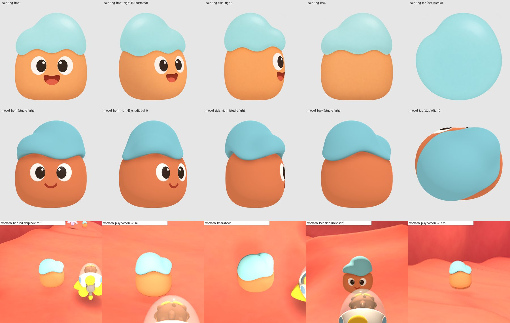

# W2-02 い（胃）の かべの さいぼう（wallcell）3D 化の結果

| 項目 | 内容 |
|------|------|
| 対象 | `wallcell`（い（胃）の かべの さいぼう。い（胃）の ステージの なかま。動かない。さわると おうえん。ふつうは 3 つ） |
| 作った日 | 2026-11-25（作業 約 50 分。測る・形を 合わせる 25 分、色を ゲームの 光で 合わせる 15 分、確かめ 10 分）。同じ 日に 見なおしを うけて 直した（約 60 分。7 章）。2 回目（い（胃）の 光・絵の 色・うれしい 口・ゆかに すわる 底）は 9 章 |
| もとの絵 | `art/w2-friends` の `art/concepts/W2_friends/`（`wallcell_3d_*`、`wallcell_faces.png`。点検は `W1W2_取り込みの結果.md` 3.3、決めは 5 章 13・7 章 8） |
| 作りかた | `blender/wallcell.py`（形は ぜんぶ 式。作りの 道具は `blender/pod.py` と 共通。`python -m blender.characters wallcell` で 作りなおせる。2 回 作って 同じ GLB（md5 一致）に なる ことを 確かめた） |
| 出力 | `godot/assets/models/characters/wallcell.glb`（402 KB、16,572 三角形、マテリアル 8、テクスチャなし。ノードは 本体 `wallcell` と その子 `MouthHappy`）。`wallcell.glb.import` の LOD は 切った。外形 幅 0.99 × 高さ 1.21 × 奥行き 0.84 m |
| 変えなかった 約束 | GLB の 名前、`BUILDERS["wallcell"]`、前 ＝ +Y、`friend.gd` の CONFIG（radius 0.9、static）。名前で さがされる 部品は `MouthHappy`（2 回目で 足した。ゲームは おうえん される まで かくす。9 章） |
| ゲームの コードで 変えた 所 | `godot/src/ui/card.gd`：ものしりカードの 3D の 絵で、形の 上下の まん中を わくの まん中に する 1 行（原点を 底の 近くに うつした ので、そのままだと 下が 切れた。まん中に 原点が ある ほかの モデルは ほぼ 変わらない） |
| 絵との 見くらべ | `docs/screenshots/W2_wallcell_compare.jpg`（上 ＝ 絵、中 ＝ モデル（スタジオの 光）、下 ＝ い（胃）の 中で ゲームの カメラから）。色は `docs/screenshots/W2_wallcell_colour.jpg`（絵・カード・い（胃）の 中の アップ） |
| ゲームの 中 | `docs/screenshots/W2_wallcell_game.jpg`（2 回目：近い・おうえん 前・中くらい・遠い・顔の アップ（うれしい 口／線の 笑顔）・ゆかとの さかい（平ら・坂 16°）・坂の 上・カード・タイル） |



## 0. 部品の 表

寸法は ゲームでの m（絵の 座標で 作って 0.75 倍 した あと）。原点は 底から 0.97 m 上（`friend.gd` が なかまを ゆかから 1.17 m に 置くので、底は ゆかから 約 0.19 m。ゆれ ±0.15 で 0.04〜0.34 m）。前 ＝ +Y、上 ＝ +Z、本人の 右 ＝ +X（正面の 絵では 左）。位置は 原点から。`blender/wallcell.py` の 数は 絵の 座標（ゆか z 0、てっぺん z 1.6）で、`OZ ＝ 0.97 / 0.75` を 引いて `SCALE ＝ 0.75` を かけると この 表の 数に なる。

| 部品 | 形 | 寸法（m） | 位置 | 色（sRGB） | 材質 |
|------|----|----------|------|-----------|------|
| 体 | 角の 丸い 箱（超だ円体 (( \|x/a\|^m + \|y/b\|^m )^(n/m) + \|z/c\|^n = 1、m 2.2・n 2.7） | 半幅 a 0.497、半奥行き b 0.413、上下 c：下 0.405・上 0.435（上は ねんえきの 中） | 中心 (0, 0, -0.58)。底 z -0.985 | `#F3A161`（2 回目。前は `#E27C4E`） | つやなし（roughness 0.85） |
| ねんえき | 1 つの かたまり（下の 3 つを なめらかに つないで、下の ふちを 波で 切った 面。陰関数を まん中から 外へ 線で たどって 面に した） | 全体 幅 約 0.99・奥行き 約 0.84・高さ 約 0.55（てっぺん z +0.226） | 下の 行 | `#ADE0E0`（2 回目。前は `#80C2CC`） | 半つや（0.8）・不透明 |
| 　└ 土台 | 体を 3.75 cm（絵の 座標で 5 cm）ふくらませた 面 | — | 体と 同じ | | |
| 　└ 高い こぶ | だ円体 | 半径 0.379 × 0.348 × 0.371 | (-0.075, -0.068, -0.145)＝本人の 左うしろ | | |
| 　└ 低い こぶ | だ円体 | 半径 0.266 × 0.234 × 0.217 | (+0.203, +0.188, -0.182)＝右まえ | | |
| 　└ つなぎ・ふち | なめらかな 和（k 0.15／0.11）、ふちの 丸み 0.105 | 下の ふち z ＝ -0.286 − 0.0225·cos 2φ − 0.0525·cos 3(φ − 1.85) − 0.015·cos(φ − 2.6)（φ ＝ 0 が 本人の 右。大きな 波 3 つ：たれは 顔の まん中の 少し 左・左うしろ・右うしろ。左まえの たれが いちばん 深い） | | | |
| 白目 ×2 | 体の 前の 面に はった うすい ふくらみ（高さ 0.75 cm、ふちは 体に もぐる） | だ円 半径 0.106 × 0.126 | 中心 (±0.185, 前の 面, -0.493) | `#FCF3EC` | つやなし（0.9） |
| 黒目 ×2 | 同じ（白目の 上に 0.5 cm） | だ円 半径 0.068 × 0.085 | 白目の 中心から 内がわ（はなの ほう）へ 0.039、下へ 0.004 | `#35251C` | 半つや（0.45） |
| 光の 点 ×2 | 同じ（黒目の 上に 0.3 cm） | 円 半径 0.0165 | 黒目の 中心から 内がわへ 0.029・上へ 0.042（両目で 鏡） | `#FCF3EC` | 半つや（0.5） |
| 口 | 円弧の 線の ふくらみ（線の 笑顔。高さ 0.45 cm、はしは 丸い） | はしまで 横 0.075、線の 太さ 0.029 | はし z -0.659、いちばん 下 z -0.700 | `#A93824` | つやなし（0.9） |
| うれしい 口（別の ノード `MouthHappy`。2 回目） | 口の 中：上が ゆるい 弓・下が 丸い U の ふくらみ（高さ 約 1 cm）。舌：下 半分、上の ふちが 山なり（口の 上に 0.2 cm） | 半幅 0.113、上の ふち z -0.62、いちばん 下 z -0.76。舌の 上 z -0.68 | 線の 笑顔と 同じ まん中 | 口の 中 `#962C1B`、舌 `#E55E45` | つやなし（0.9／0.8） |

- 三角形：体 4,200、ねんえき 8,960（ふちの まわり 下 40°〜下 6° だけ 細かく 切った）、顔 2,048。合計 15,208。366 KB。2 回 作って 同じ GLB（md5 一致）。
- ねんえきの ふちの 下の うすい 影は 頂点カラー（`COLOR_0`）に 焼いて ある（`bake_soft_shadow`、ねんえきと 体の あいだ）。顔には 焼かない。
- glTF の 1 つ目の マテリアルに 頂点カラーが 使われない 件（pod の 記録 7 章）は、影の 要らない 光の 点を 1 つ目に して よけた（mushiba と 同じ）。
- 全体の 外形（GLB の 頂点から）：幅 0.99 × 高さ 1.21 × 奥行き 0.84 m（顔の ふくらみ こみ）。z は -0.985〜+0.226。

## 1. 使った絵

| 絵 | 何を 読んだか | 注意 |
|----|--------------|------|
| `wallcell_3d_front.png` | 体の 幅（高さ 0.1 m ごと）、ねんえきの 外形と 下の ふちの 高さ（4 cm ごと）、目の 位置と 大きさ、色 | 縮尺の 基準（外形の 高さ 1091 px ＝ 1.6 m、1.466 mm/px） |
| `wallcell_3d_side_right.png` | 体の 奥行き、ねんえきの 前後（低い こぶが 前、高い 所が うしろ）、下の ふち | 自分の 高さで m に 直した（1028 px、1.556 mm/px） |
| `wallcell_3d_back.png` | 形の 確かめと 下の ふち（重みを 半分に して 合わせた） | こぶが 正面と 同じ 画像の 右に ある（鏡に なって いない）。取り込みの 決め どおり「本人の 左うしろ に 高い こぶ」で 作った。そのため うしろからは 絵と 左右が 逆 |
| `wallcell_3d_front_right45.png` | 体の よこの 丸み（45° で 半幅 0.62 → 体の 横の 断面は ほぼ だ円、m 2.2） | 左右が 逆の 絵。反転して 形の 確かめだけ |
| `wallcell_3d_top.png` | 使わなかった（縮尺が 合わない、低い こぶが 画像の 左上） | 決めの 形（低い こぶ ＝ 右まえ）では 真上から 画像の 右上に 出る |
| `wallcell_faces.png` | 「通常」の 顔：線の 笑顔の 幅・太さ・反り、口の 色 | 3D 用の 絵は 開いた 口。決め どおり「通常」で 作った |

## 2. 寸法の 決めかた

- 体：正面と 真横の 外形の 幅を 高さ 0.1〜0.8 m で はかり、超だ円体の 式（a、b、zc、c、n）を 最小二乗で 合わせた。残りの ずれは どの 高さでも 1.1 cm 以下（正面の 幅：絵 0.538／0.612／0.645／0.657／0.661／0.657／0.646／0.622、式 0.527／0.604／0.642／0.658／0.662／0.661／0.652／0.626）。
- ねんえき：陰関数の 形を 絵の 外形（全体）と ねんえきの 色の 所に 合わせた（正面・真横・背面へ 投影して 重なり（IoU）を くらべ、ランダムに 少しずつ 動かして よく なる 方を とる。作業の スクリプトは リポジトリに 入れて いない）。重なりは 高さ 0.6 m より 上で 正面 0.98（ねんえきの 色の 所 0.91）、真横 0.98（0.92）、背面 0.88（0.76。背面の 絵は こぶの 向きが 正面と 同じなので 低い）。
- 下の ふちの 波：はかった ふちは 正面で たれが 左右の はし・まん中、山が ±0.27 m（山と たれの 差 約 0.1 m）。合わせの 計算は 波を 小さく したがった（波の 位置が 向きごとに そろって いない ため）が、絵の 大事な 形なので 波の 大きさは 絵の とおり 0.045（山と たれの 差 0.09 m）に した。
- 大きさ：はじめは spec の「高さ 1.6」で 作った（幅と 奥行きは spec（1.15・0.8）では なく 絵の 比（1.32・1.11）。取り込みの 決め どおり）。見なおしで 0.75 倍（高さ 1.2、幅 0.99）に した（7 章）。形の 比は 絵の まま。当たり判定（`friend.gd` の radius 0.9、さわる 範囲 1.4）は 変えて いない。体の 半幅 0.50 は 0.9 の 内がわ。
- ねんえきの 土台の ふくらみと 下の ふちの 波は 見なおしで 変えた（7 章）。上の 重なりの 数は はじめの 形（ふくらみ 9.3 cm、たれ 8 つ）で はかった もの。

## 3. 色（ゲームの 光に 合わせた）

- 絵の 平らな 所の 中央値は 体 `#F6A361`（上 `#F9A764`〜下 `#EF9A5B`）、ねんえき `#ADE1E1`、白目 `#FCF3EC`、黒目 `#35251C`、表情シートの 口の 線 `#A93824`。
- い（胃）の 場所は キャラクターに 当たる 光が 強い（たいようが カメラの がわ（下向き 32°）から 当たる、まわりの 光 0.55、ミクロごうの ライト、トーンマップ linear。面には light_gain 0.6 が かかるが キャラクターには かからない）。測ると 光の 当たる がわで 色の 緑が 約 1.45 倍、青が 約 1.3 倍、赤は 255 で 止まる。
- ためした 色（うしろから、光の 当たる 面）：絵の 色 `#F6A361` → (255, 232, 129) 黄色に とぶ。`#E0945A`（見なおしの 案の まん中の 色）→ (255, 215, 114) まだ 黄色。はじめの `#CC8650` → (255, 193, 105) だが、カード・ずかんで どんぐりの ような 暗い 茶色。
- **いまの 色：体 `#E27C4E`**（明るさは 落とさず、緑と 青を へらした 赤い オレンジ）。ゲームの カメラから 見た 光の 当たる 面は (255, 174, 104) で 絵の 色 (246, 163, 97) に 近い。カード・ずかん・スタジオの 光では 絵より 赤い オレンジ（テラコッタ）に 見えるが、茶色には 見えない。
- **ねんえき `#80C2CC`**（つや 0.8）。ゲームでは うすい 水色 (224, 255, 255)、てっぺんは 白っぽく 光る。カードでは 絵より こい 水色。
- 顔の がわは ゲームでは かげに なる ので 暗い 赤茶（光の 向きの せい。モデルでは 直せない）。
- ねんえきは spec の「半透明」に しなかった。絵は 不透明に 見え、半透明だと 体の 上の 面が すけて 見え、Godot の 並べかえの みだれも 出る。
- 絵の 色の まま ゲームでも 正しく 見せる なら、い（胃）の 光を 変える ほうが よい（キャラクターに 当たる たいようを 弱め、面の light_gain を 上げて 面の 明るさを たもつ。ミクロごう・ピロリきんにも 効くので、ここでは しなかった。8 章）。

## 4. 絵との ちがい（残したもの。目立つ 順）

1. **色**（3 章）。スタジオの 光・カードでは 体が 絵より 赤い オレンジ、ねんえきが こい 水色。ゲームの 中の うしろ姿は 絵に 近い。
2. **大きさ**。絵と spec は 高さ 1.6 m。ゲームでは 船が 見えなく ならない ように 0.75 倍（7 章）。
3. **ねんえきの たれ**。モデルは まわりに 大きな 波 3 つ（深さは 向きで ちがう）。絵は 正面から 2 つ くらいの 波が 見え、たれの 位置が 向きごとに ちがう（背面・真横と 合わない）ので、ぴったりは 合わせて いない。
4. **高い こぶの 形**。絵の こぶは 少し とがって 画像の 右へ かたむく（正面）。モデルは 丸い。正面で 低い こぶの 肩が 絵より 少し 高く 広い。
5. **うしろ（背面）の こぶ**。背面の 絵は 画像の 右に こぶ（正面と 同じ がわ）。モデルは 決め どおり 左うしろ なので、うしろから 見ると 画像の 左に こぶが ある。
6. **真横の ふち**。真横では うしろがわの ふちが 体から 少し 出て 見える（高い こぶが うしろに ある ため）。正面・背面では ふちは 体と ほぼ 同じ 幅。
7. **口**は「通常」の 線の 笑顔（3D 用の 絵は 開いた 口と 舌）。ほおの 赤みは 絵にも ない。ねんえきの 白い つやの 点は 作らない（光で 出る）。
8. **真上**：絵は 縮尺も こぶの 向きも 合わない。モデルは 真上から 見ると こぶの ある 左うしろへ かたより、体の 前（目の 上の はし）と 右の ふくらみが ねんえきの まわりに 少し 見える（見なおしの「nice」。直して いない。7 章）。

## 5. ゲームの 中で 見た こと（見なおしの あと）

撮った 絵（PNG）は 作業フォルダ `$SP/s/wc/r2/`（`sv/` ＝ `godot/tests/stage_view.tscn`、`game/` ＝ `tools/screenshot.sh ep02:2 … --play=8〜22`、`cards/`）。まとめは `docs/screenshots/W2_wallcell_game.jpg`。

- **うしろ・上から（子どもが ふつう 見る 向き）**：オレンジの 体に うすい 水色の ぼうし、ぼうしの ふちは 大きな 波。ふちは 体と ほぼ 同じ 幅で、前の 8 つの たれの「アイシング」らしさは へった。顔は 見えない（8 章）。い（胃）の かべ（赤）・ゆか（サーモン）・いえきの いけ（こい 琥珀）の どれとも ちがう 色で、ピロリきん（うす紫の らせん）とも まちがえない。17 m 先でも「水色の ぼうしの オレンジ」と 分かる。光る 黄色（ゴール）には 見えない。上から 見ると 水色の まるい かたまりに オレンジの ふち。
- **大きさ**：船（1.4 m）と ほぼ 同じ 高さ（1.2 m）。船の となりで 小さすぎない。
- **おうえん**：2 話の い（胃）の 場面を 自動操縦で 進めた（`--play` 12.5〜17 秒）。船が さいぼうに さわる とき、さいぼうが 船の うしろ・下に かくれ、船は いつも 見える（前は 船が さいぼうの 中に 消えた）。体が 1.3 倍に ふくらんで もどり、ハートが 出る。ふくらむ 0.3 秒の あいだ、底が ゆかに 少し もぐる ことが ある（原点が 上に ある ため。めだたない）。
- **ゆかとの あいだ**：底は ゆかから 0.04〜0.34 m（前は 0.2〜0.6 m）。ゆかに めりこまない。たいようの かげは うすく うしろに おちる（ピロリきんの ような 足もとの まるい かげは 無い。8 章）。
- **ものしりカード**：`card:stomach:wallcell`・`cards:stomach`・`zukan` で 3D の 絵が 出る。原点を うつした ので `card.gd` で 上下を まん中に した（下が 切れない）。むしばきんの カードも 撮って くずれて いない ことを 見た。

## 6. 確かめかた

```bash
<venv>/bin/python -m blender.characters wallcell
tools/pod_views.sh /tmp/w/ wallcell                    # 正面・背面・真横・ななめ・真上・ゲームの カメラ
python3 tools/pod_compare.py <絵の フォルダ> /tmp/w/ /tmp/w_compare.png wallcell   # 4 方向（真上は 入らない）
tools/screenshot.sh ep02:2 /tmp/ep02.png --play=7       # 2 話の い（胃）の 場面
xvfb-run … godot --path godot res://tests/stage_view.tscn -- --stage=stomach --out=/tmp/v/ --still \
  "--views=near:@-23.6,-13.2,-12;mid:@-23,-19,0;far:@-20,-26,-10;scale:@-23.4,-9.3,0;above:-25,-14,10>-25,-9,3@45;facing:@-25.3,-5.2,178"
tools/screenshot.sh "card:stomach:wallcell,cards:stomach,zukan" /tmp/cards/
LOG=/tmp/t.log tools/run_tests.sh --stage=stomach      # と --episode=ep02、--episode=ep03
```

- テスト（見なおしの あと）：ぜんぶの テスト `tools/run_tests.sh`（`--stage=stomach`・`--episode=ep02`・`--episode=ep03` を ふくむ）で `PROBE RESULT: OK`・`RESULT: OK`・`DASHBOARD: OK`、`SCRIPT ERROR` 0。ep02 の い（胃）の 場面（おうえん 3 つの ミッションを ふくむ）を 自動操縦で クリア。
- 見て いない もの：ブラウザ版（撮影は 同じ OpenGL の レンダラー）。
- 見くらべの 正投影（`pod_views.sh`）は 原点の まわりを 撮るので、見くらべの 絵だけ 原点を まん中に した 写し（`W.OZ = 0.8`）で 撮った（形・色は 同じ）。

## 7. 見なおしで 直した こと（2026-11-25）

| 見なおしの 指摘 | どう したか |
|----------------|-------------|
| must：おうえんの とき 船が 1.6 m の さいぼうの 中に 消える | モデルを 0.75 倍（高さ 1.2、半幅 0.50）に した（`SCALE`）。船は いつも 見える（`game/ep02_2_t13.5〜17`）。当たる 体（StaticBody）を `friend.gd` に 足す 案は ゲームの コードなので しなかった（8 章） |
| should：うしろから カップケーキに 見える（8 つの たれ、ふちが 体より 出る） | たれ 8 → 大きな 波 3 つ（`wn` 3、深さ 0.07、向きで ちがう ゆがみ `wa2`）。土台の ふくらみ 0.093 → 0.05（ふちは 体の 幅）。横の ふちを 少し 下げた（`zl2` -0.03）。顔を みちの 入口へ 向ける 件は できなかった（下） |
| should：カード・ずかんで 暗い 茶色 | 体 `#CC8650` → `#E27C4E`、ねんえき `#7CBAC6` → `#80C2CC`（3 章）。案の まん中の 色 `#E0945A` は うしろが 黄色に なった ので 使わなかった。場所の 光を 変える 案は ミクロごう・ピロリきんにも 効くので しなかった |
| should：かげが なく、0.2〜0.6 m 浮く | 原点を 底から 0.97 m 上に（絵の 座標で OZ 1.29）。底は ゆかから 0.04〜0.34 m。カードの 絵は `card.gd` で 上下を まん中に した。足もとの かげは ゲームの コード（8 章） |
| nice：真上で 体が ぼうしから 出る | 直して いない。ふちを 体の いちばん 広い 所（z 0.5）まで かぶせると 正面の ふちが 下がって 顔に かかり、土台を ふくらませると ふちが 体より 出る（上の should と ぶつかる）。プレイの カメラから は 目立たない |

- 顔を みちの 入口へ 向ける：`level.gd` は マーカーの 向きを 読まない（位置だけ）ので、`blender/stage_stomach.py` の `MK_friend_wallcell_*` を まわしても 変わらない。前 ＝ +Y は 約束なので モデルでも まわせない。`friend.gd` の 変更が 要る（8 章）。

## 8. リードへ（ゲームの コードの 案。この ブランチでは して いない）

1. **おうえんで 船が とまる 体**：`friend.gd` の `_ready()` で `move_kind == "static"` の とき `StaticBody3D`（球 半径 0.5、collision_layer は 船が ぶつかる 層）を 足す。さわる 範囲（半径 1.4）は その 外なので おうえんは 先に 起きる。
2. **顔を みちの 入口へ**：`friend.gd` の `_ready()` で static の とき `model.rotation.y = HoverBody.yaw_for(((level.spawn_point - global_position) * Vector3(1, 0, 1)).normalized())`（または `level.gd` が マーカーの 向きを `f.rotation` に わたす）。
3. **足もとの かげ**：static の なかまにも てきと 同じ まるい かげを つける（または ゆれを 止める）。
4. **い（胃）の キャラクターの 光**：たいようを 0.75 → 0.5、面の `light_gain` 0.6 → 0.9（面の 明るさは 同じ）に すれば、絵の 色の まま 作れる。ミクロごう・ピロリきん・かべの さいぼうの 色を 合わせなおす 必要が ある。

## 9. 2 回目（2026-11-25）：い（胃）の 光、絵の 色、うれしい 口、ゆかに すわる 底

リードの 見なおしの 指摘（光が 強すぎて 色を ずらして いた、顔が 見えない、宙に うく、カードが テラコッタ）に こたえた。顔を 船へ 向ける・ゆかに すえる・カードの 向きは ゲームの コードの 係（別の 作業）。ここは 光（`stage_db.gd` の い（胃）の `"look"` だけ）と モデル。

### 9.1 い（胃）の キャラクターの 光

- 測りかた：色の わかって いる 球（`#F3A161` と 灰色 `#808080`、つや 0.85）を 船の 前 2.5／5／8 m に 置き、ゲームの カメラから 撮って 球の 画素 ÷ 色 を 出した（船の ライトあり／なし、船の 向き 4 つ。作業用の 一時的な シーン。コミットしない）。光の 当たる がわ ＝ 球の 明るい 方から 3 %、かげ ＝ 暗い 方から 3 % の 画素。
- わかった こと：この 描画方式では、まわりの 光・たいよう・船の ライトが 別々の 回で 画面の 色（sRGB）の まま 足される。だから 弱い たいようでも 明るさが 大きく ふえる（たいよう 0.05 で 色の 約 0.22 倍 ぶん）。面の シェーダーは "fill" の 光にも light_gain を かける（`stage_clay.gdshader` の `light()` は 向きの ある 光 すべてに light_gain）。
- 前（たいよう 0.75、まわり 0.55 の `#FFE8D5`、fill 0.4）：灰色の 球で 光の 当たる がわ 1.66／1.51／1.37 倍（ライトなし）、2.5 m で ライトこみ 1.85／1.70／1.55 倍。かげ 0.77／0.68／0.62 倍（青が 足りない）。体の 色 `#F0A262` の 球は うすい 黄色に とんだ（赤は 255 で 止まる）。
- いま：たいよう 0.035、まわりの 光 0.54（色 (0.97, 1.0, 1.06)。たいようの 黄みを うちけす）、light_gain 0.45 / 0.035、lamp_gain と fill_energy は 0.24 × 0.035 / 0.45。体の 色 `#F3A161` の 球（赤・緑・青 の 倍率）：

| 船の 向き | 距離 | 光の 当たる がわ（ライトこみ） | ライトなし | かげ（ライトなし） |
|----------|------|------------------------------|-----------|------------------|
| たいようを 背に（0°） | 2.5 m | 1.05／1.11／1.08 | 0.94／0.92／0.90 | 0.86／0.84／0.82 |
| 同 | 5 m | 1.05／1.02／1.01 | 0.94／0.92／0.90 | 0.86／0.84／0.84 |
| 同 | 8 m | 1.00／0.97／0.95 | 0.94／0.92／0.90 | 0.84／0.83／0.81 |
| 横から（270°） | 2.5 m | 1.05／1.09／1.06 | 0.94／0.91／0.90 | 0.74／0.75／0.79 |
| たいようへ 向かって（180°） | 2.5 m | 0.92／0.93／0.95 | 0.81／0.80／0.79 | 0.74／0.75／0.79 |

  光の 当たる がわは 0.95〜1.11（船の ライトが 2.5 m で 約 +0.1〜0.2、5 m で +0.1、8 m で +0.05）。かげは 0.74 より 下に ならない。
- 面（ゆか・かべ・わ・いけ・きり）は 前と 同じ：たいようの 強さ × light_gain ＝ 0.45、ライト × light_gain × lamp_gain と fill × light_gain ＝ 0.24 を たもった。同じ 4 つの カメラ（スタート・いけの そば・わ・高い 所）で 撮った 前と あとの 17 の 場所の 平均の 色の ちがいは 最大 1.5 %（キャラクターが 入る ゆかの 遠くの 1 か所。ほかは 0.3 % 以下）。
- ミクロごう：船体は 前の まっ白（255, 255, 255）から 明るい 白（216, 209, 206）に、ひれは レモン色に とんだ (255, 255, 73) から 黄色 (229, 178, 42)（色は `#FCC738`）。光る 黄色に 見えなく なった。「光る 黄色は ゴールだけ」の テスト（`_check_pools`）は 通る。
- ハートの アイテムも 白から ピンクに 見える ように なった（もとの 色）。ピロリきんは 前より こい 紫に 見える（色の 決めなおしは ピロリきんの 係）。

### 9.2 色を 絵に もどした

- 絵の 平らな 所の 中央値（2 回目に 測りなおし）：体 正面 `#F6A260`・背面 `#F3A161`・真横 `#F7A05C`、ねんえき 正面 `#B0E3E3`・背面 `#B2E1E0`・真横 `#A8DFDE`。
- モデル：体 `#E27C4E` → **`#F3A161`**、ねんえき `#80C2CC` → **`#ADE0E0`**。
- い（胃）の 中（ゲームの カメラ、顔の がわ、ミクロごうの ライトこみ）：体 `#E59254`〜`#DD8E53`（絵の 0.91〜0.94 倍。明るい 所 `#F59D5C`）、ねんえき `#B2E6E7`〜`#A8DBDE`（0.97〜1.03 倍）。10 m 先：体 `#D48850`、ねんえき `#9ECFD5`。たいようへ 向かって 見る ときは 体 0.78 倍・ねんえき 0.83 倍（かげの がわ）。
- カード（いまの カードの 光）：体 `#D28B58`（0.86 倍）、ねんえき `#98C5D0`（0.88 倍）。テラコッタ・こい 水色では なく、絵に 近い うすい オレンジと うすい 水色。カードは まだ 回るので この 撮影では うしろ姿（向きは カードの コードの 係）。
- （あとから）カードの こまは、顔の まわりで ゆれる いまの カードで 撮りなおした（体 `#DF9359`、ねんえき `#ACDEDE`）。カードの 光は 10 章で 前から 当てる ように 直した（`card.gd` の `add_picture_light()`）。
- 体の 下を 向いた 面を 少し 暗く した（`bake_soft_shadow` の `ground` 0.1。ゆかに つく 所が 少し 暗く、すわって 見える）。

### 9.3 うれしい 口（`MouthHappy`）

- 3D 用の 絵の 開いた 口：口の 中 `#962C1B`、舌 `#E55E45`（絵で 測った 値と 同じ）。正面の 絵で 測った 形（幅 u −0.168〜+0.130、高さ z 0.278〜0.463、絵の 座標）を、線の 笑顔と 同じ まん中に 置いた（絵は 2 cm 本人の 左へ よる）。
- 本体とは 別の ノード `MouthHappy`（本体 `wallcell` の 子、原点は 同じ）。口の 中は 線の 笑顔より 高く ふくらませた（線の 笑顔 0.45 cm、うれしい 口 1 cm。線の 笑顔の はしの 所でも 0.8 cm）。線の 笑顔は 口の 外形の 内がわに すっぽり 入る（線の 笑顔の はし u ±0.12、高さ 0.395〜0.435 で、口の 幅は ±0.14 以上）。
- GLB だけを 見せる 道具（カード・ずかん・`pod_views`）では 両方 見えるので うれしい 口が 出る。正面・ななめ 45°・真横・ゲームの カメラの アップで 線の 笑顔が はみ出して いない ことを 見た（`W2_wallcell_compare.jpg`、`W2_wallcell_game.jpg` の 「close-up」）。`MouthHappy` を かくすと 線の 笑顔だけ（「before the cheer」）。
- 三角形 1,364 ふえた（合計 16,572、402 KB）。

### 9.4 ゆかに すわる 底

- ゲームは いちばん 下を ゆかの 0.05 m 下に 置き、ゆらさない ように なる（ゲームの コードの 係）。モデルの 底は 絵と 同じ 角の 丸い 平らな 底の まま（5 cm しずめると 底の 平らな 所の 大部分が ゆかに うまる。うすい ふちや 浮いた ふちは 無い）。
- 原点は 底から 0.97 m 上の まま（ゲームは 外形の 箱で 置くので 原点は もう 関係ない。いまの ゲームの コードの まま でも 底が ゆかに 近い）。
- 確かめ：作業用の シーンで 3 つの さいぼうと 坂（16°）の 上の 1 つを その 置きかた（いちばん 下を ゆかの 0.05 m 下、船の ほうへ 向ける）に して、ゲームの カメラと アップで 撮った。平らな ゆかでも 坂でも 底は ゆかに 入り、すきまや 線は 見えない（`W2_wallcell_game.jpg` の 「base on flat floor」「base on a 16 deg slope」「on the 16 deg slope」）。坂では 下がわが 少し 多く うまる（めだたない）。

### 9.5 変えなかった もの

- 大きさ 0.75 倍（高さ 1.21 m）、下の ふちの 大きな 波 3 つ、高い こぶは 本人の 左うしろ。形の 式は 1 回目の まま。
- 2 回 作って 同じ GLB（md5 `408c94d9dd7906597b05e86783ef1222`）。
- テスト：`--stage=stomach`、`--episode=ep02`、`--episode=ep03` で `PROBE RESULT: OK`・`RESULT: OK`・`DASHBOARD: OK`、`SCRIPT ERROR` 0。
- 見て いない もの：ブラウザ版。ゲームの コードの 変更（顔を 船へ・ゆかに すえる・おうえんで うれしい 口・カードの 向き）と あわせた 本物の 画面（まとめる 係が 撮る）。

## 10. 3 回目（カードの 光。見なおしの 指摘）

見なおしで「ものしりカード（大きい カード・ずかん・「みつけた ものしりカード」の タイル）では 体が 絵の 約 0.85 倍で、うすい あんず色で なく カラメル色、ねんえきは 少し 灰色がかった 水色」と 言われた。モデルの 色は 変えず（カードの 光は 全部の モデルで 共通）、`godot/src/ui/card.gd` の 光を 直した。

- わけ：カードの 光（`DirectionalLight3D`）が モデルの うしろから 当たって いて、こちらを 向いた 面は まわりの 光（0.9、少し 青い）だけで 照らされて いた。灰色 0.5 の 球で 測ると 正面が 0.89 倍、光が 当たるのは うしろの ふちだけ だった。
- 直した こと：光を 左上の 前（カメラの がわ）から 当てる（`PIC_SUN_DEG` (-40, 145, 0)、強さ `PIC_SUN` 0.36）、まわりの 光は 白で 0.73（`PIC_AMBIENT`・`PIC_AMBIENT_COLOR`）。光は `add_picture_light()` に まとめた（カード・しらせ・タイル・ずかんで 共通）。
- 測った 結果（カードと 同じ カメラ・光で 撮った 球。光の 当たる がわ ＝ 明るい 25% の 中央値）：灰色 0.5 は 1.04 倍（前は 正面 0.89 倍）、かげの がわ 0.88 倍。絵の 色の 球（`#F6A260`）は 1.03〜1.05 倍。
- かべの さいぼうの カード（`card:stomach:wallcell`）：体 中央値 `#E0945A`（絵 `#F6A260` の 0.91〜0.94 倍。前は `#D28A58`、0.85 倍）、光の 当たる がわ `#ED9E61`（0.96〜1.01 倍）。ねんえき 中央値 `#A7D7D7`（0.95 倍。前は `#99C6D1`）、光の 当たる がわ `#B3E7E7`（絵 `#B0E3E3` の 1.02 倍）。中央値が 1.0 より 少し 低いのは 体の 下の かげ（頂点カラーに 焼いた 影）の 分。
- ほかの モデル：全部の キャラクター（20 体）の カードの 絵を 前と あとで ならべて 見た。白く とぶ ものは ない（ミクロごうの 白い 船体の 明るい 5% は 225、前 213。しろい けっきゅう（wbc）は 色が 0.98 の ほぼ 白なので 明るい がわが 白に なる。前も 明るい 5% は 255）。顔の 向きと 形の かげが 前より 分かる。
