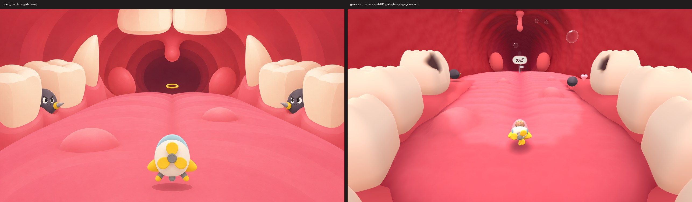

# W3-01 からだのぶたい：口（mouth）取り込みの結果

| 項目 | 内容 |
|------|------|
| 納品ブランチ | `art/w3-stages`（`2c8a3db`「art: W3-01 stages (1)」。`main` の `9292cee` から 分かれた） |
| 納品日 | 2026-11-24（順 1：口だけ。発注書 `W3_01_からだのぶたい.md` の 1・2・2.6 章） |
| 確認日 | 2026-11-24。点検は 全 9 ファイル（PNG 8、spec.md）。数は ぜんぶ 画像から 測った |
| 結果 | 描き直しが 必須の ものは 0。表面の 画像 2 枚は そのまま 使える。部品の 三面図は 縮尺が そろって おらず、真上の 絵は 使えない（正面と 真横と spec の 表で 作った） |
| main に取り込んだもの | `spec.md`（`art/concepts/W3_stages/spec.md`）、表面の 画像 2 枚（`godot/assets/textures/stages/tex_mouth_floor.png`・`tex_mouth_wall.png`。仮の 画像を 同じ 名前で 上書き）、`sign_board.png`（`godot/assets/ui/sign_board.png`。かんばんの 板） |
| ブランチに残したもの | `mood_mouth.png`、`parts_mouth_front.png`・`_side.png`・`_top.png`・`_assembled.png`（見るときは `git worktree add ../ibs-w3 origin/art/w3-stages`） |
| ゲームに 入れた 結果 | `blender/stage_mouth.py`（形）、`godot/src/autoload/stage_db.gd` の 口の `"look"`（色と 光）、`godot/src/level/level.gd` の `_spawn_sign()`（かんばんの 板） |
| 絵との 見くらべ | `docs/screenshots/W3_01_mouth_compare.jpg`（左 ＝ 雰囲気画、右 ＝ ゲームの スタートの カメラ。HUD なし） |



## 1. 結論

| 納品物 | 使えるか | 使いかた | 直してもらうもの（どれも 任意） |
|-------|---------|---------|------------------------------|
| `tex_mouth_floor.png`・`tex_mouth_wall.png` | そのまま 使える | 仮の 画像と 入れかえた（4 m 四方で くり返す） | なし |
| `mood_mouth.png` | 色と 光の 手本に 使える | 色を 測って `"look"` に 入れ、ゲームの 画面と 数で くらべた（4 章） | 歯の ならびの 順（6 章。ユーザーが 決める 点） |
| `parts_mouth_front.png`・`_side.png` | 形の 手本に 使える | 形を 読んで 式で 作った。大きさは spec の 表 | 縮尺を そろえた 版（任意） |
| `parts_mouth_top.png` | 使えない | 使って いない | 本当の 真上（任意） |
| `parts_mouth_assembled.png` | 組みかたの 参考 | のどちんこの つけ根、へんとうせんの 位置 | なし |
| `sign_board.png` | そのまま 使える | 全部の 場所の かんばんの 板に した（5 章） | なし |
| `spec.md` | 使える | 色と 大きさの 正本 | 色見本の 追記（文章だけ） |

- 必須の 描き直しは 0。直してほしい ものは 3 件で、どれも 作業を 止めない（6 章）。
- ユーザーに 決めて ほしい 点は 7 個（7 章）。全部に おすすめを 書いた。

## 2. 受け取ったもの

| ファイル | 大きさ | 形式 | 発注 |
|---------|-------|------|------|
| `mood_mouth.png` | 2048×1152（16:9） | RGB | 1920×1080 以上、16:9 → 合う |
| `tex_mouth_floor.png`・`tex_mouth_wall.png` | 2048×2048 | RGB | 2048×2048 → 合う |
| `parts_mouth_front/_side/_top/_assembled.png` | 2048×2048 | RGBA（透過） | 合う。番号は 下の 余白（1〜6） |
| `sign_board.png` | 2048×2048 | RGBA（透過） | 合う。文字なし |
| `spec.md` | 69 行 | | 冒頭に「納品した順：1」、色見本 8 行、部品の 表 6 行 → 合う |

発注書の ファイルは 8 枚とも ある（不足 0）。文字・署名・ロゴは 無い（三面図の 番号だけ）。こわい 表現は 無い（のどは 暗い 赤で、黒い 穴に なって いない）。

## 3. 点検の 結果

### 3.1 表面の 画像（2 枚）

| 点検 | `tex_mouth_floor.png` | `tex_mouth_wall.png` | 判定 |
|------|----------------------|---------------------|------|
| 中央値（spec の hex） | `#F9949E`（spec `#F9949E`、差 0） | `#EA6571`（spec `#E96571`、差 R +1） | 合う |
| 左右の つなぎ目（右はしの 列と 左はしの 列の 差の 平均） | 0.00 | 0.00 | 合う（下の 注） |
| 上下の つなぎ目 | 0.00 | 0.00 | 合う |
| 中の となりあう 列どうしの 差の 平均（くらべる 値） | 0.34 | 0.38 | |
| つなぎ目の そばの こまかさ（はしから 6 列の 差） | 0.05〜0.54 | 0.19〜1.12 | 中と 同じ（0.07〜0.65）。ぼかした 帯は 無い |
| 2×2 に ならべた 絵 | 目で 見て つなぎ目 なし | 目で 見て つなぎ目 なし | 合う |
| 光の かたより（左半分−右半分、上半分−下半分 の 明るさ） | −0.09、−0.19 | −0.20、−0.29 | 合う（焼きこんだ 光・影は 無い） |
| 8×8 に 分けた 明るさの はば | 184.1〜186.4 | 143.7〜153.8 | ゆか は ほぼ 平ら、かべは ゆるい ななめの すじ |
| 明るさの 1〜99% | 182.7〜188.3 | 142.3〜155.3 | 手で ぬった むらは とても 弱い |
| 中身の こまかさ（1/4・1/8 に 縮めて もどした ときの 差） | 0.41・0.47 | 0.44・0.49 | 512 px で 中身は 全部 のこる |

- 右はしの 列と 左はしの 列が 同じ 色（差 0.00）：はしの 1 列を そろえて つないで ある。ならべると 同じ 色の 列が 2 本 となりあう だけで、目では 分からない。
- ゆかの 画像には うすい 弓形の すじ（よこ向き）が ある。かべの 画像には ななめの すじが ある。どちらも 4 m ごとに くり返すが、弱いので 目立たない（ゲームの 中の 画面で 確かめた）。
- 読みこむ 大きさ：`.import` の `process/size_limit` を 1024 → **512** に した（mipmaps あり、圧縮なし は そのまま）。上の 測りかたで 512 px に 縮めても 色の 差が 0.4（256 段階の）しか 出ないので、2048 の まま 読むのは メモリと ブラウザ版の 読みこみの むだ。画面では 1 m あたり 128 px に なり、ミクロごうの カメラから 見て たりる。

### 3.2 雰囲気画（`mood_mouth.png`）

通ったこと：

- 発注の 中身が ぜんぶ ある：舌の 上を 飛ぶ ミクロごうを 後ろ上から、左右に 歯、奥に のどちんこ と へんとうせん と のどの 穴、歯の あいだに むしばきん 2 体。
- 色の 決まり：舌は 明るい ピンク、かべは コーラル〜こい 赤、歯は クリーム色、のどは 暗い 赤（黒でない）。壁と ゆかに 黄色が 無い（黄色は ゴールの 輪だけ）。
- ミクロごうと むしばきんは W1・W2 の 納品の 形と 色。

測った 色（4 章で ゲームと くらべる）：

| 所 | 色 | 所 | 色 |
|----|----|----|----|
| 舌（手前） | `#F87180` | 舌（まん中・奥） | `#FA7785`・`#FC7A89` |
| 舌の ぶつぶつの 上 | `#FD8E96` | 舌の ふち | `#F66B7C` |
| かべ（手前の ほお） | `#BC333D`〜`#C2333E` | かべ（のどの わ。外 → 内） | `#BB323A` → `#A72A35` → `#8F2634` |
| のどの 穴 | `#681F2E`〜`#6E2030` | はぐき | `#EF656E`〜`#F87383` |
| 奥歯 | `#F8CCAE` | 前歯（上） | `#FCD7B9` |
| へんとうせん | `#EC565C` | のどちんこ | `#F35D65` |

spec の 色見本と くらべると、画面の かべは spec の かべ `#E96571` より ずっと こい（`#BC333D`）。spec の 値は 光を 当てる 前の 色、雰囲気画は 光と かげの あとの 色。ゲームは 雰囲気画の 色に 合わせた（4 章）。

残る 問題：

| 問題 | くわしく | 回避 |
|------|---------|------|
| ミクロごうが 大きい | 画面の 幅の **14.4%**（黄色い ひれの はしから はし、2048 px 中 295 px）。ゲームの スタートの カメラでは **7.0%**（1280 px 中 90 px）。差 2.05 倍 | カメラは 変えて いない（ほかの 作業で 直して いる）。ステージの 大きさは ゲームの カメラから 絵と 同じ 見えかたに なる ように 決めた（4.1） |
| 歯の ならびの 順 | 手前（ミクロごうの 横）に 奥歯、その 奥に 犬歯が 描いて ある。本当は 犬歯が 前（くちびる側）、奥歯が 奥（のど側） | ゲームは 体の 順の まま（前歯 → 犬歯 → 奥歯）。7 章 1 |
| 上の 前歯が 画面の 上に 見える | スタートの 位置から 上の 前歯が 見える のは、カメラが 前歯より 前（くちびる側）で、上を 見上げて いる とき だけ。ゲームの カメラ（下向き 19°、上は 水平から 15° まで）と スタート（舌の 上）では 見えない | 上の 歯ならびを 奥に ずらして 見せる 形を 試したが、天井から 入れ歯が ぶらさがった ように 見えた ので やめた。7 章 2 |
| 犬歯が 背の 高い 円すい | 奥歯より 高い（画面で 1.5 倍） | spec の 表の 高さ（犬歯 2.2 m、奥歯 2.4 m）で 作った |

### 3.3 部品の 三面図（`parts_mouth_front/_side/_top.png`）

外形（透過の ふち）を 測った 大きさ（px）と、spec の 表の 比：

| 番号 | 部品 | 正面 幅×高さ | 真横 奥行き×高さ | 真上 幅×奥行き | 正面の 幅÷高さ（spec） | 真横の 奥行き÷高さ（spec） | 真上の 幅÷奥行き（spec） |
|-----|------|------------|----------------|--------------|----------------------|------------------------|----------------------|
| 1 | 前歯 | 449×414 | 183×431 | 457×286 | 1.08（0.62） | 0.42（0.28） | 1.60（2.27） |
| 2 | 犬歯 | 228×540 | 181×536 | 243×401 | 0.42（0.41） | 0.34（0.39） | 0.61（1.06） |
| 3 | 奥歯 | 453×547 | 302×541 | 478×429 | 0.83（0.75） | 0.56（0.60） | 1.11（1.24） |
| 4 | 舌の ぶつぶつ | 335×125 | 305×130 | 254×264 | 2.68（1.75） | 2.35（1.75） | 0.96（1.00） |
| 5 | のどちんこ | 201×386 | 166×390 | 166×207 | 0.52（0.41） | 0.43（0.38） | 0.80（1.08） |
| 6 | へんとうせん | 280×373 | 212×381 | 310×382 | 0.75（0.67） | 0.56（0.47） | 0.81（1.43） |

通ったこと：

- 3 枚とも 同じ 番号・同じ ならび。正面と 真横の 高さは そろう（差 1〜4%：414/431、540/536、547/541、125/130、386/390、373/381）。
- 形の 読みとり：前歯 ＝ 角の まるい 板（真横で 先へ うすく なる）、犬歯 ＝ たかい しずく（先は まるい）、奥歯 ＝ まるい 箱で 上に 大きな まるい やま（正面で 3 つ、真横で 2 つ）、ぶつぶつ ＝ 底の 平らな ひくい まんじゅう、のどちんこ ＝ 花びん形（つけ根が ひろがり、くびれて、下が まるく ふくらむ）、へんとうせん ＝ たまご（真横で うしろが 平ら ＝ かべに うめる 面）。
- 歯の 根は 3 枚とも 描いて あり、色が すこし こい（`#F0D1BE` 前後）。

残る 問題と 回避：

| 問題 | くわしく | 回避 |
|------|---------|------|
| 部品ごとに 縮尺が ちがう | 正面の 幅を spec の m で わると、前歯 359 px/m、犬歯 253、奥歯 252、ぶつぶつ 479、のどちんこ 287、へんとうせん 280。どの 部品も マスいっぱいに 描いて ある（`01` の 6 章「同じ 縮尺」に 合わない） | 大きさは spec の 表を 正に して、絵からは 形（比）だけ 読んだ |
| 前歯の 正面が よこ長 | 正面の 幅÷高さ 1.08（spec 1.25×2.0 m では 0.62）。雰囲気画の 上の 前歯も よこ長 | spec の 表（たて長）で 作った。7 章 3 |
| 真上の 絵が 真上で ない | 前歯・奥歯・へんとうせん・のどちんこの 真上は、正面の 冠の 外形と ほぼ 同じ（前歯 457×286 ↔ 正面の 冠 449×約 250、奥歯は 上の ふちに やまが 3 つ ならぶ ＝ 正面の 形）。奥行きが 真横と 合わない（前歯 286 ↔ 183、犬歯 401 ↔ 181、奥歯 429 ↔ 302、へんとうせん 382 ↔ 212 px） | 使わない。奥行きは 真横と spec の 表から。修正の 依頼 あり（6 章。任意） |
| ぶつぶつが spec より ひくい | 正面の 幅÷高さ 2.68（spec 0.7×0.4 m なら 1.75） | 雰囲気画と 三面図に 合わせて ひくめ（高さ ＝ さしわたし × 0.3） |
| 絵の 色が 3 枚で ちがう | へんとうせん：正面 `#D9747B`、真横 `#DF8085`、真上 `#F798A3`。歯：正面 `#F5D9C5`、真上 `#F8D8CC` | 色は spec と 雰囲気画から。三面図の 色は 使わない |
| spec に 色が 無い 部品 | へんとうせん・のどちんこ・ぶつぶつ・歯の 根 | 雰囲気画で 測った 色（3.2）。修正の 依頼 あり（6 章。文章だけ） |

### 3.4 組んだ 例（`parts_mouth_assembled.png`）

舌の 板、左右の 奥歯 3 本ずつ、へんとうせん、のどちんこ（天井の わが まんなかで たれさがる M の 形の つけ根）、のどの わ 4 段、ゴールの 輪。三面図・雰囲気画と 食い違いは 無い。犬歯と 前歯は 入って いない。

### 3.5 かんばんの 板（`sign_board.png`）

外形 1204×729 px（2048 四方の 中、x 421〜1624、y 698〜1426）。よこ長の まるい ふきだしで、下の まんなかに しっぽ。中は クリーム `#F3EDE3`（spec `#F8F4E9`）、ふちは コーラル `#D0737D`。文字なし、光らない 色。半透明の ふちは 5,669 px だけ（なめらかな ふち）。そのまま 使える。

## 4. ゲームへの 入れかた

### 4.1 大きさ（spec の m と ゲームの m）

ゲームの カメラは ミクロごうの 後ろ 7.5 m、上へ 約 3.8 m、下向き 19°、たての 画角 68°。雰囲気画は 船が 画面の 14.4% なので、絵の カメラは もっと 近い（約 2 倍）。**spec の m の まま 作ると、ゲームの カメラからは 口ぜんたいが 小さく 遠くに 見え、絵に ならない**。そこで、部品の 大きさの 比は spec の 表の まま、全部を 同じ 倍率 **2.2 倍**（`TOOTH_G`）に した。口の 広さも だいたい 同じ 倍率に した（スタートの カメラから 見て、奥歯が 画面の 左右の はしに 来る 広さ）。

| 部品 | spec（幅×奥行き×高さ、m） | ゲーム（m） | 倍率 |
|------|-------------------------|-----------|------|
| 舌の ゆか | 17×24 | 幅 19.4〜21.4、さき（y −15.5）から のどの 入口まで 約 32 | 1.1〜1.3 |
| 天井まで | 10 | 約 18（y 0 で ゆか −3.7、天井 14.4） | 1.8 |
| 前歯（下の 2 本） | 1.25×0.55×2.0（根 0.45） | 2.61×1.15×4.18、2.75×1.21×4.40（根 0.99） | 2.1〜2.2 |
| 前歯（上の まんなか） | 同上 | 3.16×1.39×4.84 | 2.5（上の 1 本目は 大きく） |
| 犬歯 | 0.9×0.85×2.2（根 0.5） | 1.98×1.87×4.84（上 5.08）、根 1.10 | 2.2 |
| 奥歯（3 本：こどもの 奥歯 2 本 と 6 さい きゅうし） | 1.8×1.45×2.4（根 0.5） | 3.37×2.71×4.86、3.76×3.03×5.12、4.16×3.35×5.28、根 1.10 | 1.9〜2.3 |
| 舌の ぶつぶつ（5 こ） | 0.7×0.7×0.4（0.3〜1.2 m） | さしわたし 3.3・2.6・2.2・1.7・1.5、高さ 0.99〜0.45 | 2.2（高さは 三面図に 合わせ ひくめ） |
| のどちんこ | 0.7×0.65×1.7 | 1.54×1.43×3.74（つけ根から 下） | 2.2 |
| へんとうせん（2 こ） | 1.0×0.7×1.5 | 4.4×3.1×6.6 | 4.4（7 章 4） |
| のどの 穴（くだの 半径） | — | 8.4（前は 6.6） | |

- 歯は 1 本ずつ 少し ちがう（ゆれ ±3%、向き ±3°）。根は はぐきに うまって いる（はぐきの てっぺんから 下へ 根の 長さ）。
- 歯の 数は 前と 同じ 24 本（7 さい：前歯 2・犬歯 1・奥歯 3 が 上下 左右）。いちばん 奥の 下の 奥歯 2 本の むしばの あな（お話 1 の げんいん）は のこした。
- 舌の まん中の やわらかい みぞ（深さ 0.6 m）、よこの すじ（2.1 m ごと、高さ 0.11 m。山は 少し 明るい）、ぶつぶつの ねもとの うすい かげ を 足した。前の おくの V の 列（7 こ）は、spec の「少数反復」と 雰囲気画に 合わせて 5 こに 変えた。
- 上の 歯ならびと 天井は 前の 位置の まま（3.2 の「上の 前歯」）。

### 4.2 形

`blender/stage_mouth.py` の `tooth_mesh()` を 三面図に 合わせて 作りなおした：

- 前歯：たての 軸の まわりの 形（断面は 角の まるい 四角）。正面は 角の まるい 板、真横は 先へ 45% うすく なる。
- 犬歯：たかい しずく。いちばん 太い ところは はぐきから 30%、先は とがらせず まるい。
- 奥歯：まるい 箱。てっぺんに 大きな まるい やまを はばに 3 つ・奥行きに 2 つ（三面図の 正面 3、真横 2）。前の「4 つの 小さな やま」から 変えた。
- のどちんこ：つけ根が ひろがり、くびれて、下が まるく ふくらむ 花びん形（`build_uvula()`）。天井から さがり、Godot 側で ゆれる（前と 同じ）。
- へんとうせん：のどの 穴の 左右に 1 こずつ、のどの わの 前に 立つ たまご。うしろ（のど側）は 平らに して かべに うめた（`build_tonsils()`）。
- のど：わ 5 段で 奥へ 暗く なる 赤（雰囲気画の 色）。くだの 半径を 6.6 → 8.4 m に して、穴を 大きく 見せた。
- 口の はば（かたがわ）は 23.5 → 13.9 m、歯ならびの はば 19 → 9.8 m（歯の 外がわと ほおの あいだに、むしばきんが 入りこむ すきまを 作らない）。舌は 歯ぐきの 下まで ひろげ、ふちの 落ちこみを 浅く した（前は 舌が 島の ように 盛りあがって 見えた）。

### 4.3 色と 光（`stage_db.gd` の 口の `"look"`）

| 面 | spec の 色（もとの 色） | ゲームの 設定 | ねらい（雰囲気画） |
|----|----------------------|-------------|----------------|
| ゆか（舌） | `#F9949E`（画像） | 画像 × `tex_tint` (1.0, 0.97, 0.98) × 頂点の 色 | `#FA7785` |
| かべ | `#E96571`（画像） | 画像 × `tex_tint` (0.79, 0.58, 0.61) × わの 段の 色 | `#BC333D` → のど `#681F2E` |
| はぐき | `#E4566C` | `#FD727F` | `#EF656E` |
| 歯 | `#FBE6D2` | `#FFF2E2`（かげの 焼きこみを 弱く した） | `#F8CCAE` |
| へんとうせん・のどちんこ | （無い） | `#DB646D` | `#EC565C`・`#F35D65` |
| きり・はいけい | `#7A1B2E` | `fog_color` `#7A1B2E`、`background` `#681F2E` | |
| 光 | `#FFE7DC` | 場所の `ambient`、`sun_color`、`fill_color` | |

- GLB の マテリアルの 色（`HEX`）は spec の 値に した。頂点の 色（かげの 倍率）は 雰囲気画の 色の 比で 書いた（`REF`）。
- かべは spec の 色に くらべて 画面で だいぶ こく した（雰囲気画が こい）。spec の 色の まま だと 明るい サーモン色に なり、雰囲気画の「コーラルから 奥へ こい 赤」に ならない。

### 4.4 数で くらべた 色

同じ 部分を、雰囲気画と ゲームの スタートの 画面（`stage_view.tscn`、HUD なし、1280×720）で 四角く 切り、色の 中央値を とった。

| 所 | 雰囲気画 | ゲーム（前） | ゲーム（いま） |
|----|---------|------------|-------------|
| 舌（手前） | `#F87180` | `#FF6978` | `#FF6777` |
| 舌（奥） | `#FC7A89` | `#FF8B9A` | `#FF8696` |
| かべ（手前） | `#C2333E` | `#F45A65` | `#BD2D37` |
| かべ（のどの わ） | `#BF333E` | `#E75460` | `#C32F3A` |
| のどの 奥 | `#681F2E` | `#7A293B` | `#621423` |
| 奥歯 | `#F8CCAE` | `#E7B19B` | `#F5D2C0` |
| へんとうせん | `#EC565C` | `#FF4A4D` | `#F55A5F` |
| のどちんこ | `#F35D65` | `#F74A4F` | `#F66168` |

「前」は 新しい 画像を 入れた だけで 色の 設定を 変える 前。かべは 赤が 3%、緑と 青が 1〜5 段 ちがう だけに なった。舌の 手前は 緑が 10 段 低い（ミクロごうの ライトの 外で 少し 暗い）。

## 5. かんばんの 板

`level.gd` の `_spawn_sign()`（かんばんは 全部の 場所で これ 1 つ）で、`sign_board.png` の 板の 上に 文字を 出す ように した。

- 板は 文字の 長さに あわせて よこに のばす：左右の まるい はしと 下の しっぽは そのまま、あいだの まっすぐな ところだけ のばす（画像を 1 回 切って 組みなおす。1/2 に 縮めて から 使う）。2 行の かんばん（「だいじょうみゃく（からだから）」など）は 絵ごと 高く する（まるい はしも 大きく なる）。
- 板と 文字は 1 まいの 絵に して（`SubViewport` で 1 回だけ 描く）、`Sprite3D` で 出す。板と 文字を 別々の 3D の ものに すると、うしろの かんばんの 文字が 手前の 板の 上に 出た（すける ものどうしの 順が くずれる）ため。
- 文字は こい 色 `#5A2630`、ふちどり なし、大きさは 前と 同じ（1 文字 1.28 m）。板は 光らない（`shaded = false` だが 0.94 倍。ゴールの 黄色より 明るく しない）。
- 板の はばは 7 m まで（それより 長い かんばんは 全体を 小さく する）。前は 心臓の「だいじょうみゃく」が はば 10 m で、半径 4 m の くだの かべに 両はしが うまって 読めなかった。
- カメラから 4 m より 近い かんばんは 消す（`visibility_range_begin`）。板は すけないので、カメラの 前に 来ると 画面を ふさぐ。
- `sign_board.png` が 無ければ 前の まま（白い 文字に こい ふちどり）。
- ほかの 場所の かんばん（心臓の「みぎの しんぼう」など）も 板つきに なる。見た目が 変わるのは かんばん だけ（9 章）。

## 6. 修正の 依頼（作画担当に 貼る 文）

どれも 任意。出さなくても 作れる。歯の ならびの 順（雰囲気画）は ユーザーが 決めて から（7 章 1）。

```text
あなたはゲーム開発プロジェクト『からだのなか だいぼうけん』の作画担当です。納品済みの絵に修正依頼があります。

【リポジトリ】
- URL：https://github.com/hassy0511/inside-body-seek
- 作業ブランチ：art/w3-stages（修正対象を納品したブランチ）
- 最初に git clone（取得済みなら git fetch）し、git checkout art/w3-stages と git pull で最新にする。

【対象】
- フォルダ：art/concepts/W3_stages/
- 元の発注書：docs/art_orders/W3_01_からだのぶたい.md
- 守るルール：docs/art_orders/00_共通ルール.md と 01_3D変換用の絵の条件.md（6 章・7 章）

【修正指示】
1. parts_mouth_top.png：真上から見た絵になっていません。前歯・奥歯・へんとうせん・のどちんこは正面の外形と同じ形で、奥行きが parts_mouth_side.png と合いません（例：奥歯の奥行きが真上 429 px、真横 302 px）。6 部品を真上（カメラは真下向き）から見た正投影で描き直し、parts_mouth_top_r2.png として追加してください。奥歯は、てっぺんの大きな丸い山（はばに 3 つ、奥行きに 2 つ）が上から見える形にします。前歯は細長い楕円、犬歯は丸に近いしずく、へんとうせんは平らな面（壁に埋める面）が画像の上になる半楕円です。
2. 三面図の縮尺：いまは部品ごとにマスいっぱいに描いてあり、1 m あたりの px が部品で違います（前歯 359、奥歯 252、舌のぶつぶつ 479 px/m）。spec.md の寸法表どおりに、3 枚とも全部の部品を同じ縮尺（1 m = 250 px）で描いた parts_mouth_front_r2.png・parts_mouth_side_r2.png・parts_mouth_top_r2.png を追加してください。並びと番号は今のままです。
3. spec.md：絵は描き直さず、そのまま書きかえてください。色見本に、へんとうせん、のどちんこ、舌のぶつぶつ、歯の根の hex と材質を追記します。雰囲気画から測った参考値：へんとうせん #EC565C、のどちんこ #F35D65、ぶつぶつの上 #FD8E96（意図と違う場合は意図した値を書く）。また、前歯の寸法（1.25×0.55×2.0 m、たて長）と、三面図・雰囲気画の前歯（よこ長）のどちらを正とするかを書いてください。

【作業】
- 修正版は元のファイル名の末尾に _r2 を付けて追加する（_r2 が既にあれば _r3）。元のファイルは消さない。
- spec.md の末尾に「修正履歴」を追記する（日付、対象、直した内容）。

【完了したら】
- 1 コミットで追加し（メッセージ例："art: W3-01 stages (1) r2"）、git push で同じブランチに送る。
- 直したファイルの一覧を報告する。
```

## 7. ユーザーに 決めて ほしい 点

おすすめの まま で よければ、返事は「おすすめで」だけで よい。

1. **歯の ならびの 順**。雰囲気画は ミクロごうの 横に 奥歯、その 奥に 背の 高い 犬歯。本当は 犬歯が 前、奥歯が 奥。おすすめ：体の 順の まま（いま の ゲーム）。子どもに まちがいを 見せない。次の 場所の 雰囲気画を 頼む ときに「歯の 順は 体の とおり」と 書きそえる。
2. **上の 前歯を スタートの 画面に 出すか**。いまの カメラでは 体の 形の まま では 出ない（3.2）。おすすめ：出さない。カメラを 近づける 作業の あとで もう一度 見る。
3. **前歯の 形**。spec の 表は たて長（1.25×2.0 m）、三面図と 雰囲気画は よこ長。おすすめ：spec（たて長）の まま。本物の 前歯も たて長。
4. **へんとうせんの 大きさ**。spec の 2.2 倍では のどの 奥で 小さな 点に しか 見えない ので、雰囲気画に 合わせて その 2 倍（spec の 4.4 倍）に した。おすすめ：この まま。
5. **口の 広さ**。前より せまい（かべから かべ 47 → 27.8 m、舌の はば 約 20 m）。spec の 舌 17 m の 2.2 倍より せまいが、スタートの 画面が 雰囲気画に いちばん 近い。おすすめ：この まま。ブラウザ版で 遊んで せまく 感じたら `MOUTH_A` と `LOWER["W"]` を ひろげる。
6. **スタートと むしばきんの 位置**。スタートを 3 m 奥（y −15 → −12）に した（カメラが 下の 前歯の 上に 来て、奥歯が 画面の 左右に 入る）。むしばきんは 雰囲気画の とおり 奥歯の すきまから 顔を 出す 位置に した ので、スタートから 9.8 m と 14.5 m（前は 19 m より 遠く、じどうで ねらう 16 m の 外）。スタートで おくすりを うつと 手前の 2 ひきに とどく。おすすめ：この まま（はじめの 場所なので すぐ 当たる 方が よい）。
7. **かんばんの 板を 全部の 場所で 使うか**。おすすめ：使う（板の 形は 発注書 2.5 で 1 つ だけ 頼んだ）。

## 8. 大きさと 重さ

- 三角形 146,288（目安 150,000 以下）。内わけ：歯 63,680、ゆか 38,560、かべ 30,528、はぐき 8,800、くちびる 2,016、へんとうせん 1,344、のどちんこ 1,320、おそと 40。
- `stage_mouth.glb` 3.8 MB（3,828,200 バイト。前 3.5 MB）。表面の 画像 2 枚は PNG で 2.0 MB・2.1 MB（前は 仮の 0.6 MB ずつ）、読みこみは 512 px。

## 9. 確かめた こと

- `tools/run_tests.sh --stage=mouth`：`PROBE RESULT: OK`、`RESULT: OK`（`cleared mouth in 8.6s (sim)`、もう 1 回 9.6 s。前は 9.3〜10.2 s）、`DASHBOARD: OK`。
- `tools/run_tests.sh --episode=ep01`：`RESULT: OK`（`cleared ep01 in 16.5s (sim); scenes=1 stars=3`。前は 14.9〜15.4 s）。
- 全部の テスト：`PROBE RESULT: OK`・`RESULT: OK`・`DASHBOARD: OK`、`SCRIPT ERROR` なし（`cleared mouth in 9.2s`、`cleared ep01 in 16.1s`）。1 回目は 口が 37 s かかった（むしばきんが 歯の 外がわ と ほおの あいだに 入り、自動操縦の たまが 歯に 当たった）。口の はばを せばめて すきまを なくし、むしばきんの 置き場を 舌の がわへ 1.2 m 寄せて なおした。
- 当たり判定：歯・はぐき・へんとうせん・かべ・ゆかは 当たる（内向き、`orient_inward` は 前と 同じ 作り）。のどちんこ・くちびるは `NC_`（当たらない）。マーカーの 名前と 数は 前と 同じ（`MK_player`、`MK_goal`、`MK_checkpoint_1`、`MK_enemy_mushiba_1〜4`、`MK_pickup_heart_item_1`、`MK_card_tooth`、`MK_sign_throat`、`MK_path_000〜004`）。
- カメラ：スタート、奥歯の 横（左右、横向き）、前歯の 前（うしろ向き）、歯の すきま、のどの 入口で ふさがれない ことを 撮って 見た。
- ほかの 9 か所：スタートと とちゅうの 2 枚ずつ、前と あとで くらべて、かんばんの 板 いがいは 同じ。
