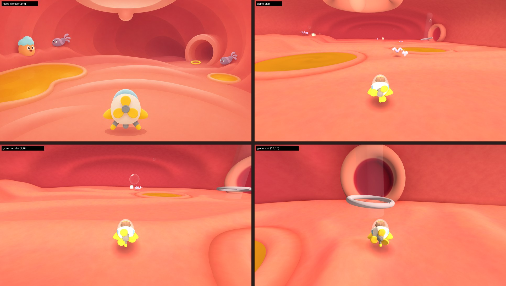

# W3-01 からだのぶたい：い（胃・stomach）取り込みの結果

| 項目 | 内容 |
|------|------|
| 納品ブランチ | `art/w3-stages`（順 2：食道と 胃。`spec.md` の「順2」の 章） |
| 確認日 | 2026-11-25。胃の 7 ファイル（PNG 7）と `spec.md` の 胃の 行を 点検。数は ぜんぶ 画像から 測った |
| 結果 | 描き直しが 必須の ものは 0。表面の 画像 2 枚は そのまま 使える。部品の 三面図は 正面いがいが 正しい 向きに なって おらず、縮尺も そろって いない（形は 雰囲気画と 組んだ 例と spec の 表で 作った） |
| main に取り込むもの | 表面の 画像 2 枚（`godot/assets/textures/stages/tex_stomach_floor.png`・`tex_stomach_wall.png`。`.import` は 口と 同じ：mipmaps あり・512 px） |
| ブランチに残すもの | `mood_stomach.png`、`parts_stomach_front.png`・`_side.png`・`_top.png`・`_assembled.png` |
| ゲームに 入れた 結果 | `blender/stage_stomach.py`（形。`stages.py` の `build_stomach()` が 呼ぶ）、`godot/src/autoload/stage_db.gd` の 胃の `"look"`（色と 光）、`godot/src/entities/hazard_pool.gd`（いえきの 水面と あぶない 円） |
| 絵との 見くらべ | `docs/screenshots/W3_01_stomach_compare.jpg`（左上 ＝ 雰囲気画、右上 ＝ スタート、左下 ＝ まんなか、右下 ＝ 出口の 前。どれも ゲームの カメラ、HUD なし） |



## 1. 結論

| 納品物 | 使えるか | 使いかた | 直してもらうもの（どれも 任意） |
|-------|---------|---------|------------------------------|
| `tex_stomach_floor.png`・`tex_stomach_wall.png` | そのまま 使える | 4 m 四方で くり返す（口と 同じ） | なし |
| `mood_stomach.png` | 色・光・組みかたの 手本 | 色を 測って `"look"` と 頂点の 色に 入れ、ゲームの 画面と 数で くらべた（4.4） | なし |
| `parts_stomach_front.png` | 形の 手本に 使える（向きは 正しい） | ひだ・いけの ふち・輪の 断面を 読んだ | 縮尺を そろえた 版（任意） |
| `parts_stomach_side.png`・`_top.png` | 使えない（部品 1〜4 の どれも、真横・真上に なって いない） | 使って いない | 真横・真上の 描きなおし（任意） |
| `parts_stomach_assembled.png` | 組みかたの 参考 | 天井の 入口、かべの 下の 出口、ゆかを よこぎる ひだ、ふちの ある いけ | なし |
| `spec.md`（胃） | 使える | 色と 大きさの 正本。ゲームの 中の 大きさは カメラから 見て 決めた（4.1） | 部品 1 の 大きさ（6 章） |

- 必須の 描き直しは 0。直して ほしい ものは 3 件で、どれも 作業を 止めない（6 章）。
- ユーザーに 決めて ほしい 点は 6 個（7 章）。全部に おすすめを 書いた。

## 2. 受け取ったもの

| ファイル | 大きさ | 形式 | 発注 |
|---------|-------|------|------|
| `mood_stomach.png` | 2048×1152（16:9） | RGB | 合う |
| `tex_stomach_floor.png`・`tex_stomach_wall.png` | 2048×2048 | RGB | 合う |
| `parts_stomach_front/_side/_top/_assembled.png` | 2048×2048 | RGBA（透過） | 合う。番号は 下の 余白（1〜4） |
| `spec.md` の 胃の 行 | 色見本 7 行、部品の 表 4 行 | | 合う |

文字・署名・ロゴは 無い（三面図の 番号だけ）。こわい 表現は 無い（おくは 赤橙で、黒い 穴に なって いない）。

## 3. 点検の 結果

### 3.1 表面の 画像（2 枚）

| 点検 | `tex_stomach_floor.png` | `tex_stomach_wall.png` | 判定 |
|------|------------------------|-----------------------|------|
| 中央値（spec の hex） | `#FDA086`（spec `#FDA086`、差 0） | `#D45E5D`（spec `#D45E5D`、差 0） | 合う |
| 左右の つなぎ目（右はしの 列と 左はしの 列の 差の 平均） | 0.00 | 0.00 | 合う（口と 同じ 作り：はしの 1 列を そろえて ある） |
| 上下の つなぎ目 | 0.00 | 0.00 | 合う |
| 中の となりあう 列どうしの 差の 平均 | 0.47 | 0.44 | |
| つなぎ目の そばの こまかさ（はしから 6 列の 差） | 0.27〜0.68 | 0.26〜1.20 | 中と 同じ ていど。ぼかした 帯は 無い |
| 2×2 に ならべた 絵 | 目で 見て つなぎ目 なし | 目で 見て つなぎ目 なし | 合う |
| 光の かたより（左半分−右半分、上半分−下半分 の 明るさ） | +0.25、−0.34 | −0.25、−0.27 | 合う（焼きこんだ 光・影は 無い） |
| 8×8 に 分けた 明るさの はば | 180.8〜184.0 | 130.8〜135.1 | ほぼ 平ら |
| 明るさの 1〜99% | 178.7〜185.3 | 129.0〜136.7 | 手で ぬった むらは とても 弱い |
| 中身の こまかさ（1/4・1/8 に 縮めて もどした ときの 差） | 0.54・0.67 | 0.51・0.61 | 512 px で 中身は 全部 のこる |

読みこみは 口と 同じ 512 px（`.import` の `process/size_limit=512`、mipmaps あり、圧縮なし）。

### 3.2 雰囲気画（`mood_stomach.png`）

通ったこと：

- 発注の 中身が ぜんぶ ある：ミクロごうを 後ろ上から、明るい ゆかに よこへ のびる 太い ひだ、ふちの ある 琥珀色の いけ（左の 手前に 大きく、右の おくに 小さく）、天井の 入口の 輪（しずくが さがる）、右の かべの 下の 出口の 輪と その 前の ゴールの 輪、左の 段の 上に 胃壁細胞 と ピロリきん、出口の そばに もう 1 ぴき。
- おくの かべは かさなる アーチで 赤橙へ 暗く なる（黒に しない）。ゆかと かべに 黄色は 無い（黄色の 光は ゴールの 輪だけ）。

測った 色（四角く 切った 中央値。4.4 で ゲームと くらべる）：

| 所 | 色 | 所 | 色 |
|----|----|----|----|
| ゆか（手前） | `#FA886A` | ゆか（まんなか） | `#FC8F71` |
| ゆか（おく） | `#F67B68` | ひだの 山（いちばん 明るい 線） | `#FDB49A` |
| ひだの 谷 | `#FA8B6C` | かべ（手前の 左・右） | `#E7554E`・`#E8544B` |
| かべ（まんなかの 高さ） | `#D54444` | おくの アーチ（外 → 内） | `#B7373C` → `#A5313A` |
| いけ（大・小） | `#F5981F`・`#F89E27`（いけ ぜんたいの 中央値 `#F49920`） | いけの ふち（光の 当たる 側） | `#FDA083` |
| 入口の 輪 | `#F0856C`（内がわ `#FBB69A`） | 出口の 輪 | `#E6685B` |
| 出口の 穴 | `#AA3036` | ゴールの 輪 | `#FAAE32` |

spec の 色見本と くらべると：いけは spec `#ECAA38` より 赤み（`#F49920`）、かべは spec の 画像の 色 `#D45E5D` より 明るく あざやか（手前 `#E7554E`）。spec は 光の 前の 色、雰囲気画は 光の あと。ゲームは 雰囲気画に 合わせた（口と 同じ 考え）。

ミクロごうの 大きさ：雰囲気画は 画面の 幅の **18.0%**（黄色い ひれの はしから はし、2048 px 中 368 px）。ゲームの スタートの カメラ（後ろ 5.2 m）は **10.2%**（1280 px 中 130 px）。絵の カメラは 約 1.8 倍 近い。

### 3.3 部品の 三面図（`parts_stomach_front/_side/_top.png`）

外形（透過の ふち）を 測った 大きさ（px）と spec の 表の 比：

| 番号 | 部品 | 正面 幅×高さ | 真横 | 真上 | 正面の 幅÷高さ（spec） | 真横の おくゆき÷高さ（spec） | 真上の 幅÷おくゆき（spec） |
|-----|------|------------|------|------|----------------------|------------------------|----------------------|
| 1 | 太い ひだ（5.0×1.1×0.7 m） | 710×128 | 698×114 | 707×133 | 5.5（7.1） | 6.1（1.6） | 5.3（4.5） |
| 2 | いえきの いけ と ふち（10×7×0.2 m） | 667×211 | 718×67 | 660×269 | 3.2（50） | 10.7（35） | 2.5（1.4） |
| 3 | 入口の 輪（外径 8、穴 5、おくゆき 1.6 m） | 494×511 | 490×391 | 508×511 | 0.97（1.0） | 1.25（0.2） | 0.99（0.2） |
| 4 | 出口の 輪（外径 6、穴 4、おくゆき 1.2 m） | 417×288 | 400×242 | 419×293 | 1.45（1.0） | 1.65（0.2） | 1.43（0.2） |

通ったこと：

- 3 枚とも 同じ 番号・同じ ならび。形の 読みとり：ひだ ＝ 底が 平らで 上が ゆるい 弓の 長い 帯、いけ ＝ 平らな 琥珀の 水面を ゆかの 色の まるい ふちが かこむ、輪 ＝ 太い まるい くちびるの 輪で 中は 暗い 赤。
- いけの 水の 色：正面 `#EA9C36`、真横 `#E29633`、真上 `#EEA220`。

残る 問題と 回避：

| 問題 | くわしく | 回避 |
|------|---------|------|
| 真横の 絵が 真横で ない | ひだの 真横（698×114）が 正面（710×128）と 同じ ながい 帯。spec では 真横は 1.1 m × 0.7 m の 短い 断面。輪 3・4 の 真横は ながい つつ（おくゆき÷外径 1.25・1.65。spec は 0.2） | 使わない。断面は 正面と 組んだ 例から |
| 真上の 絵が 真上で ない | 輪 3 の 真上（508×511）が 正面の 輪と 同じ まる。かべに つく 輪を 上から 見ると 細い 帯に なる はず。いけの 真上は 幅÷おくゆき 2.5（spec 1.4） | 使わない |
| 正面の 絵が ななめ | いけ（2）と 出口（4）の 正面が ななめ上から 見た だ円（いけ 3.2、出口 1.45）。正投影なら いけは うすい 帯、出口は まる | 形（ふちの 太さの 比）だけ 読んだ |
| 部品ごとに 縮尺が ちがう | 正面の 幅を spec の m で わると、ひだ 142 px/m、いけ 67、入口 62、出口 70（ひだだけ 2 倍） | 大きさは spec と ゲームの カメラから（4.1） |
| ひだの 大きさ | spec は 5.0 m の 短い 部品を「少数 反復」。雰囲気画と 組んだ 例では ゆかを よこぎる ながい 帯 | 雰囲気画に 合わせ、ながい 帯に した（7 章 1） |

### 3.4 組んだ 例（`parts_stomach_assembled.png`）

おわんの 床に よこへ ながい ひだ、左に ふちの ある いけ 1 つ、天井に 入口の 輪、右の かべの 下に 出口の 輪。雰囲気画と 食い違いは 無い。

## 4. ゲームへの 入れかた

### 4.1 大きさ（spec の m と ゲームの m）

ゲームの カメラは ミクロごうの 後ろ 5.2 m、下向き 19°、たての 画角 68°。雰囲気画の カメラは 約 1.8 倍 近い（3.2）。胃は 自由に うごく 広場なので、**部屋の 広さは spec の まま**（ひろさを けずると あそびが せまく なる）、**部品は ゲームの カメラから 絵と 同じ ていどに 見える 大きさ**に した。

| 部品 | spec（m） | ゲーム（m） | 倍率・理由 |
|------|----------|-----------|----------|
| 部屋（ゆか） | 60×76、深さ 10 | 60×76（上から 見た 形は 角の まるい だ円）、天井まで 12〜15 | 1.0。天井は ドーム。入口の 上は ひくめ |
| 太い ひだ（部品 1） | 5.0×1.1×0.7 | ゆかを よこぎる 帯 6 本（スタートの 4.5 m 先から）、高さ 1.3、はば（ガウスの σ）2.0、ゆるく うねる。見なおしの 前は 7 本・0.85・1.6 で、ゲームの カメラから ゆかが たいらに 見えた | 1.9、はばは 雰囲気画に 合わせ ながく |
| いけ（部品 2） | 10×7、ふち 0.2 | まる 3 つ：半径 7・5・6（マーカー名の r）。くぼみ 0.55、水面は まわりより 0.18 下、ふちは まわりより 0.32 上・はば 約 1.9 | 円に した（あぶない ところは 円。4.2） |
| 入口の 輪（部品 3） | 外径 8、穴 5、おくゆき 1.6 | 外径 12、穴 7.5、おくゆき 2.4。天井から らっぱ形に さがり、輪の 下の はしは ゆかから 7.8 m | 1.5。スタートの カメラの 画面の 上の はしに 入る 高さ |
| 出口の 輪（部品 4） | 外径 6、穴 4、おくゆき 1.2 | 外径 9、穴 6、おくゆき 1.8。右の かべの 下（穴の 下の はしは ゆかから 0.35 m）。先に 5.5 m の くだ（おくは 暗い 赤で まるく とじる） | 1.5 |
| 左の 段 | — | 高さ 2.3、坂の はば 約 5 m（いちばん 急な 所 約 35°）、y −21〜24 | 雰囲気画の 段 |

### 4.2 形と いけ

- `blender/stage_stomach.py`（`stage_kit` を 使う。kit は さわって いない）：
  - `StomachShell`（かべと 天井。内向き）：上から 見て 角の まるい だ円、たては 下が ほぼ まっすぐ・上が ドーム。おくの かべに かさなる アーチ 3 本（内がわへ 1.1 m の もりあがり）。入口と 出口の ところは 面を けして 穴に した（穴の ふちは 輪の 部品の 中に かくれる）。
  - `StomachFloor`（ゆか。上向き）：ひだ・いけの くぼみ・左の 段・かべへの 入りすみ。ふちは かべの 中へ しずめた（口と 同じ）。
  - `PoolRims`（いけの ふち 3 つ。当たる）：断面を まわして 作った なめらかな 輪（128 分割）。**水面の 高さを d = r で ちょうど よこぎる**（坂 1.2）。ゆかの 格子（0.36 m）で 水の ふちを 作ると ぎざぎざに なった ので、ふちを べつの 部品に した。ゆかは ふちの 下に かくれる。
  - `Exit`（当たる）：輪 ＋ くだ ＋ ふた。`NC_Entry`（当たらない）：らっぱ形の 入口 ＋ しずく。
- いえきの 水面は `hazard_pool.gd` が マーカーの 高さに 出す 平らな 円（半径 r ＋ 0.35。外の ぶんは ふちの 下に かくれる）。光らない：場所の 面と 同じ ねんどの 材質（`StageLook.material`、色は `"look"` の `"juice"`）。円は ゆっくり まわり、中の うすい もようだけが ながれる（ふちは うごかない）。
- **あぶない ところ ＝ 見える 水**：当たりの 円柱を ミクロごうの 当たりの 半径（0.7 m）だけ 小さく した ので、ハートが へるのは ミクロごうの **まんなかが 水の ふちより 内がわ** に 入った とき だけ。テスト（`smoke.gd` の `_check_pools()`）が 3 つの いけを 8 方向ずつ しらべる：水の ふち と r の ずれ 最大 0.02 m、あぶない ふち と r の ずれ 最大 0.05 m（しらべる きざみ）。わざと 0.7 m ずらすと テストが 落ちる ことも 確かめた。
- いけが 出ない 場面（とおりみち `"pass"`。いまは 胃の とおりみちは 無い）では、くぼみは **からの まま**：ゆかの 色の ふちと 少し こい 底（`#E26E5A` 相当）が 見える。水が 見えない ので はいっても へらない ことと 合う。
- GLB の じどうの LOD は 切った（`.import`）。ふちが とおくで くずれると 水の ふちが ずれる ため。

### 4.3 色と 光（`stage_db.gd` の 胃の `"look"`）

| 面 | spec の 色（もとの 色） | ゲームの 設定 | ねらい（雰囲気画） |
|----|----------------------|-------------|----------------|
| ゆか | `#FDA086`（画像） | 画像 × `tex_tint` (0.97, 0.81, 0.79) × 頂点の 色（ひだの 山は 明るく、おくへ 下る 坂は こく） | `#FA886A`〜`#FC8F71` |
| かべ | `#D45E5D`（画像） | 画像 × `tex_tint` (1.04, 1.08, 1.0) × 頂点の 色（上・おく・アーチの みぞで こく） | `#E7554E` → `#D54444` → `#B7373C` |
| 入口・出口の 輪 | `#F3A28B`・`#CF6A66` | `#F4927A` × 頂点の 色 | `#F0856C`・`#E6685B` |
| いえき | `#ECAA38` | `"juice"` `#CC8A26`（光らない ねんどの 材質） | `#F5981F` |
| きり・はいけい | `#9E4B49` | `fog_color` `#A5313A`、`fog_depth` 22〜95 m、`background` `#8E2E36` | おくの アーチ `#A5313A` |
| 光 | `#FFE8D5` | `ambient`、`sun_color`、`fill_color`。たいようは スタートの うしろ 低め（−32°）から | 手前の 坂が 明るく、おく側が 暗い |

- たいようを スタートの うしろ・低めに した：雰囲気画の ひだは 手前の 坂が 明るく、おくへ 下る 坂が 暗い。ほかの 向きから 見ても おかしく ない よう、頂点の 色の こさは ひかえめ。
- 輪は かげを 落とさない（入口の らっぱの 大きな かげが ゆかに 四角く 出た ため）。

### 4.4 数で くらべた 色

同じ 部分を、雰囲気画と ゲームの スタートの 画面（`stage_view.tscn`、HUD なし、1280×720）で 四角く 切り、色の 中央値を とった。差は ゲーム − 絵（R, G, B）。

| 所 | 雰囲気画 | ゲーム（前） | ゲーム（いま） | 差 |
|----|---------|------------|-------------|----|
| ゆか（手前） | `#FA886A` | `#FFF1C9`（うすい 黄色） | `#FF8B6B` | +5, +3, +1 |
| ゆか（まんなか） | `#FC8F71` | `#FFEFC7` | `#FF9170` | +3, +2, −1 |
| ひだの 山 | `#FDB49A` | （ひだ なし） | `#FFA079` | +2, −20, −33 |
| ひだの おく側 | `#FA8B6C` | （ひだ なし） | `#FF876C` | +5, −4, 0 |
| かべ（手前 左・右） | `#E7554E`・`#E8544B` | `#FFEDC3` | `#E6534D`・`#DD534B` | −1, −2, −1 ／ −11, −1, 0 |
| かべ（まんなかの 高さ） | `#D54444` | 同上 | `#D23D43` | −3, −7, −1 |
| おくの アーチ（きり） | `#B7373C`（いちばん 暗い 所 `#A5313A`） | 同上 | `#CA3841` | +19, +1, +5 |
| いけ | `#F5981F` | 光る 黄色 | `#EA9018` | −11, −8, −7 |
| いけの ふち（光の 当たる 側） | `#FDA083` | （ふち なし） | `#FF9B76` | +2, −5, −13 |
| 入口の 輪 | `#F0856C` | （無い） | `#FF8363`（見なおしの 前 `#FF9373`） | +10, −1, −8 |
| 出口の 輪 | `#E6685B` | だ円の くだ | `#EB6759` | +5, −1, −2 |
| 出口の 穴 | `#AA3036` | — | `#BE2D3B` | +20, −3, +5 |

「前」は 作りかえる 前の ゲーム（`stage2_before/stomach.png`：ぜんたいが うすい 黄色）。

15 段より 大きい 差の わけ：

- **ひだの 山**（G −20、B −33）：雰囲気画の 山は 細い 明るい 線で 描いて ある。ゲームの 山は 形と 光で 明るく して いて、測った 四角（3 px の 列）に 山の いちばん 上が 入りきらない。頂点の 色を もっと 明るく すると、ほかの 向きから 見た ときに ゆかが しましまに 見えた ので ひかえた。
- **おくの アーチ**（R +19）：60 m 先の かべ。もっと こく すると アーチの もりあがりが 見えなく なる。雰囲気画でも 画面の まんなかの 暗い 所（`#A5313A`）と まわり（`#B7373C`）の あいだ。
- **出口の 穴**（R +20）：スタートから 40 m 先で、穴は 20 px ほど。四角に 輪の 内がわの 明るい 所が 入る。出口の 前（`exit_nohud.png`）では 穴の おくは 暗い 赤。
- **入口の 輪**：見なおしで 頂点の 色を 約 1 わり こく した（`P_ENTRY` `#D9745E` → `#C46650`）。R の +10 は 255 で 頭うち。

## 5. マーカー（前と あと）

名前と 数は 前と 同じ。位置は Blender の 座標（x 右・y おく・z 上）。前は スタートが +Y の はし（入口の そば）で、ミクロごうは かべを 向いて 出て きた。いまは スタートが −Y の はし、入口の 輪の 下の 少し 手前で、ミクロごうは おく（+Y）を 向く。

| マーカー | 前（x, y） | あと（x, y, z） |
|---------|-----------|----------------|
| `MK_player` | (0, 26) | (2.5, −27.0, 1.6)。向きは おくから 右へ 14°（出口の 輪が スタートで ミッションの 箱の うらに 入らない） |
| `MK_goal` | (23, −33) | (19.3, 18.9, 1.2)：出口の 輪（右の かべ、y = 21）の 前 3.6 m |
| `MK_hazard_acid_r7_1` | (0, 2) | (−8.5, −15.0)：左の 手前（雰囲気画の 大きな いけ） |
| `MK_hazard_acid_r5_2` | (−12, 12) | (6.5, 23.5)：おくの 右より（雰囲気画の 小さな いけ。出口を おくへ ずらした ので 左へ） |
| `MK_hazard_acid_r6_3` | (11, −12) | (12.5, −5.0)：右の まんなか |
| `MK_friend_wallcell_1〜3` | (−19, −2)、(17, 14)、(−9, −22) | (−25.0, −9.0, 3.7)、(−24.5, 13.0, 3.8)：左の 段の 上。(4.0, 31.5, 1.6)：おくの まんなか |
| `MK_enemy_pylori_1〜5` | (−15, 6)、(−18, −10)、(13, 20)、(20, 4)、(−3, −24) | (−24.5, 2.0)・(−23.0, 20.0)：段の 上、(21.5, 9.5)：出口の そば、(−6.0, 25.0)：おく、(19.0, −15.0)：右の 手前 |
| `MK_pickup_heart_item_1` | (10, 24) | (6.0, −17.0) |
| `MK_card_acid` | (0, 11) | (−0.5, −9.0)：大きな いけの 右 |
| `MK_path_000〜002` | (0, 26)、(0, 0)、(23, −33) | (2.5, −27)、(2.0, 4.0)、ゴール |

スタートから まっすぐ 進むと、大きな いけ（右の ふちまで 4.5 m）と 右の いけ（左の ふちまで 4 m）の あいだを とおる。

## 6. 修正の 依頼（作画担当に 貼る 文）

どれも 任意。出さなくても 作れる。

```text
あなたはゲーム開発プロジェクト『からだのなか だいぼうけん』の作画担当です。納品済みの絵に修正依頼があります。

【リポジトリ】
- URL：https://github.com/hassy0511/inside-body-seek
- 作業ブランチ：art/w3-stages（修正対象を納品したブランチ）
- 最初に git clone（取得済みなら git fetch）し、git checkout art/w3-stages と git pull で最新にする。

【対象】
- フォルダ：art/concepts/W3_stages/
- 元の発注書：docs/art_orders/W3_01_からだのぶたい.md
- 守るルール：docs/art_orders/00_共通ルール.md と 01_3D変換用の絵の条件.md（6 章・7 章）

【修正指示】
1. parts_stomach_side.png と parts_stomach_top.png：真横・真上から見た絵になっていません。部品1（ひだ）の真横が正面と同じ長い帯（698×114 px）で、輪（部品3・4）の真横が長い筒（奥行き÷外径 1.25・1.65。spec では 0.2）、輪の真上が正面と同じ丸です。4 部品を正投影の真横（カメラは横向き）と真上（カメラは真下向き）で描き直し、parts_stomach_side_r2.png・parts_stomach_top_r2.png として追加してください。ひだの真横は 1.1×0.7 m の平らな底の低い山、輪の真横と真上は奥行き 1.6 m（出口は 1.2 m）の短い帯になります。
2. parts_stomach_front.png：いけ（部品2）と出口の輪（部品4）が斜め上から見た楕円になっています。正投影の正面（いけは薄い帯、輪は丸）で描き直し、4 部品を同じ縮尺（1 m = 60 px）で描いた parts_stomach_front_r2.png を追加してください（いまはひだだけ 142 px/m で、ほかは 62〜70 px/m）。並びと番号は今のままです。
3. spec.md：絵は描き直さず、そのまま書きかえてください。部品1（ひだ）の寸法 5.0×1.1×0.7 m と、雰囲気画・組立例の「床を横切る長い帯」のどちらを正とするかを書いてください。また胃液の池の色見本 #ECAA38 と、雰囲気画の池の色（測った値 #F49920）のどちらを正とするかを書いてください。

【作業】
- 修正版は元のファイル名の末尾に _r2 を付けて追加する（_r2 が既にあれば _r3）。元のファイルは消さない。
- spec.md の末尾に「修正履歴」を追記する（日付、対象、直した内容）。

【完了したら】
- 1 コミットで追加し（メッセージ例："art: W3-01 stages (2) r2"）、git push で同じブランチに送る。
- 直したファイルの一覧を報告する。
```

## 7. ユーザーに 決めて ほしい 点

おすすめの まま で よければ、返事は「おすすめで」だけで よい。

1. **ひだの 形**。spec は 5 m の 短い 部品を 少し ならべる、雰囲気画と 組んだ 例は ゆかを よこぎる ながい 帯。おすすめ：雰囲気画の とおり ながい 帯（いま）。本物の 胃の ひだ（すうへき）も 長く のびる。
2. **いけの 形**。雰囲気画の いけは まめの 形・だ円、ゲームは まる。あぶない ところが まる（マーカー名の 半径）なので、まるに すると 見える 水と ぴったり 合う。おすすめ：まる の まま。
3. **いけの 色**。spec `#ECAA38`（黄色より）と 雰囲気画 `#F49920`（オレンジより）。ゲームは 雰囲気画（ゴールの 黄色と はなす）。子どもに 言う ことばは「オレンジいろの いけ」に した（前は「きいろい いけ」）。おすすめ：この まま。
4. **入口の 輪の 高さ**。雰囲気画は 天井の 輪が 画面の 上の まんなかに 大きく 見える。ゲームの カメラ（上は 水平から 15° まで）で 見える ように、天井から らっぱ形に さげ、輪の 下の はしを ゆかから 7.8 m に した。おすすめ：この まま。
5. **出口の 輪が スタートで HUD の 下**。スタートの 画面では 出口の 輪が 右上の ミッションの 箱の うらに 入る（雰囲気画も 同じ 所に 描いて ある）。すこし 進むと 見える。→ 見なおしで 直した：スタートの 向きを 右へ 14°、出口の 輪を 右の かべに そって 4 m おくへ（y 17 → 21）、小さな いけを 左へ。いまは スタートで 出口の 輪が x 690〜760 px（ミッションの 箱は x 760 から）に 見える。
6. **胃壁細胞の 見た目**。雰囲気画は オレンジの からだに 水色の ぼうし（W2 の 色 `#ECA66F`・`#9EDCE5`）。ゲームの 仮の モデルは うすい ベージュの 箱で、胃の ゆかの 上で 白っぽく 見える。見なおしで 仮の モデルだけ 直した：W2 の 色の まるい からだと 水色の もこもこの あわ、はばは 約 0.9 m（前の 箱は 約 1.7 m）で、さわった ときに ミクロごうが かくれない。おすすめ：W2 の 絵が 来たら 作りなおす。

## 8. 大きさと 重さ

- 三角形 113,770（目安 150,000 以下。見なおしの 前は 113,814）。内わけ：ゆか 約 72,300、かべ 21,750、いけの ふち 7,680、出口 6,144、入口 5,856。
- `stage_stomach.glb` 3.0 MB（3,158,364 バイト。前は 0.2 MB：198,840 バイト）。表面の 画像 2 枚は PNG、読みこみは 512 px。

## 9. 確かめた こと

見なおし（ほかの 人の 目で 見た 指摘を 直した あと）：

- ひだの 見え方：スタートの 画面の ゆかの 明るさの ゆれ（1 列、ゆるい 変化を 引いた あと の 標準偏差。x 760〜840、y 300〜560）は 1.1 → 4.4。雰囲気画（x 1250〜1350、y 560〜880）は 同じ 測りかたで 6.8 で、その 6 わり 強。
- 横の かべにも ひくい アーチ 2 本（もりあがり 1.4 m）、かべと ゆかの 入りすみは かべの 下の まるみを ひろげた（`Q_DN` 4 → 3）。
- はさまった ときの もどし（`player.gd` の `_check_stuck`）：ひろい 場所では いつも 押した 向きの はんたいへ、かべの 手前で とめ、下に ゆかの ない 所へは うごかさない。うしろを 12 秒 押す・うしろの かべ・左うしろの すみ・口で うしろを 12 秒：どれも かべの 外へ 出ない（前は 高さ −7〜−11 まで おちた）。


- 全部の テスト：`PROBE RESULT: OK`・`RESULT: OK`・`DASHBOARD: OK`、`SCRIPT ERROR` なし。
- じかん（自動操縦、シミュレーションの 秒）：場所だけ 17.8 → 21.4 s、2 話の 胃の 場面 17.6 → 20.0 s、3 話の 胃の 場面 16.9 → 10.9 s。
- いけ：テスト（4.2）。光る 黄色は ゴールだけ：テストが 場所の 中の 光る 材質を 全部 しらべる（ミクロごうの やじるしは 船の もの なので のぞく）。いけを 光らせると 落ちる ことを 確かめた。
- はさまらない：`steer_trace.tscn`（`--at` で 置き場所、`--no-enemies`、`--cards-seen`）で ひだを こえる・いけの ふちに 入る／中から 出る／よこから・出口の 輪の くだの おくまで・輪の くちびるの よこ・左の 段を のぼる・段の 上で かべぞい・右の かべぞい・おくの かべ・うしろの かべ。どれも 押しつけた あと まわって 9 m/s で ぬけた。
- カメラ：スタート、3 つの いけ、段の 下・上・うしろ向き、出口の 前、出口の くだの 中、かべぞいで ふさがれない ことを 撮って 見た。
- 2 話（ピロリきん・胃壁細胞）と 3 話（けんこうな 胃）を HUD つきで、タッチの 画面も 撮って 見た。
