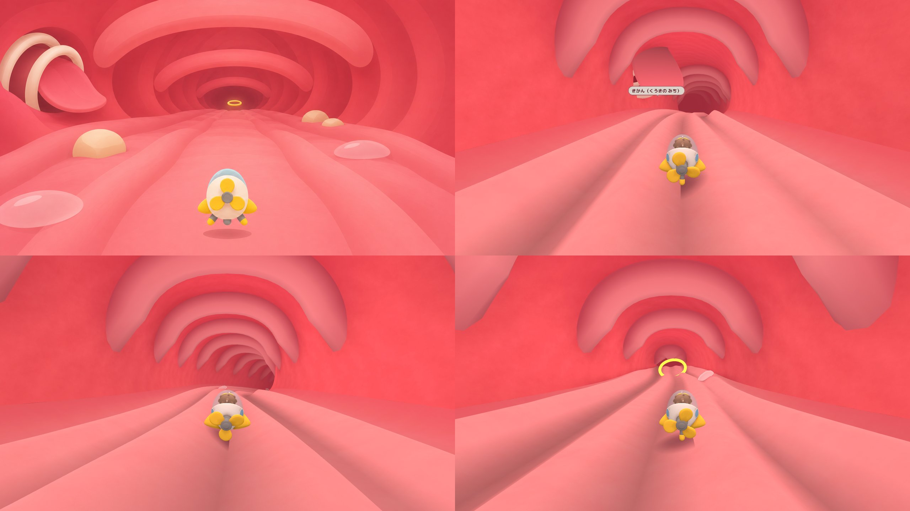

# W3-01 からだのぶたい：食道（esophagus）取り込みの結果

| 項目 | 内容 |
|------|------|
| 納品ブランチ | `art/w3-stages`（順 2：食道と 胃。`spec.md` の 順2 の 章） |
| 確認日 | 2026-11-25。点検は 食道の 7 ファイル（PNG 7）と spec.md の 順2。数は ぜんぶ 画像から 測った |
| 結果 | 描き直しが 必須の ものは 0。表面の 画像 2 枚は そのまま 使える。部品の 三面図は 縮尺が そろって おらず、部品 1・4・5 の 真上の 絵は 正面と 同じ 形（使えない）。形は 正面・真横・spec の 表・雰囲気画で 作った |
| main に取り込んだもの | 表面の 画像 2 枚（`godot/assets/textures/stages/tex_esophagus_floor.png`・`tex_esophagus_wall.png`。`.import` は 口と 同じ：mipmaps、512 px） |
| ブランチに残したもの | `mood_esophagus.png`、`parts_esophagus_front.png`・`_side.png`・`_top.png`・`_assembled.png` |
| ゲームに 入れた 結果 | `blender/stage_esophagus.py`（形。`stages.py` の `build_esophagus()` から 呼ぶ）、`godot/src/autoload/stage_db.gd` の しょくどうの `"look"`（色と 光）と `"waves"`、`godot/src/level/peristalsis.gd`（なみ・かたまり・こうとうがい）、`godot/src/entities/lump.gd`（かたまり） |
| 絵との 見くらべ | `docs/screenshots/W3_01_esophagus_compare.jpg`（左上 ＝ 雰囲気画、右上 ＝ スタート、左下 ＝ まん中（道の 161 m）、右下 ＝ ゴールの 手前（約 385 m）。見なおしの あとで 撮りなおした。どれも ゲームの カメラ、HUD なし） |



## 1. 結論

| 納品物 | 使えるか | 使いかた | 直してもらうもの（どれも 任意） |
|-------|---------|---------|------------------------------|
| `tex_esophagus_floor.png`・`tex_esophagus_wall.png` | そのまま 使える | ゆか・かべに はった（4 m 四方で くり返す） | なし |
| `mood_esophagus.png` | 色・光・形の 手本に 使える | 色を 測って `"look"` に 入れ、ゲームの 画面と 数で くらべた（4 章） | なし |
| `parts_esophagus_front.png`・`_side.png` | 形の 手本に 使える | 形を 読んで 式で 作った。大きさは spec の 表 × ゲームの カメラから 決めた 倍率 | 縮尺を そろえた 版（任意） |
| `parts_esophagus_top.png` | 部品 2・3 だけ 使える | 1・4・5 は 使って いない | 本当の 真上（任意） |
| `parts_esophagus_assembled.png` | 組みかたの 参考 | 気管の 分かれ道の 置きかた、輪の 弧の ならべかた | なし |
| `spec.md`（順2） | 使える | 色と 大きさの 正本 | 粘液の しずくの 色の 書きわけ（文章だけ） |

- 必須の 描き直しは 0。直して ほしい ものは 3 件で、どれも 作業を 止めない（6 章）。
- ユーザーに 決めて ほしい 点は 6 個（7 章）。全部に おすすめを 書いた。

## 2. 受け取ったもの

| ファイル | 大きさ | 形式 | 発注 |
|---------|-------|------|------|
| `mood_esophagus.png` | 2048×1152（16:9） | RGB | 合う |
| `tex_esophagus_floor.png`・`tex_esophagus_wall.png` | 2048×2048 | RGB | 合う |
| `parts_esophagus_front/_side/_top/_assembled.png` | 2048×2048 | RGBA（透過） | 合う。番号は 下の 余白（1〜5） |

文字・署名・ロゴは 無い（三面図の 番号だけ）。こわい 表現は 無い（おくは 暗い 赤 `#A6303C` で、黒い 穴に なって いない）。

## 3. 点検の 結果

### 3.1 表面の 画像（2 枚）

| 点検 | `tex_esophagus_floor.png` | `tex_esophagus_wall.png` | 判定 |
|------|--------------------------|-------------------------|------|
| 中央値（spec の hex） | `#FAA3A8`（spec `#FAA3A8`、差 0） | `#E1686F`（spec `#E1686F`、差 0） | 合う |
| 左右・上下の つなぎ目（はしの 列どうしの 差の 平均） | 0.00・0.00 | 0.00・0.00 | 合う（はしの 1 列を そろえて ある） |
| 中の となりあう 列どうしの 差の 平均（くらべる 値） | 0.37 | 0.41 | |
| つなぎ目の そばの こまかさ（はしから 6 列の 差） | 0.09〜0.54 | 0.22〜1.08 | 中と ほぼ 同じ。かべの はしから 2 列目だけ 1.06〜1.08（中の 2.6 倍）だが、6 倍に コントラストを 上げた 2×2 でも 見えない |
| 2×2 に ならべた 絵（コントラスト 6 倍） | つなぎ目 なし。ゆかに うすい たての すじ（4 m ごと） | つなぎ目 なし。ゆるい よこの むら | 合う |
| 光の かたより（左半分−右半分、上半分−下半分 の 明るさ） | +0.35、−0.20 | +0.04、−0.02 | 合う（焼きこんだ 光・影は 無い） |
| 8×8 に 分けた 明るさの はば | 187.1〜191.5 | 137.8〜144.0 | ほぼ 平ら |
| 明るさの 1〜99% | 185.9〜192.6 | 136.4〜145.9 | 手で ぬった むらは とても 弱い |
| 中身の こまかさ（1/4・1/8 に 縮めて もどした ときの 差） | 0.45・0.54 | 0.48・0.56 | 512 px で 中身は 全部 のこる → `.import` は 512 px |

### 3.2 雰囲気画（`mood_esophagus.png`）

通ったこと：spec の 5 部品が ぜんぶ ある（太い 筋肉の 輪の 弧、ゆかの 太い たてじわ、粘液の しずく、左上の 気管の 白い 輪 2 本、たれさがる 喉頭蓋）。床は 明るく 壁は こい（A-model の 色の 役わり）。黄色は ゴールの 輪 だけ。おくは 暗い 赤。

測った 色（4 章で ゲームと くらべる。四角の 中央値）：

| 所 | 色 | 所 | 色 |
|----|----|----|----|
| ゆか（手前） | `#FD8687` | ゆか（まん中）・（おく） | `#FD8E8E`・`#F87174` |
| かべ（右の よこ） | `#EB4C54` | わと わの あいだの かべ | `#CC3642` |
| 筋肉の 輪（上の 光る ところ） | `#FD7D7E`〜`#FA666A` | おくの 穴（遠くの きり） | `#A6303C` |
| 気管の 白い 輪（クリーム色の 画素の 中央値） | `#F2B8A1` | 喉頭蓋 | `#FB6974`〜`#FC6D78` |
| 粘液の しずく | `#FB989A`（半とうめいで ゆかの 色が すける） | 食べものの かたまり | `#F8BF97` |
| ミクロごうの 黄色い ひれの はば | 画面の 13.0%（2048 px 中 266 px） | | |

spec の 色見本と くらべると、絵の 壁は spec の 壁 `#E1686F` より こく あざやか（`#EB4C54`）、輪は spec `#D86A78` より 明るい（`#FD7D7E`。絵では 輪が 光を 受けて かべより 明るい）。ゲームは 雰囲気画の 色に 合わせた（4 章）。

残る 問題：

| 問題 | くわしく | 回避 |
|------|---------|------|
| ミクロごうが 大きい | 絵 13.0%、ゲームの スタートの カメラ 10.1%（1280 px 中 129 px）。差 1.29 倍（口の とき 2.05 倍 → カメラを 近づけた ので 小さく なった） | 部品の 大きさは ゲームの カメラから 絵と 同じ 見えかたに なる ように 決めた（4.1） |
| 食べものの かたまりが 床に のって いる | 絵では かたまりが 床に 止まって いる。本物の しょくどうに 食べものは のこらない（のみこんだ ものは なみで 数秒で い（胃）へ いく） | ステージには 置かない。カルテ 2 だけ、ゲームが 動く かたまりを 出す（5 章） |
| 道が まっすぐ | 絵は まっすぐ おくまで 見える。前の しょくどうの 道は 左右に ±10 m ゆれる | よこの ゆれを 半分に した（4.2。7 章 3） |

### 3.3 部品の 三面図

外形（透過の ふち。番号の 字は のぞく）の 大きさ（px）と、spec の 表の 比：

| 番号 | 部品 | 正面 幅×高さ | 真横 奥行き×高さ | 真上 幅×奥行き | 正面の 幅÷高さ（spec） | 真横の 奥行き÷高さ（spec） | 色（正面の 中央値） |
|-----|------|------------|----------------|--------------|----------------------|------------------------|------------------|
| 1 | 筋肉の 輪の 弧 | 532×210 | 139×263 | 530×204 | 2.53（3.85） | 0.53（1.08） | `#F47C7E`（spec `#D86A78`） |
| 2 | 縦ひだ | 168×483 | 98×477 | 178×490 | 0.35（0.23） | 0.21（0.12） | `#F89F98`（spec `#F19AA2`） |
| 3 | 粘液の しずく | 344×136 | 287×122 | 233×165 | 2.53（3.2） | 2.35（2.4） | `#F7CDBD`（spec `#FBE1DB`） |
| 4 | 喉頭蓋の ふた | 378×367 | 106×379 | 468×348 | 1.03（1.39） | 0.28（0.16） | `#F17D87`（spec `#D76F80`） |
| 5 | 気管の 白い 輪の 弧 | 509×361 | 99×386 | 523×373 | 1.41（1.19） | 0.26（0.29） | `#EDCBB4`（spec `#F8EDE3`） |

通ったこと：3 枚とも 同じ 番号・同じ ならび。正面と 真横の 高さは 2・4・5 で そろう（差 1〜7%）。形の 読みとり：1 ＝ 太い 弓（はしが まるい）、2 ＝ 長い カプセル、3 ＝ 底の 平らな ひくい ドーム、4 ＝ 上に ちょうつがいの ぼう、まん中で いちばん ひろく、下が まるい 盾（真横で 外へ ふくらむ）、5 ＝ 太い C の 字。

残る 問題と 回避：

| 問題 | くわしく | 回避 |
|------|---------|------|
| 部品ごとに 縮尺が ちがう | 正面の 幅を spec の m で わると 1：213、2：240、3：430、4：97、5：204 px/m | 大きさは spec の 表と ゲームの カメラで 決め、絵からは 形（比）だけ 読んだ |
| 真上の 絵が 真上で ない（1・4・5） | 1 の 真上 530×204 は 正面 532×210 と 同じ 弓の 形（真上なら 細い 帯）。5 の 真上 523×373 も 正面の C の 字。4 の 真上は 正面の 盾の 形 | 使わない。2・3 の 真上は 形が 合う（3：幅÷奥行き 1.41、spec 1.33） |
| 1 の 正面と 真横の 高さが ちがう | 210 px と 263 px（25%） | 雰囲気画の 太い 輪に 合わせた（4.1） |
| 3 の しずくの 色が もも色 | 三面図 `#F7CDBD` は 雰囲気画の 食べものの かたまり（`#F8BF97`）に 近い。雰囲気画の 粘液は 半とうめいの うすい ピンク | 粘液は 雰囲気画の 色（`#FB989A` 前後）で 作った。もも色は カルテ 2 の かたまりだけ（ゆかの しずくと まちがえない） |
| 色が spec と ちがう | 1 と 4 は spec より 明るい。5 は spec より もも色 | 色は spec と 雰囲気画から。三面図の 色は 使わない |

### 3.4 組んだ 例（`parts_esophagus_assembled.png`）

輪の 弧が 天井と よこを おおい、ゆかは あける。左上に 気管（白い 輪 2 本、喉頭蓋は 入口の 上から たれる）。ゆかに たてじわと 粘液の しずく 2 つ と もも色の しずく 1 つ（3.3 の 色の 問題と 同じ）。三面図・雰囲気画と 食い違いは 無い。

## 4. ゲームへの 入れかた

### 4.1 大きさ（spec の m と ゲームの m）

ゲームの カメラは ミクロごうの 後ろ 5.2 m、上へ 0.8 m、下向き 19°、たての 画角 68°。雰囲気画の ミクロごうは ゲームの 1.29 倍。くだの 太さは spec の 1.44 倍（スタートの 画面で、いちばん 手前の 輪が 画面の 幅の 57%。絵は 61%）。部品は spec の 表の 2〜2.6 倍：絵の 輪・たてじわは ミクロごうに くらべて 太い。

| 部品 | spec（m） | ゲーム（m） | 倍率 |
|------|----------|-----------|------|
| くだ | 半径 5、長さ 450 | はば 14.4（かたがわ 7.2）、ゆかから 天井 11.2、長さ 428（道の 長さ。前は 453） | はば 1.44 |
| 1 筋肉の 輪の 弧 | 2.5×0.7×0.65 | くだの 長さ むきの はば 2.4、かべからの 高さ 1.7（下の ほうは 0.7 まで ひくく）、天井から よこを まわって ゆかの 2 m 上まで。7.5 m ごとに 52 本 | 高さ 2.6 |
| 2 縦ひだ | 0.7×0.35×3.0 | 4 本、高さ 0.9、はば 約 1.7、くだの はじめから おわりまで つながる（ゆるく 左右に ゆれる） | 高さ 2.6 |
| 3 粘液の しずく | 0.8×0.6×0.25 | 1.6×1.2×0.5（±15%）を ゆかに 12 こ | 2.0 |
| 4 喉頭蓋の ふた | 3.9×0.45×2.8 | 7.6×0.9×7.4 | はば 1.95、長さ 2.6（気管の 入口 6.8 m を おおう） |
| 5 気管の 白い 輪 | 2.5×0.6×2.1 | 気管の 半径 3.4。入口の ふちの まるい 輪（太さ 0.96）と、中に C の 字の 輪 3 本（太さ 0.6） | 2.7 |
| ふんもん（い（胃）の 入口） | — | ゴールは ふんもんの 6 m 手前の ひらけた ところ（くだは 0.66 倍、はば 9.5 m）に うかび、その うしろで くだが 0.42 倍まで せまく なって 太い 輪（`NC_Cardia`）。その おくは 少し ひろがって 暗い 赤で とじる。ゴールの かんばんは 置かない（輪の 中に 板が 見えた） | |

### 4.2 形（`blender/stage_esophagus.py`）

- 道：前の しょくどうの 制御点で、よこの ゆれ（x）だけ 半分。前の 道は 左右に ±10 m ゆれ、なみに のった 20 m/秒 では カメラが いつも まがりかどの 外の かべを 見て いた（`docs/screenshots` に 入れて いない 試しの 画面）。長さは 453 → 428 m（−5.5%）、くだりかたは 同じ。
- くだは 2 つの 面：`EsoFloor`（ゆか。下の 弧 ±1 rad と たてじわ）と `EsoWall`（のこりと 前後の ふた）。どちらも 当たる。面は 内向き（格子の 多数決。`oriented()`）。気管の 入口だけ かべの 面を ぬいた。
- 断面は 角の まるい だ円（上 2.2、下 3.2 の スーパーだ円。ゆかが 平ら）。
- 筋肉の 輪は 1 本ずつ べつの もの（`NC_Ring_000`〜`051`。原点は くだの まんなか）。かべの 中へ 2.7 m うめて ある ので、Godot で 30% しめても かべとの あいだに すきまが 見えない。分かれ道の まわり（±8.5 m）と ゴールの まわり（おわりの 21 m）には 置かない。
- 気管（`NC_Trachea`）は 入口から 外・上・おくへ のびる 行きどまりの くだ（見える だけ）。かべの あなの ぶんの 面は「当たるだけ」の `TracheaPlug`（Godot が 見えなく する）に のこした：船は 気管に 入れず、左の かべに そって とんでも かべは なめらか。前は 気管の くだが 当たり、← を 押しつづけると 気管に 入って 出られなく なった（見なおしで 見つかった。10 章）。
- 喉頭蓋（`NC_Epiglottis`）は 入口の 面に おいた ふた。原点が ちょうつがい。Godot が ひらいた ところ（55°）から、ミクロごうが 14〜6 m に 近づく あいだに とじる（14° だけ うかせて、ふただと 分かる）。頂点の 色で ちょうつがいは こく、さきは 明るく、かべがわの 面は もっと こく。
- かげの 焼きこみ：`stage_kit.bake_ao`（わの ねもと、ゆかの へり）。わの 頂点色は てっぺんが 明るく、かべの きわが こい（雰囲気画の 輪の まるみ）。ゆかの 頂点色は たてじわの 上が 明るく、あいだが こい。
- 食べものの かたまりは 作らない（前の GLB の `FoodChunks` 12 こは 消した）。

### 4.3 色と 光（`stage_db.gd` の しょくどうの `"look"`）

| 面 | spec の 色（もとの 色） | ゲームの 設定 | ねらい（雰囲気画） |
|----|----------------------|-------------|----------------|
| ゆか | `#FAA3A8`（画像） | 画像 × `tex_tint` (1.11, 0.99, 0.96) × 頂点の 色 | `#FD8687` |
| かべ | `#E1686F`（画像） | 画像 × `tex_tint` (1.2, 0.96, 0.97) × 頂点の 色（天井ほど こい） | `#EB4C54`・`#CC3642` |
| 筋肉の 輪 | `#D86A78` | `#FF9496`、ふちの 明るさ 0。なみで しまる ときは `#FFA0A0` を 足して 明るく | `#FD7D7E` |
| 喉頭蓋 | `#D76F80` | `#FD7480` | `#FB6974` |
| 気管の 輪 | `#F8EDE3` | `#F8D2BC` | `#F2B8A1` |
| 粘液 | `#FBE1DB` | `#FFC0C0`、ふちの 明るさ 0.6（つやの ある しずく。1.5 倍の 大きさ） | `#FB989A` |
| 気管の 中 | （無い） | `#9A2C3A` | 暗い 赤 |
| きり・はいけい | `#9F4351` | `fog_color` `#9C2C3A`、`background` `#A0303C`、10〜85 m | `#A6303C` |
| 光 | `#FFE5E2` | 場所の `ambient`、`sun_color`、`fill_color`。`hemi_up`／`hemi_down` は 口の 1.3 倍 | |
| かたまり（カルテ 2） | `#F8BF97`（雰囲気画） | `lump.gd`：`#F8BF97` ＋ 自分の 光 0.25 | `#F8BF97` |

### 4.4 数で くらべた 色

同じ 部分を、雰囲気画と ゲーム（`stage_view.tscn --still`、HUD なし、1280×720）で 四角く 切り、色の 中央値を とった。場所は スタート（ゆか・かべ・輪・おく・気管）と まん中（粘液）。

| 所 | 雰囲気画 | ゲーム | 差（R, G, B） |
|----|---------|-------|--------------|
| ゆか（手前） | `#FD8687` | `#FF908F` | +2, +10, +8 |
| ゆか（まん中） | `#FD8E8E` | `#FF8A8A` | +2, −4, −4 |
| かべ（よこ） | `#EB4C54` | `#EF5258` | +4, +6, +4 |
| 筋肉の 輪 | `#FD7D7E` | `#EF7075` | −14, −13, −9 |
| わと わの あいだの かべ | `#CC3642` | `#DB3E4B` | +15, +8, +9 |
| 遠くの きり（おくの 穴） | `#A6303C` | `#AB3541` | +5, +5, +5 |
| 気管の 白い 輪 | `#F2B8A1` | `#E7AC9C` | −11, −12, −5 |
| 粘液の しずく | `#FB989A` | `#FD9293` | +2, −6, −7 |
| 喉頭蓋（とじた ところ） | `#FB6974` | `#FB6975`（はじめの 色 `#E86A7A` では `#E6606F`、−21, −9, −5） | 0, 0, +1 |
| 食べものの かたまり（カルテ 2、ぶつかった ところ） | `#F8BF97` | `#FBB48D`（自分の 光 なしでは `#E39E7B`、−21, −33, −28） | +3, −11, −10 |

- 15 を こえる 差は 0。いちばん 大きいのは わと わの あいだの かべ（R +15）：天井を こく する 頂点の 色と 焼きこんだ かげが 弱め。これ いじょう こく すると、まん中の 画面で かべが 黒っぽく 見えた。
- 喉頭蓋は 入口の 面に あり 上からの 光を ななめに しか 受けない ので、色を `#E86A7A` → `#FD7480` に 上げた。
- かたまりは 赤い うすぐらい 光で くすむ ので、自分の 光 0.5 を 足した（0.3 で `#E9A480`、0.8 で `#FFD9AA`）。

## 5. 遊びの 入れかた（なみに のる）

学ぶ こと：しょくどうの きんにくの わが じゅんばんに しまって、たべものを い（胃）へ おしおくる（ぜんどううんどう）。持ち主の 指摘 3 つへの こたえ：

| 指摘 | いまは |
|------|-------|
| 食べかすは しょくどうに のこるのか | のこらない。GLB に かたまりは 無い。ep03 の とおりみちと 場所だけの ときは かたまり 0 こ。カルテ 2（はやぐい）だけ、のみこんだ ばかりの かたまり 9 こが うごいて くだって いく（場面の データ `"lumps": 9`） |
| よけなくても 何も 起きない | かたまりは やわらかい：ぶつかると ミクロごうは はねかえって なみから おち、1 秒 ゆっくり。かたまりは ぷるんと ゆれて よこへ ずれる。音（`pop`）。ハートは へらない。つぎの なみが また のせて くれる。のって いた なみからは おちる ので、よけると はやく つく（↑ だけ 31.1 秒、ぶつからない 場所だけ 22.1 秒） |
| 知識の ポップアップが じゃま | この 場所では カードの 点を へらした（`MK_card_food` を 消し、かたまりの カードは カルテ 2 の かたまりに つける）。カードの 出しかた そのものは べつの 役わり（K）が 直す |

しくみ（`godot/src/level/peristalsis.gd`。場所の `"waves": {"every": 3.0, "speed": 20.0}`）：

- なみは スタートの うしろから 3 秒ごとに 来て、道に そって 20 m/秒で すすむ。なみの 先頭で 筋肉の 輪が じゅんばんに 30% しまり（2〜3 本 いっしょ）、くだの むきに 35% ふとり、`#FFA0A0` で ぽっと 明るく なる（見た目だけ。当たり判定は 動かない）。い（胃）の 入口の 輪は なみが 来ると 12% ひらく。
- しまる 輪の 前 9 m（うしろ 2 m）に いる ミクロごうは なみに のる：前へは 20 m/秒より おそく ならない。よこは じぶんで うごける。のった しゅんかんに 音（`heal`）、カメラの 画角が 68 → 77°、左上の「なみに のって ○ センチ」（本物の からだの 長さに なおした 数。道の 428 m を 25 cm と する）が 黄色に なって ぷくっと ふくらみ、のって いる あいだ のびる。↑ だけなら 11 m/秒、ダッシュでも 16 m/秒 なので、なみは いちばん はやい。
- クリアの ひとことに のった きょりが つく（「い（胃）の いりぐちに ついた！ なみに のって 21 センチ すすんだよ！」。はじめは ゲームの m の まま 出して いたが、カードの「やく 25 cm」と 食いちがうので 直した）。ミッションは「い（胃）へ いこう」の まま（なみに のらなくても ゴールは 開いて いる）。
- 前の なみ（ピンクの すけた 輪が 飛んで くる `wave.gd`）は 消した。

## 6. 修正の 依頼（作画担当に 貼る 文）

どれも 任意。出さなくても 作れる。

```text
あなたはゲーム開発プロジェクト『からだのなか だいぼうけん』の作画担当です。納品済みの絵に修正依頼があります。

【リポジトリ】
- URL：https://github.com/hassy0511/inside-body-seek
- 作業ブランチ：art/w3-stages（修正対象を納品したブランチ）
- 最初に git clone（取得済みなら git fetch）し、git checkout art/w3-stages と git pull で最新にする。

【対象】
- フォルダ：art/concepts/W3_stages/
- 元の発注書：docs/art_orders/W3_01_からだのぶたい.md
- 守るルール：docs/art_orders/00_共通ルール.md と 01_3D変換用の絵の条件.md（6 章・7 章）

【修正指示】
1. parts_esophagus_top.png：部品 1（筋肉の輪の弧）、4（喉頭蓋）、5（気管の白い輪の弧）が真上から見た絵になっていません（正面図と同じ外形。例：部品 5 は真上 523×373 px、正面 509×361 px。真上から見れば幅 2.5 m・奥行き 0.6 m の細い帯）。5 部品を真上（カメラは真下向き）から見た正投影で描き直し、parts_esophagus_top_r2.png として追加してください。
2. 三面図の縮尺：部品ごとにマスいっぱいに描いてあり、1 m あたりの px が部品で違います（筋肉の輪 213、粘液のしずく 430、喉頭蓋 97 px/m）。spec.md の寸法表どおりに、3 枚とも全部の部品を同じ縮尺（1 m = 120 px）で描いた parts_esophagus_front_r2.png・parts_esophagus_side_r2.png・parts_esophagus_top_r2.png を追加してください。並びと番号は今のままです。部品 1 の正面と真横の高さ（210 px と 263 px）もそろえてください。
3. spec.md：絵は描き直さず、そのまま書きかえてください。部品 3（粘液のしずく）の三面図はもも色（#F7CDBD）ですが、色見本は #FBE1DB、雰囲気画の粘液は半透明のうすいピンクです。粘液の色を一つに決めて書き、もも色は食べ物のかたまり（カルテ 2）の色だと書きわけてください。
```

## 7. ユーザーに 決めて ほしい 点

おすすめの まま で よければ、返事は「おすすめで」だけで よい。

1. **ゆかに 食べものを 置かない**。雰囲気画の もも色の かたまりは ステージに 入れず、カルテ 2 だけ 動く かたまりに した。おすすめ：この まま（たべて いない 人の しょくどうは からっぽ）。
2. **なみの はやさ 20 m/秒・3 秒ごと**。↑ だけで 22 秒（場所だけ）、カルテ 2 で ぶつかりながら 31 秒。おすすめ：この まま。ブラウザ版で はやすぎたら `"waves"` の `speed` を 16 に（ダッシュ 16 m/秒と 同じに なるので、それより 下げない）。
3. **道の よこの ゆれを 半分に した**（長さ 453 → 428 m）。おすすめ：この まま（なみに のると 前の まがりかたでは かべしか 見えない）。
4. **くだの 太さ**（はば 14.4 m、spec の 半径 5 m の 1.44 倍）。おすすめ：この まま。
5. **こうとうがいは ひらいた ところから とじる**（入口から 22〜12 m で）。雰囲気画は とじかけで たれた ふた。おすすめ：この まま（「ふたが しまる」の が 見える）。
6. **カードの 点**：かたまりの カード（「たべものの かたまり」）は カルテ 2 の かたまりに 近づくと 見つかる。場所だけ・ep03 では 見つからない。おすすめ：この まま（かたまりの ない ところで 食べものの カードは 出さない）。

## 8. 大きさと 重さ

- 三角形 117,804（目安 150,000 以下）。前は 20,428。
- `stage_esophagus.glb` 3.0 MB（3,098,756 バイト。前 0.6 MB）。表面の 画像 2 枚は PNG で 2.2 MB・2.3 MB、読みこみは 512 px。
- `.import` の 自動 LOD は 切った（`meshes/generate_lods=false`。口と 同じ）。

## 9. 確かめた こと

- `tools/run_tests.sh`（全部）：`PROBE RESULT: OK`、`RESULT: OK`、`DASHBOARD: OK`、`SCRIPT ERROR` なし。
- テストが 見る こと（`smoke.gd` の `_check_esophagus()`）：GLB に `FoodChunks` が 無い／場所だけと ep03 の とおりみちに かたまり 0 こ／筋肉の 輪が 30 本 いじょう あり なみで しまる／↑ だけで 場所だけ・ep03・ep02 が ゴールに つく（ep03 は 10〜40 秒）／なみに のると 20 m/秒／ep02 で 船の 前に おいた かたまりに 本物の 当たり判定で ぶつかると、0.2 秒 あとに なみから おちて 6.0 m/秒、ハート 3 → 3、5.5 秒で つぎの なみに のる。
- 時間（シミュレーションの 秒）：

| 走りかた | 前 | いま |
|---------|----|------|
| ep02 しょくどう、自動操縦 | 26.1 | 28.2 |
| ep02 しょくどう、↑ だけ | 36.7（かたまりに さわっても 何も ない） | 31.1（ぶつかった 3 回、のった 4 回・198 m） |
| ep03 とおりみち、自動操縦 | 25.9 | 22.0 |
| ep03 とおりみち、↑ だけ | 37.0 | 22.1（のった 4 回・355 m） |
| 場所だけ、自動操縦（smoke） | 26.3 | 22.3 |

- はやさの 記録（↑ だけ。1 秒ごと、m/秒。W ＝ なみに のって いる）
  - ep03：`0:0.5 1:11.0 2:11.0 3:15.8W 4:20.0W … 8:20.0W 9:11.0 10:20.0W … 17:20.0W 18:13.6 19:20.0W 20:20.0W 21:20.0W`
  - ep02：`… 7:20.0W 8:3.0 9:11.0 … 13:11.0 14:12.1W 15:5.8 16:11.0 … 20:11.0 21:20.0W 22:20.0W 23:20.0W 24:6.0 25:11.0 … 29:11.0 30:20.0W 31:20.0W`（3.0・5.8・6.0 が かたまりに ぶつかった ところ）
- マーカー：前 65 こ（`MK_path_000`〜`056`、`MK_player`、`MK_goal`、`MK_checkpoint_1`・`2`、`MK_pickup_heart_item_1`、`MK_card_epiglottis`、`MK_card_food`、`MK_sign_goal`）→ いま 61 こ（`MK_path_000`〜`053`：道が 25 m 短い、`MK_card_food` を 消した、`MK_sign_trachea` を 足した、`MK_sign_goal` を 消した。のこりは 同じ 名前・同じ 意味）。
- 床プローブ：しょくどうの マーカー 59 こ、bad 0。
- 画面（ゲームの カメラ）：スタート、分かれ道（とじかけ・とじた）、まん中で なみに のった ところ、かたまりに ぶつかった ところ（2 回）、ゴールの 手前、ep03 の とおりみち、タッチ。
- 見て いない こと：ブラウザ版（Web の 書き出し）、本物の 子どもが 遊んだ 時間、音の 聞こえかた（`heal`・`pop` は 鳴らす ように した だけ）。

## 10. 見なおしの あとで 直した こと

見た目と 遊びの 見なおし（2 人）の 指摘を 受けて 直した。

- **気管に 入れた**（← を 押しつづけると 気管の 行きどまりに 入り、150 秒 たっても 出られない。↑← では 気管の 入口の 下の ふちに 16 秒 はさまり、スタートへ もどされた）。→ 気管の くだを 見える だけ（`NC_Trachea`）に し、かべの あなの 面を 当たるだけの `TracheaPlug` に した。見なおしと 同じ 入力で、ep02 の ← だけ・↑← だけ・← 5 秒の あと 何も 押さない・ep03 の ← だけ・場所だけの ↑←・タッチの ← 6 秒：どれも 21.6〜24.8 秒で つき、よこの ずれは 6.8 m まで（はば 7.2 m）、もどされ 0 回。`smoke.gd` に 同じ 確かめを 足した（場所だけ と ep03、← 6 秒の あと 何も 押さない／↑←）。
- **ゴール**：輪が ふんもんの ふちで 切れ、うしろに だいだい色の 板が 見えた。板は かんばんでは なく ゴールの 光の はしら（30 m）が くだの 天井を つきぬけた もの。→ ゴールを ふんもんの 6 m 手前の ひらけた ところへ、はしらは しょくどうでは 出さない、輪は カメラへ 35° かたむける（水平の ままでは 黄色い 線）。ゴールの かんばんは 消した。ゴールの 面を こえたら、輪の よこを とおっても つく（`peristalsis.gd`）。
- **黄色い まる**：ミクロごうの 行き先の 矢印を まうしろから 見た もの。くだの 場所で 行き先が 道の 先（35° いない）に ある ときは 出さない（`player.gd`）。
- **かたまり**：うしろから 来た かたまりが 船と カメラを すりぬけた。→ 船の よこ（半径 ＋ 1.4 m）を よけ、よけきれない ときは 船の うしろで まつ。カメラの 3〜5 m いないでは 消える。自分の 光 0.5 → 0.25（上が 明るく 下が こい まるい かたまりに 見える）。い（胃）の 入口で 小さく なって から つぎの ひとくちに なる。
- **きかんの かんばん**が ひらいた ふたに かくれた。→ 6 m 手前・少し 下へ。ふたは 14〜6 m で とじる（ひらいた ふたが 長く 見える）。入口の なんこつの わを 太く（0.96 → 1.26 m）。
- **なみが 見えにくい**：しまる 分 17 → 30%、はば 4 → 6 m（2〜3 本 いっしょ）、しまる わを `#FFA0A0` で 明るく。なみが 船を 追いこすと、明るく しまる 帯が 道の 先へ はしって いくのが 見える（`docs/screenshots` には 入れて いない。`$SP/s/stage2/esophagus/fx/shots_up/ep02_t12.0.png`）。
- **ゆかの たてじわが うすい**：高さ 0.9 → 1.1 m、谷を こく。ゆかの 行（y 560〜600）の 明るさの ひろがり（5〜95%）：スタート 19 → 37、道の 161 m 20 → 32（見なおしの 測りかたでは 15 → 32）、258 m 25 → 38。雰囲気画 33。
- **粘液**：1.5 倍、色 `#FFC0C0`、ふちの 明るさ 0.6。
- **輪の 色**：`#FF9496` に して、ふちを こく（`#C2404C`）。よこの 弧の 色（スタート (320,150)）は `#EA696F` → `#E46A71`：ふちを こく した ぶん 少し 暗く なった。4.4 の 表の 輪・粘液・かたまりの 行は 見なおしの 前の 値（測りなおして いない）。
- **なみに のった きょり**：もどって また とおった ところを 数えて いた（気管で 106 m など）。いちばん すすんだ ところ より 先だけ 数える。クリアの ひとことに きょりが つく ときは 1.6 → 3.6 秒 見せる。
- **ものしりカード「food」**が かたまり 1 こ（0 ばん）の そばでしか 見つからなかった。→ いちばん 近い かたまりを さす。↑ だけの ep02 で 見つかる（テストに 足した）。

